# Day01 课程总结：《刺客破局·低吸定江山》

| 项目 | 内容 |
| --- | --- |
| 课程 | 第一课《刺客破局·低吸定江山》（众赢财富通） |
| 讲师 | 王旭（为为老师），执业编号 A0870625080015，擅长情绪判断、连板判断；众赢财富通/和众汇富，证券投资咨询牌照流水号 000000043020 |
| 课题 | 主力行为下的低吸框架：如何从"有资格涨"的股票中，识别真实底部与起爆点 |
| 盘面纪律 | 判断大盘环境一律看**周K**，过滤日线噪音，先定β（市场整体方向），再做个股α |

---

## 〇、全课逻辑主线

第一课给出的是一套完整的**主力行为学低吸流水线**，四个环节环环相扣：

```
① 猎杀第一步：涨停基因筛选      → 解决"哪些票有资格涨"（选股池）
② 资金易主：凹口淘金识别真实底部  → 解决"底在哪里"（ABC三浪 + C浪缩量）
③ 万人血坑 + 堆量固底           → 解决"洗盘何时结束"（不抄半山腰）
④ 势如破竹：两大起爆信号         → 解决"何时扣扳机"（右侧确认）
```

核心心法一句话：**别人猜底，我等信号。** 这套框架属于典型的"左侧识别结构 + 右侧确认入场"相结合的量价筹码体系，与经典的威科夫（Wyckoff）吸筹理论高度同构——先识别吸筹痕迹，再等"需求进场"的证据，最后在突破点追随主力。

---

## 一、底层理念：先建立正确的"底"观

课程开篇先纠正几个常见认知偏差：

1. **真实的底部是"磨"出来的，不是"猜"出来的。** 历史大底一定是散户割肉割出来、同时主力买出来的——筹码从恐慌的大众手中向有计划的资金手中转移，这就是本课"资金易主"四个字的含义。
2. **游资不抄底。** 游资百分百不抄底，只做热点、做右侧；抄底的一般是国家队。游资在主力眼里只是一个"大散户/小地主"。散户盲目抄底，抄的往往是下跌中继。
3. **有没有主力，决定能不能涨回去。** 股票是否到底，一定要看有没有主力参与；没有主力运作的票，再便宜也涨不回去。判断底部之前，先判断主力行为——这就是"表象与真相"。
4. **主力拉升也要考虑成本。** 主力不是慈善家，所有吸筹、洗盘、拉升的动作都受制于其资金成本与控盘目标，因此其行为会在量价与筹码上留下可识别的痕迹。

> 金融视角：以上本质是行为金融学的市场微观结构观——价格由边际资金决定，A股这种散户占比高、涨跌停约束流动性的市场里，识别"聪明钱"（smart money）的行为痕迹，比预测基本面在短周期内更有效。这也是整个"主力行为学"流派的立论基础。需要清醒认识：主力行为分析是**概率性推断**，不是确定性证明，必须配合仓位与止损纪律。

---

## 二、猎杀第一步：涨停基因——先筛出"龙头苗子"

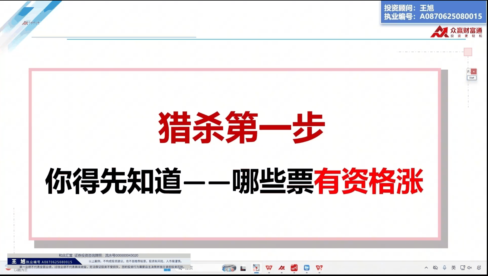

不是每只票都值得跟踪。主力高活跃票的筛选标准（一年内同时满足）：

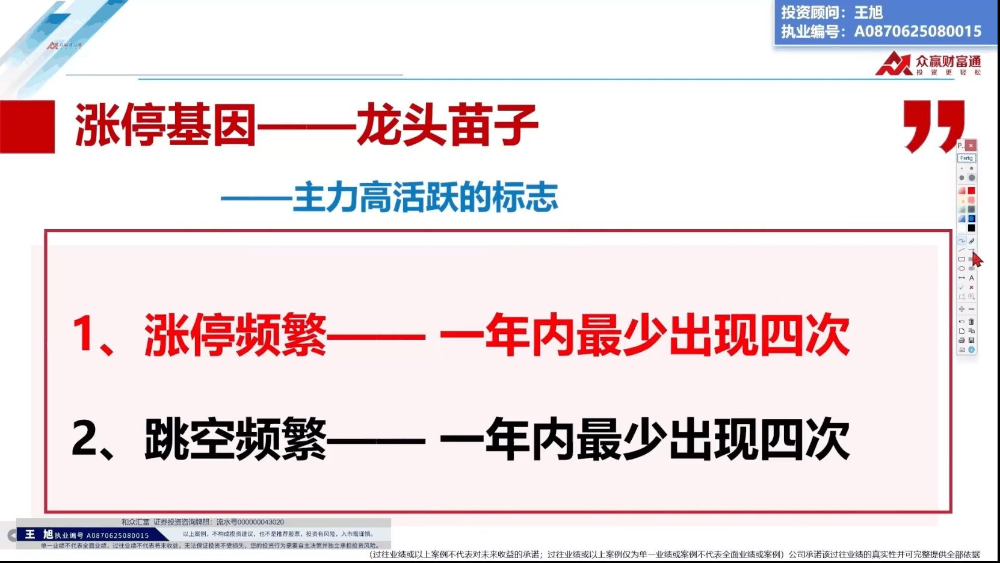

1. **涨停频繁**：一年内最少出现 **4 次**涨停
2. **跳空频繁**：一年内最少出现 **4 次**跳空

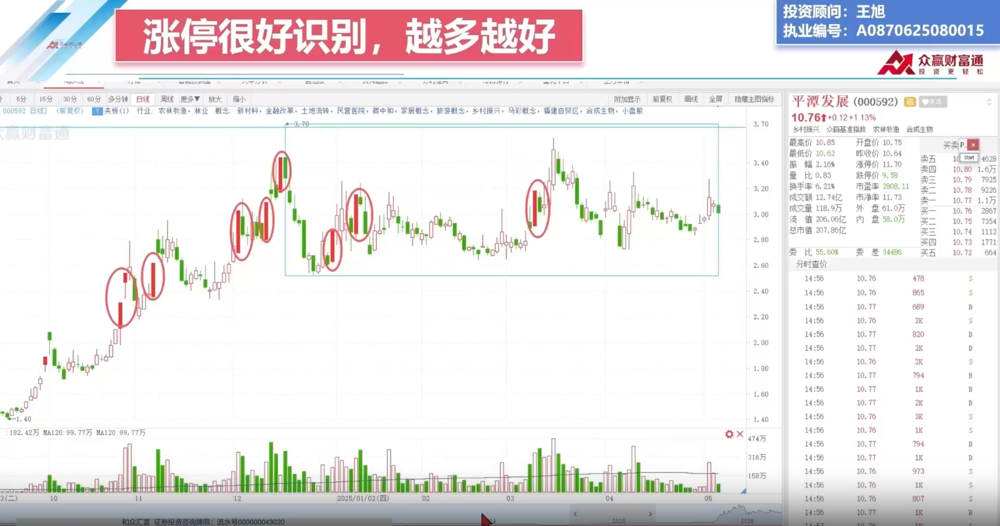

**图上原文（02.png）**：
> **涨停基因——龙头苗子——主力高活跃的标志**
> 1. 涨停频繁——**一年内最少出现四次**
> 2. 跳空频繁——**一年内最少出现四次**

**案例（03.png）**：平潭发展（**000592**）——课件标题"**涨停很好识别，越多越好**"，图中红圈标注多处涨停 K 线。

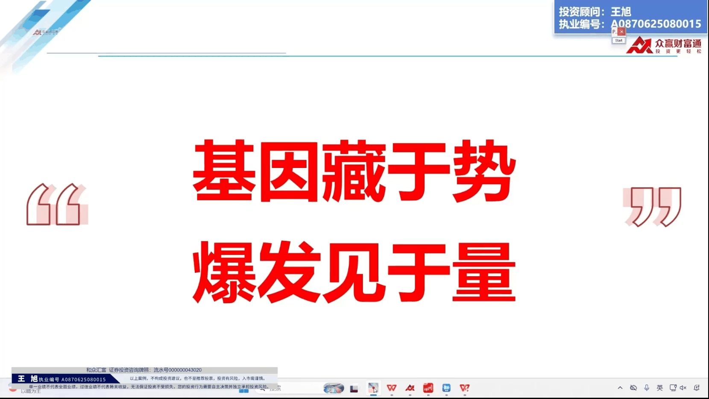

**为什么是涨停和跳空？金融含义拆解：**

- **涨停是主力的身份证。** 涨停板是A股特有的流动性约束：在10%（或20%）的价格上限上，买方必须以最高限价排队扫货才能成交。敢于反复把股价打到涨停的，几乎不可能是散户合力，而是有组织、有资金量的主力在进行"价格宣示"——既暴露了实力，也完成了快速脱离成本区的动作。
- **跳空是主力的敲门砖，本质是"静音锁筹"。** 跳空缺口意味着主力宁可支付更高的开盘价，也不愿给场外资金在低位慢慢成交的机会。用高开直接"静音"掉下方的吸筹盘口，让想卖的人在更高的位置交筹码、想买的人只能追高——这是以空间换时间的锁筹手法。
- **筹码绑架。** 频繁涨停+频繁跳空的票，会在投资者记忆中形成"妖股预期"，场内持仓者惜售、场外资金抢筹，筹码被高活跃行为"绑架"，因此这类票后续更容易再度涨停——基因可以自我强化。

**筛选纪律：**
- **基因藏于势，爆发见于量。** 涨停/跳空记录的是这只票的"势"（主力曾经活动的证据）；真正何时爆发，还要回到"量"上确认（后面第三节起的所有量能信号都由此展开）。
- 四次是**门槛不是目标**，越多越好；且要结合位置看——高位的涨停基因参考意义低于长期横盘/深跌后的涨停基因。

---

## 三、资金易主：凹口淘金——看透主力真实底部

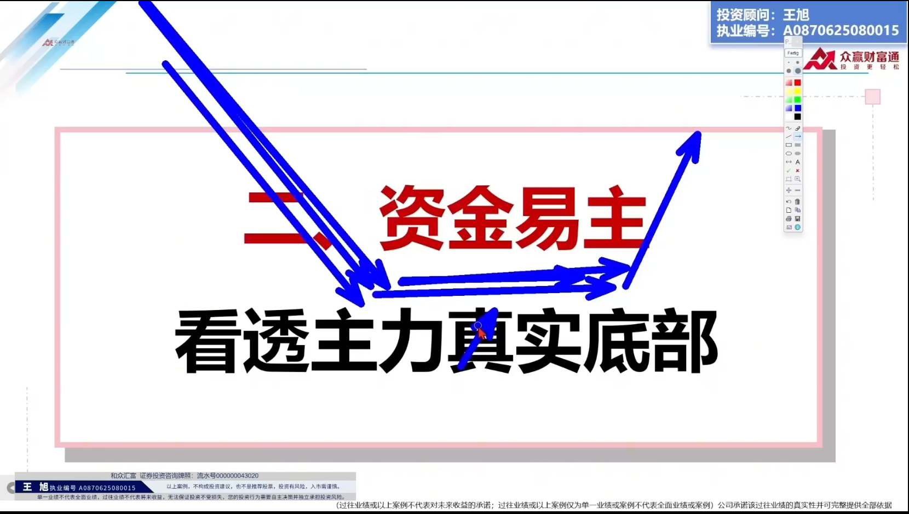

### 3.1 标准形态：凹口淘金全景图

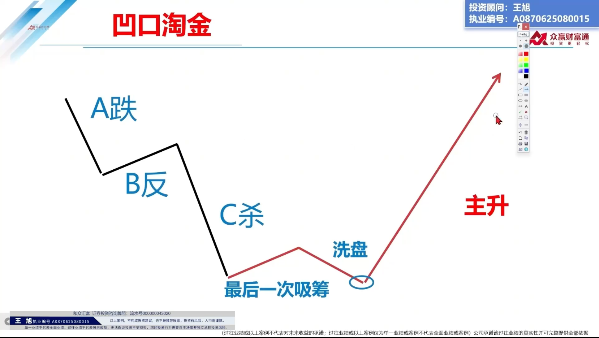

完整结构：**A跌 → B反 → C杀 → 最后一次吸筹 → 洗盘 → 主升**

这是一个标准的"挖坑—吸筹—洗盘—拉升"四段式，对应威科夫吸筹区间（Accumulation Scheme）的事件序列：初步支撑（PS）→ 自动反弹（AR）→ 二次测试（ST）→ 吸筹（Spring/吸筹高潮）→ 洗盘 → 进入趋势。

### 3.2 底部成立的两个硬条件

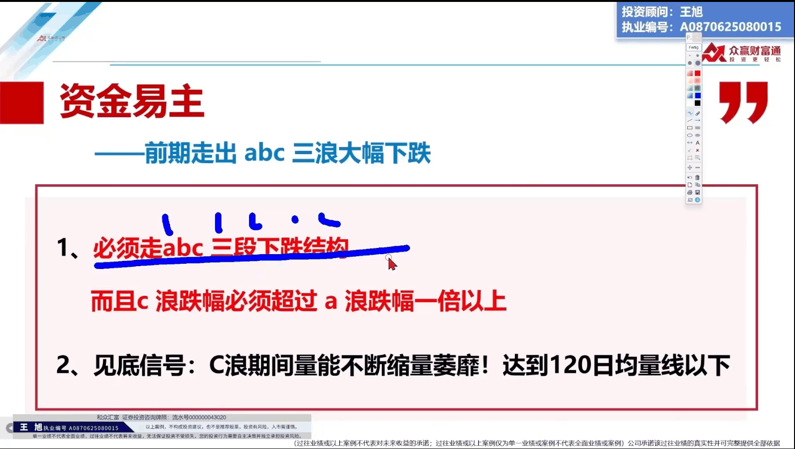

**图上原文（07.png）**：
> 1. **必须走 abc 三段下跌结构，而且 c 浪跌幅必须超过 a 浪跌幅一倍以上**
> 2. 见底信号：**C浪期间量能不断缩量萎靡！达到 120 日均量线以下**

**条件一：必须走出完整的 abc 三段下跌结构，且 C 浪跌幅超过 A 浪一倍以上。**

- **A浪（洗恐慌型散户）**：第一波急跌触发损失厌恶下的恐慌抛售，最早缴械的是风险承受力最差的一批人。
- **B浪（洗希望型散户）**：反弹给幸存者注入希望，不少人在此加仓摊薄成本——行为金融学中的"锚定效应"与"处置效应"在此集中体现。
- **C浪（杀躺平型散户）**：反弹夭折后再度阴跌，且跌幅要**超过A浪一倍以上**——只有跌穿前面所有人的心理防线，连"装死躺平"的筹码也被磨到绝望。B浪进场的希望型买家被一网打尽，这叫**三浪三洗：洗的不是股价，是人心**。
- C浪跌幅超过A浪一倍，在波浪理论语境下即经典的 **c = 1.618a（或至少 >1.0a）** 的修正浪比例关系——课程用通俗语言固化了这个量化门槛。

案例：**有研新材（600206）**，69.36 元见顶后走完 a-b-c 三段式下跌：

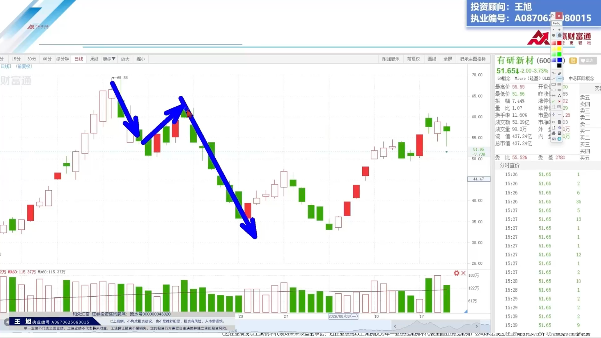

**条件二：见底信号——C 浪期间量能不断萎缩，降到 120 日均量线以下。**

- 120 交易日 ≈ 半年，120日均量线是**半年期平均换手水平**，可视为这只票的"常态流动性基准"。
- C浪缩量到该基准之下，意味着**卖压衰竭**：想卖的人已经卖完了，剩余持仓者对下跌麻木（躺平），成交清淡到极致——地量见地价。此时任何新增买盘都容易推升股价，因为上方几乎没有主动抛压。
- 课程口诀：**三浪淘尽千股泪，量能枯处见天机。**

案例：**立新能源（001258）**，图上红字结论「**C浪期间量能萎靡至120日均量线以下**」（低点 6.37 元）：

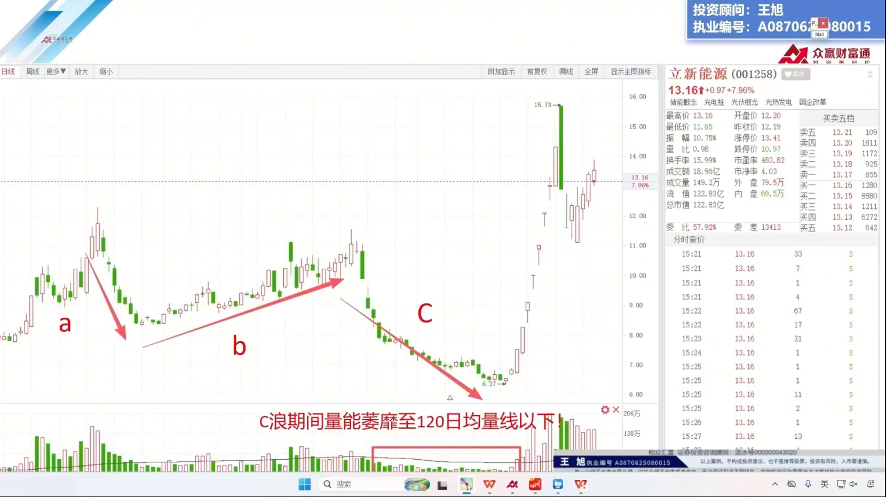

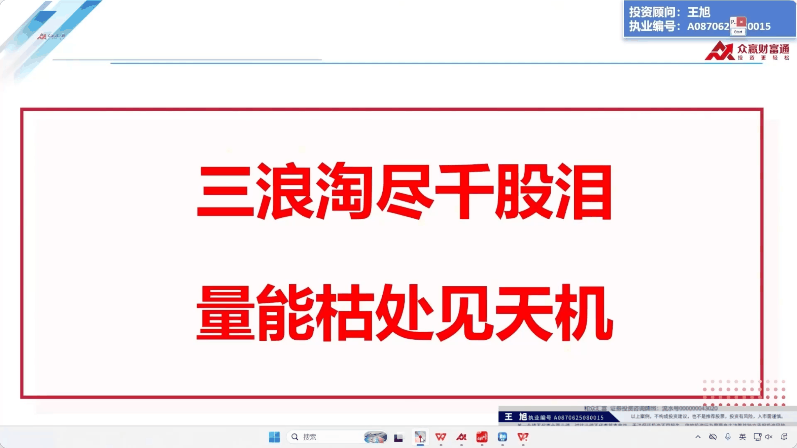

### 3.3 关键提醒：见底信号 ≠ 立即抄底

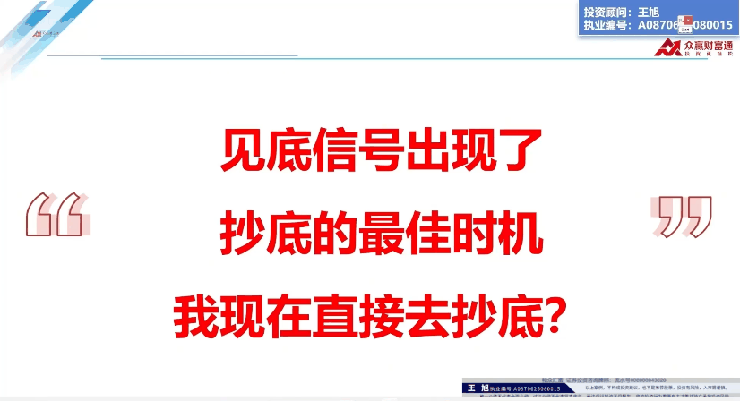

**图上原文（11.png）三行设问**：
> **见底信号出现了**
> **抄底的最佳时机**
> **我现在直接去抄底？**

中间那句"抄底的最佳时机"是模拟散户误判的错误直觉——看似最佳，其实不能抄。

课程在这里设了一个关键的"刹车"：C浪缩量只是说明**下跌动能衰竭**，并不等于**吸筹与洗盘已经完成**。主力在真正拉升前通常还有"最后一次吸筹 + 洗盘"（凹口淘金图中的后半段）。此时进场，可能还要承受反复震荡甚至二次探底——所以有了下一节的"万人血坑"。

---

## 四、万人血坑：识别洗盘终点（不抄半山腰）

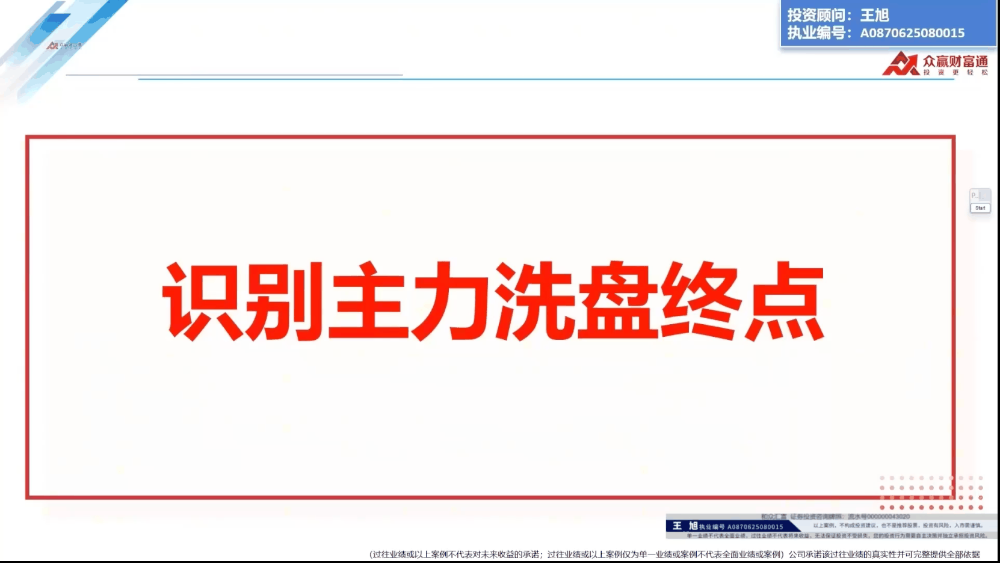

### 4.1 定义与案例

C浪见底后的反弹，若再度回落，且回撤幅度**超过反弹幅度的 50% 以上**（把前面建仓浪一半以上的涨幅全部跌回去），这段挖坑就叫**万人血坑**。

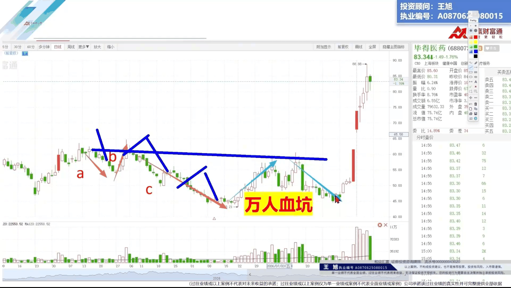

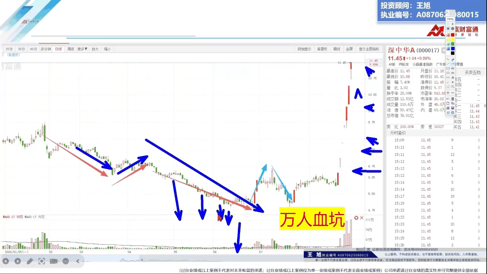

**案例数字（图上标注）**：
- **毕得医药（688073）**：黄标「万人血坑」，高点 88.88 元、坑底约 42.21 元
- **深中华A（000017）**：黄标「万人血坑」，坑后直接连续涨停至 11.45 元（+9.99%）——与后文阳线突破（25.png）是**同一案例链**

**微观结构含义**：万人血坑是主力对"底部信念"的定向爆破。散户在C浪地量后刚看到一点希望（反弹），主力反手再杀一程，把刚建立的信心彻底粉碎——绝望的持仓者在坑底交出最后的筹码，由主力照单全收。**血坑粉碎的就是希望**：希望型买家反复被证伪后离场，筹码完成从散户到主力的最后一次迁移。

### 4.2 纪律：出现万人血坑时，只观望

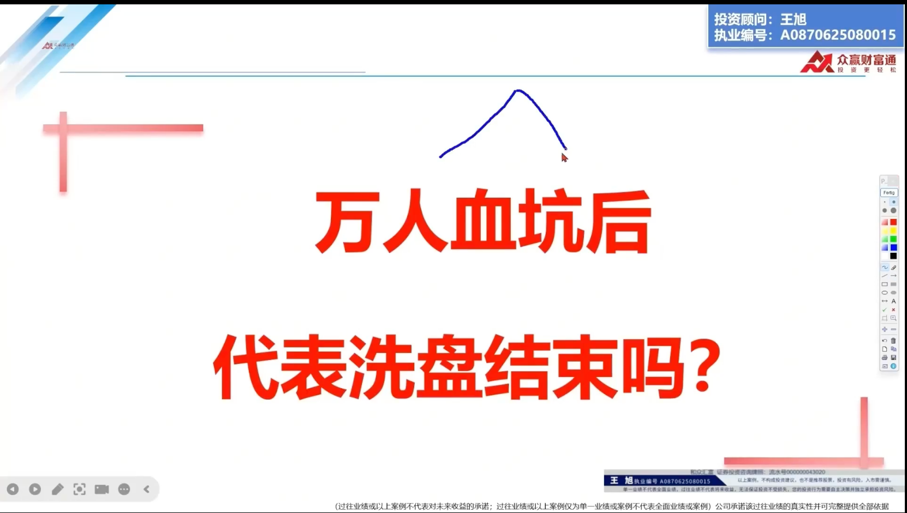

**图上原文（14.png）**：**万人血坑后，代表洗盘结束吗？**——答案是**不一定**。

- 不抄底、不臆断。万人血坑期间走势最难看，主观猜底极易买在下跌中继。
- **万人血坑出现 ≠ 洗盘一定结束。** 案例：**风范股份（601700）** 在同一轮结构中出现了**两次**万人血坑（坑底约 4.1 元）——第一次坑里进场的人，又被第二个坑埋掉一次。

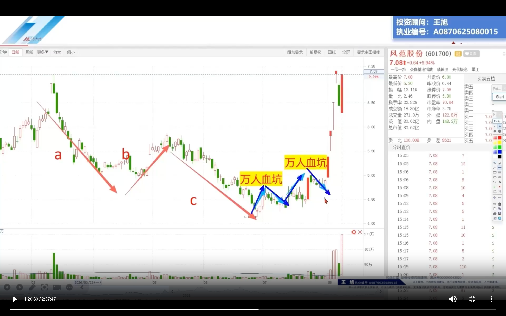

### 4.3 堆量固底：洗盘完毕的唯一暗号

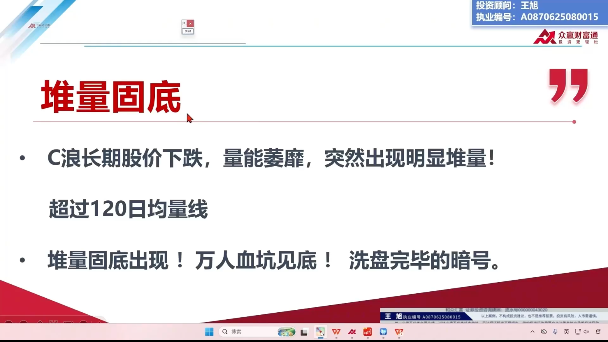

判断洗盘终点，课程给出的确认信号是**堆量固底**：

**图上原文（17.png）**：
> C浪长期股价下跌，量能萎靡，突然出现明显堆量！**超过 120 日均量线**
> **堆量固底出现！万人血坑见底！洗盘完毕的暗号。**

- **定义**：C浪长期股价下跌、量能萎靡之后，**突然出现明显堆量，成交量超过 120 日均量线**。
- **含义**：地量之后的持续放量，意味着有大资金在坑底主动承接——主力从"被动吸筹"转为"主动扫货"，万人血坑的筹码换手在此完成。**堆量固底出现的那一刻，便是万人血坑见底之时**——这是洗盘完毕的暗号。
- **反面口诀**：**没有堆量的万人血坑，不是底，是陷阱。** 没有量能确认的坑底只是无人问津的阴跌延续。

案例：**毕得医药（688073）**——股价跌至 C 浪低点，**万人血坑中主力开始最后一波吸筹，量能放大！超过 120 日均量线形成堆量！**（图上黄字三行原文）：

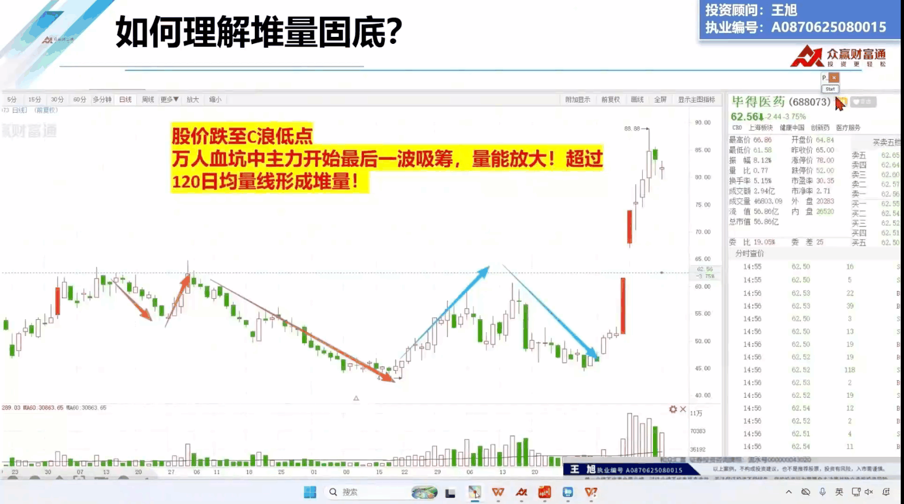

案例：**百花医药（600721）**——量能区标注「**第一次量能持续萎靡**」→「**第三次堆量出现**」→「**浴火重生，主升来临**」（其后涨停 10.54 元 +10.02%）：

> 注意课件标注为「**第三次**堆量」，说明坑内放量可能出现多次，需等**确认堆量**再动手，不是第一次放量就进。

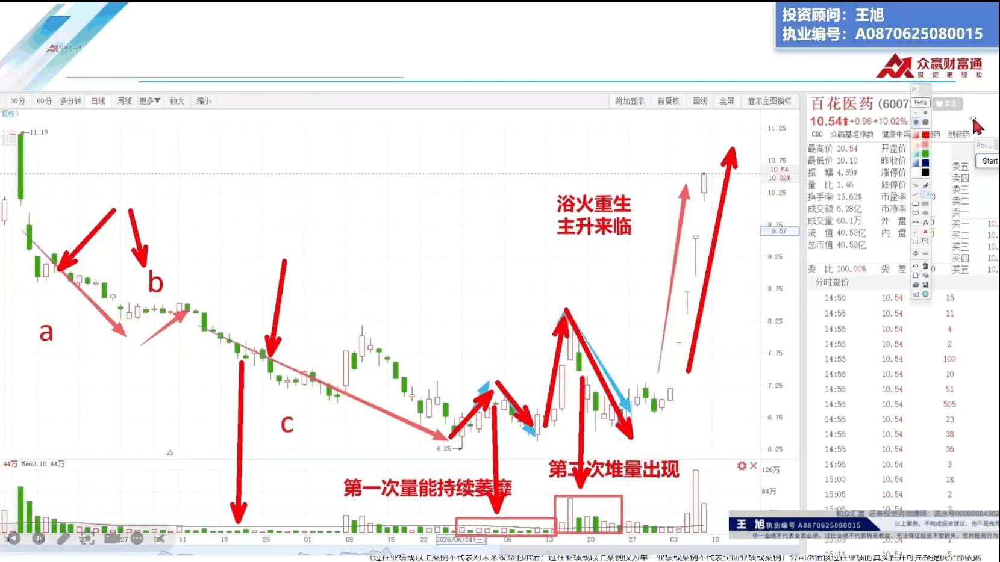

---

## 五、势如破竹：主力何时起爆——两大确认信号

结构（凹口淘金）、洗盘终点（堆量固底）都齐了，最后一步是等主力"扣扳机"的确认信号。

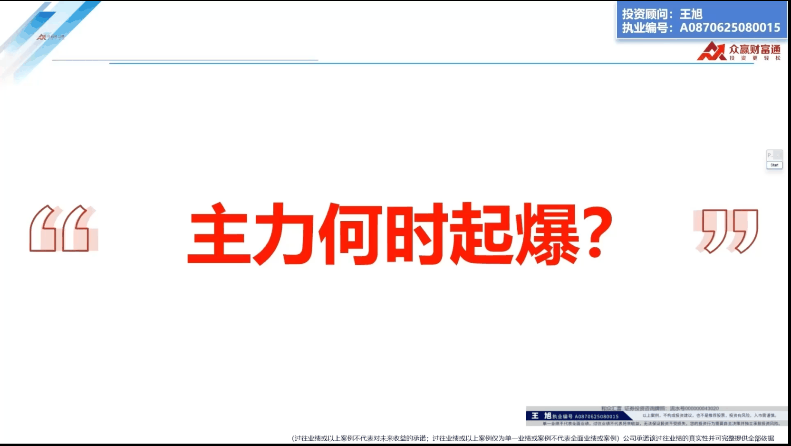

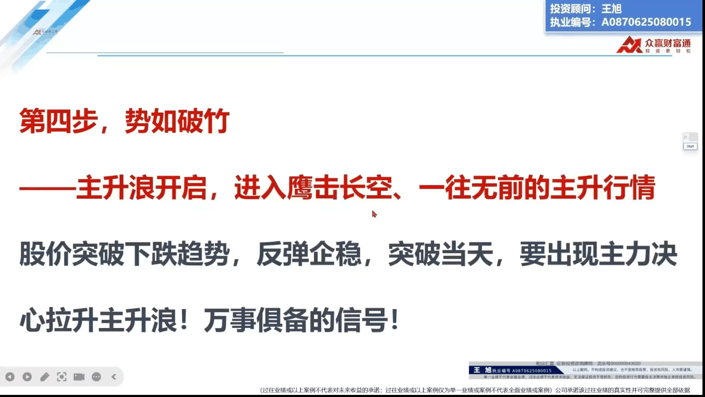

**图上原文（21.png）**：
> **第四步，势如破竹——主升浪开启，进入鹰击长空、一往无前的主升行情**
> 股价突破下跌趋势，反弹企稳，**突破当天，要出现主力决心拉升主升浪！万事俱备的信号！**

### 5.1 信号一：明示锋芒——阳线突破万人血坑下跌斜率

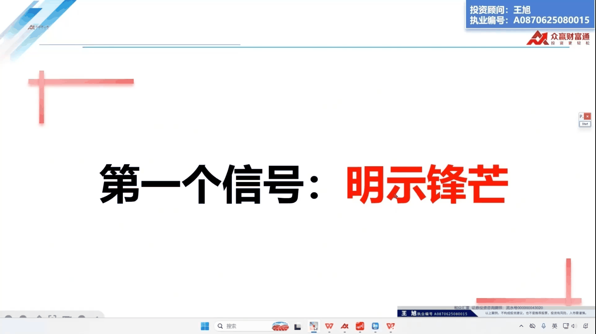

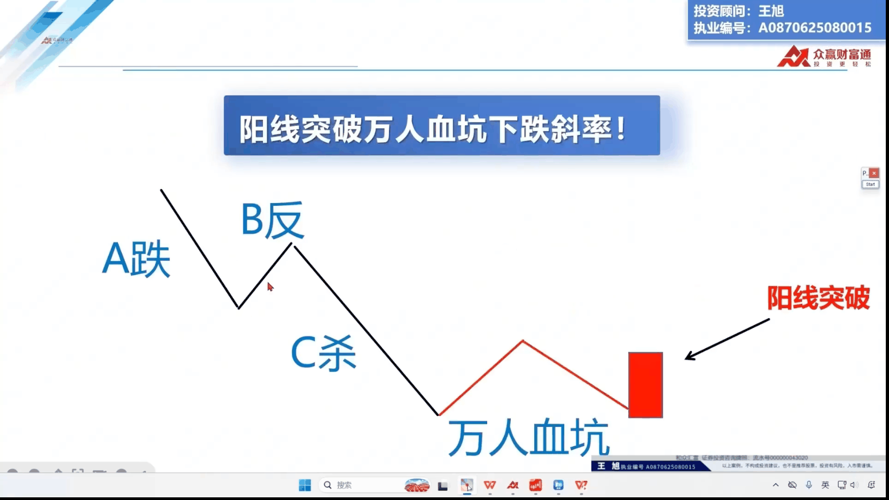

- **定义**：**阳线突破万人血坑下跌斜率**（精确说是血坑段的下降趋势线，不是泛化的"下跌趋势"），反弹企稳；**突破当天要出现主力决心拉升主升浪的大阳线**——这是万事俱备的信号。
- **强弱判据：阳线越高，突破越真。** 实体越长，说明主力投入的拉升资金越多、做多意愿越坚决，突破被回抽证伪的概率越低。
- 金融含义：这是道氏理论"趋势反转确认"的落地——下跌趋势由"低点不断降低"定义，一根放量长阳上穿下降趋势线，标志着供需关系易位，需求首次压倒供给。

案例：**有研新材（600206）**——下跌趋势末端，红圈 K 线为「阳线突破」（顶部 69.36 元）：

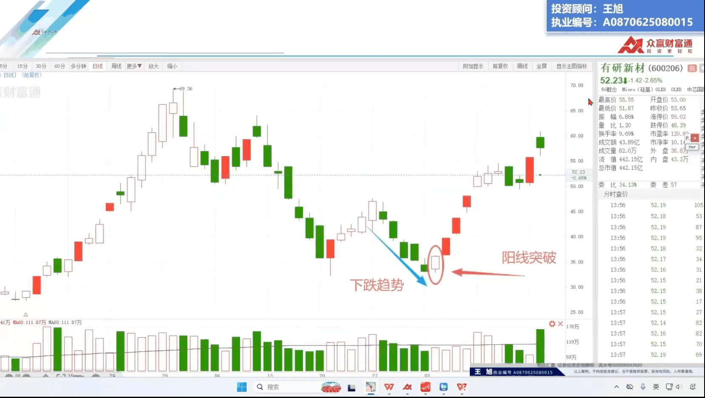

案例：**深中华A（000017）**——阳线突破后走出连续涨停至 11.45 元（+9.99%），与 13.png 万人血坑为**同一标的的前后段**：

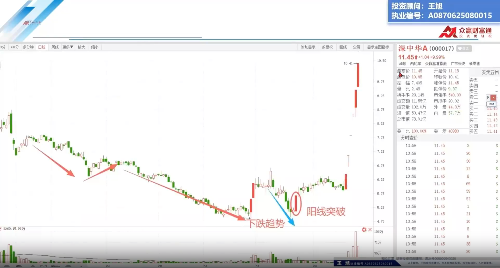

### 5.2 信号二：暗聚强兵——90%成本集中度小于 30%

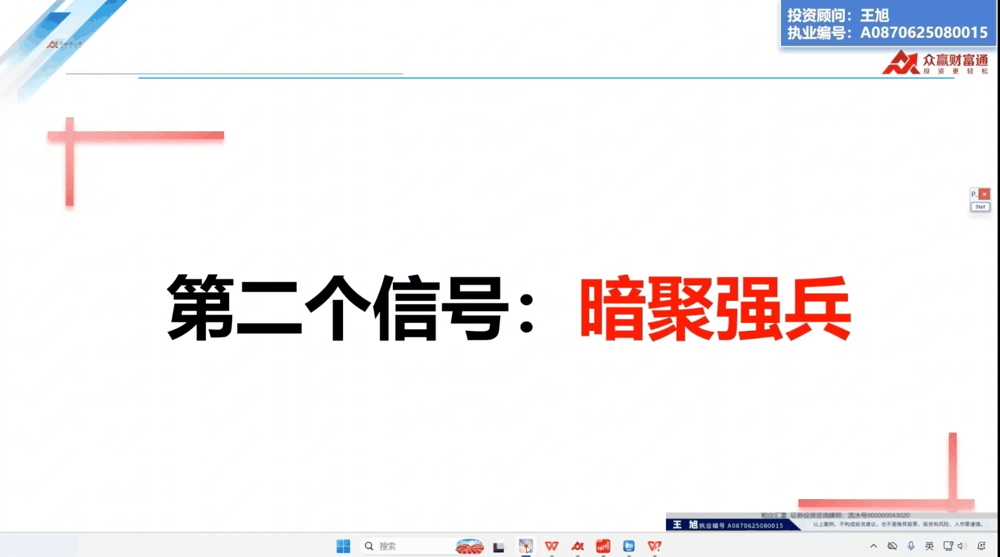

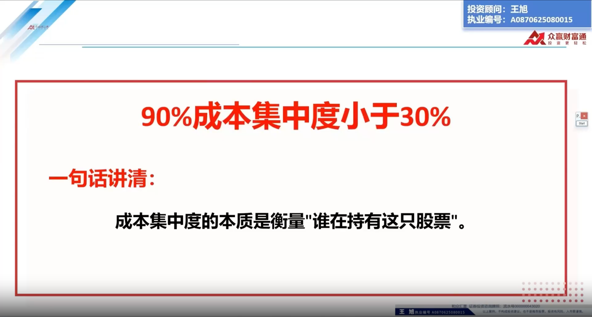

- **定义（课件原句）**：「**90%成本集中度小于30%**」——筹码分布指标中，**90% 的持仓成本集中在一个价格区间内，且该区间宽度小于 30%**。
- **本质一句话：成本集中度衡量的是"谁在持有这只股票"。** 集中度越低（数值越小），说明筹码价格分布越窄——经过前面的三浪下跌、万人血坑、堆量吸筹，散户的分散持仓已经归集到主力的统一成本区。
- **实战解读**：
  - 集中度 < 30% = **主力极度控盘**；
  - **集中度越低，主力的"子弹"越多**——浮筹少意味着拉升时抛压轻，同样的资金可以把股价拉得更高；
  - 反之，筹码分散（集中度高）说明套牢盘遍布各个价位，拉升途中步步是解套抛压。
- 金融含义：这相当于用持仓成本的"基尼系数"来度量筹码结构。吸筹的本质就是把筹码从"多人分散持有"变为"一人集中持有"，成本分布收窄是吸筹完成的统计学证据，与威科夫的"供给枯竭"互为表里。

### 5.3 总攻条件：突破万人血坑高点 + 板块共振

单有个股信号还不够，课程给出的"全军出击"条件是：

- 股价**突破万人血坑的高点**（坑沿颈线位，即B反/坑反弹的高点压力）；
- **叠加板块共振**——所属题材/板块同步走强。

金融含义：个股突破叠加板块共振，等于 α（主力控盘）与 β（题材风口）共振。板块共振既降低了单票假突破的概率，也提供了持续的跟风盘——游资生态中，龙头之所以能连板，靠的正是板块情绪的持续供血。这也呼应了讲师"擅长情绪判断"的专长定位。

---

## 六、全课口诀总结（直播收尾页）

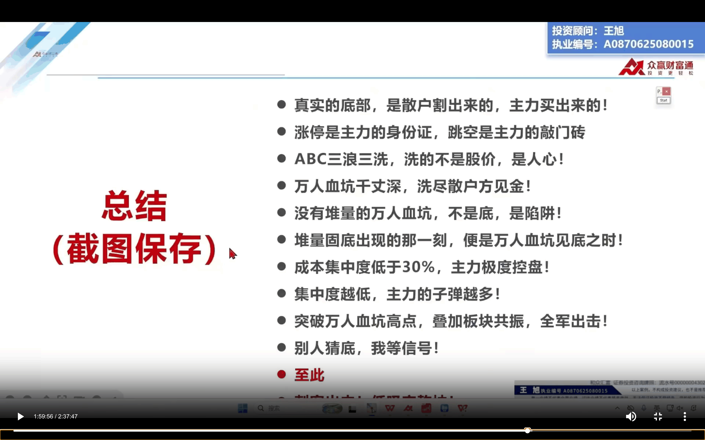

1. 真实的底部，是散户割出来的，主力买出来的！
2. 涨停是主力的身份证，跳空是主力的敲门砖
3. ABC三浪三洗，洗的不是股价，是人心！
4. 万人血坑千丈深，洗尽散户方见金！
5. 没有堆量的万人血坑，不是底，是陷阱！
6. 堆量固底出现的那一刻，便是万人血坑见底之时！
7. 成本集中度低于30%，主力极度控盘！
8. 集中度越低，主力的子弹越多！
9. 突破万人血坑高点，叠加板块共振，全军出击！
10. **别人猜底，我等信号！**

补充金句（04.png）：**基因藏于势，爆发见于量。**

---

## 七、实战检查清单（Checklist）

按顺序打勾，全部满足再考虑入场：

| # | 检查项 | 标准 | 对应章节 |
| --- | --- | --- | --- |
| 1 | 大盘环境 | 周K趋势不处于明显恶化段 | 〇 |
| 2 | 涨停基因 | 一年内涨停 ≥ 4 次、跳空 ≥ 4 次 | 二 |
| 3 | ABC结构 | 完整三段下跌，C浪跌幅 > A浪一倍 | 三 |
| 4 | C浪缩量 | 量能萎缩至120日均量线以下 | 三 |
| 5 | 万人血坑 | 反弹后回撤 > 反弹幅度50%，只观望不抄底 | 四 |
| 6 | 堆量固底 | 坑底放量超过120日均量线（洗盘完毕暗号） | 四 |
| 7 | 明示锋芒 | 放量大阳线突破万人血坑下跌斜率，阳线越高越好 | 五 |
| 8 | 暗聚强兵 | 90%成本集中度 < 30% | 五 |
| 9 | 总攻确认 | 突破万人血坑高点 + 板块共振 | 五 |

---

## 八、案例股速查（图上股票与关键数字）

| 股票 | 代码 | 图上关键标注 | 出现位置 | 教学点 |
| --- | --- | --- | --- | --- |
| 平潭发展 | 000592 | 红圈多处涨停；"涨停很好识别，越多越好" | 03 | 涨停基因 |
| 有研新材 | 600206 | 顶部 69.36 元 | 08、24 | ABC 三浪 / 阳线突破 |
| 立新能源 | 001258 | 低点 6.37；"C浪量能萎靡至120日均量线以下" | 09 | C 浪缩量 |
| 毕得医药 | 688073 | 高点 88.88、坑底约 42.21 | 12、18 | 万人血坑 / 堆量固底 |
| 深中华A | 000017 | 11.45 元 +9.99% 涨停 | 13、25 | 血坑→突破→连板（同一案例链） |
| 风范股份 | 601700 | 坑底约 4.1；两次万人血坑 | 15 | 血坑可能挖两次 |
| 百花医药 | 600721 | "第一次萎靡/第三次堆量"；10.54 元 +10.02% | 19 | 堆量可能不止一次 |

---

## 九、金融视角的客观提示

1. **理论同源。** 本课框架可在经典技术分析中找到清晰对应：ABC三浪≈艾略特修正浪；凹口淘金/万人血坑/堆量固底≈威科夫吸筹阶段（ST→Spring→LPS）；阳线突破≈道氏趋势反转确认；成本集中度≈筹码分布的集中度度量。它不是玄学，而是这些理论在A股涨跌停生态下的本土化封装。
2. **本质是概率游戏。** 主力行为推断基于历史量价痕迹的归纳，存在假信号（对倒放量、假突破、诱多）；课程展示的均为成功案例，存在**幸存者偏差**，过往案例不代表未来收益。
3. **信号越靠后，赔率越差、胜率越高。** 从C浪缩量（最早）到突破+板块共振（最晚），每多等一个确认信号，介入成本都会抬高，但被假底套牢的概率下降——用空间换确定性，是这套体系的隐含取舍，需按自身风险偏好选择介入节点。
4. **风控先于盈利。** 任何信号失效（如突破后快速跌回坑内、集中度重新发散）都应视为结构破坏，严格执行止损与仓位管理；单一技术信号永远不应构成满仓理由。

> 风险提示：本文为课程学习笔记，仅作知识整理，不构成任何投资建议。投资有风险，入市需谨慎。

---

*资料来源：day01/课程记录.md、思维导图.png、直播截图 01–28；整理日期：2026-10-14（补录课件原句与案例股信息）*
