# Day02 课程总结：《竞价抢筹·分时定乾坤》

| 项目 | 内容 |
| --- | --- |
| 课程 | 第二课《竞价抢筹·分时定乾坤》（众赢财富通） |
| 讲师 | 王旭（为为老师），执业编号 A0870625080015 |
| 课题 | 涨停后能否继续连板？——二板的甄别、验证与分时买入 |
| 今日学习目标 | 只有正确的打板，才不会被主力闷杀；出手快而急，只做确定性二板，进场即拉升；通过观察集合竞价，当日介入、当日涨停 |

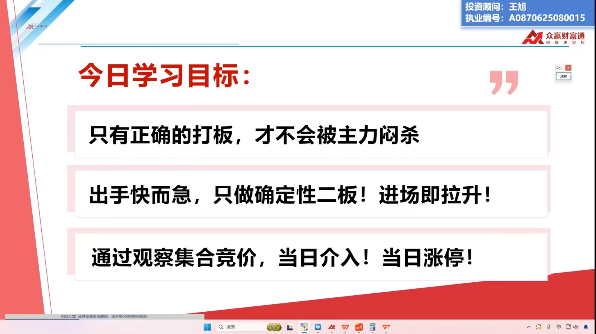

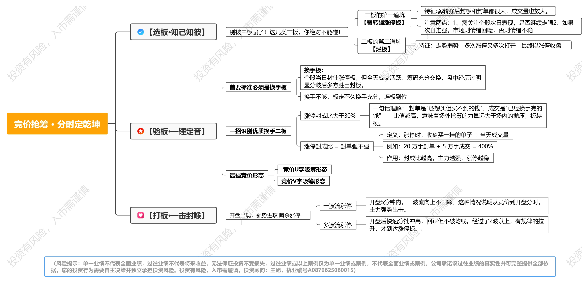

> 与 Day01 的关系：Day01《刺客破局·低吸定江山》解决"**在哪只票上等**"（主力吸筹结构 → 低吸）；Day02 解决"**在哪个瞬间扣扳机**"（连板生态中的二板确认 → 打板/半路）。两天合起来，是一套完整的"选股池 → 择时点"主力行为学体系：Day01 是左侧吸筹识别，Day02 是右侧情绪接力。

---

## 〇、开篇：周期观（盘前闲聊要点）

课程开场提到两条盘面习惯（课堂截图未覆盖，据课程记录整理）：

1. **大盘看大周期，个股看小周期；大周期决定方向，小周期决定拐点。** 落到 Day02 的实操语境就是：先用周K/日K判断市场情绪环境（能不能打板的日子），再用集合竞价与分时决定个股的介入点（今天打不打这只票）。
2. **"个股日K长上影线多，是主力在做测压？"——这个问号打得对。** 长上影线至少有三种常见解释：主力试盘（测上方抛压）、冲高出货、被动回落（解套盘/大盘拖累）。**不能只凭影线下结论**，必须结合所处位置（低位吸筹区 vs 高位加速区）和量能结构判断。低位缩量长上影更可能是试盘，高位放量长上影更要警惕出货。这条属于盘前经验闲聊，不是本课主线，但这个"存疑"的思维方式值得保留。

---

## 一、全课逻辑主线

```
核心问题：涨停后能否继续连板？能不能做？

第一步 选板·知己知彼   →  二板选择标准：什么能做、什么不能做（弱转强、烂板两类坑绕开）
第二步 验板·一锤定音   →  板的质量验证：换手板 + 涨停封成比 + 竞价U/V形态
第三步 打板·一击封喉   →  分时买入：一波流扫板 / 多波流健康节奏 + 上板时间
```

心法一句话：**别人猜板，我验质量。** 打板不是赌大小，而是用"换手、封成比、竞价形态、分时结构"四重证据链验证"这个板是不是主力真心实意封出来的"。

---

## 二、第一步：选板·知己知彼

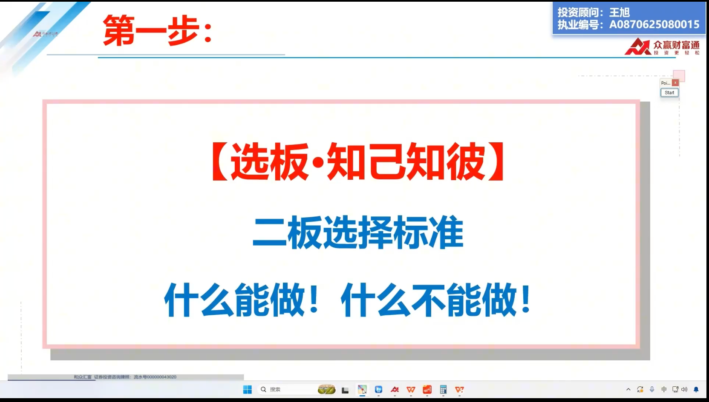

### 2.1 从"二板定龙头"到"二板辨龙头"

赵老哥的"二板定龙头"是打板界的经典口诀，但课上明确提醒：**不要盲目相信"二板定龙头"，也不要盲目相信封单额。**

- 很多主力"坏"：在涨停板上来回换手，板上的封单可能早已悄悄撤走，你看到的"强势"只是幻象。
- 一字板定龙头的案例（酒钢宏兴 600307）：看似两连板启动，随后一路阴跌——**涨停本身不等于龙头资格**。

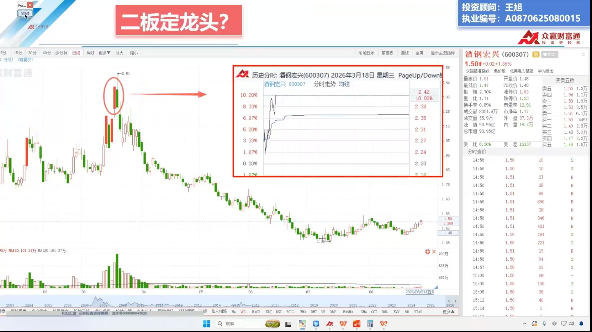

老师给出的修正：把"定"改成"**辨**"——

> **二板辨龙头！**

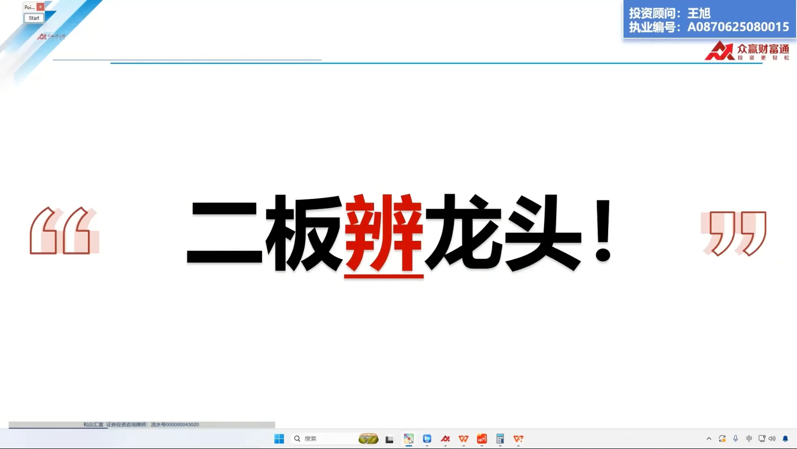

**金融含义**：首板是信息最不对称的时刻（谁在买、为何买，外界无从验证）；二板是市场的第一次"公开投票"——敢在首板之后继续封板，说明资金愿意接力，龙头属性在博弈中"辨"（被辨识）出来，而不是被某个板"定"（一锤定音）下来。二板是**验证起点**，不是**结论本身**。

### 2.2 第一道坑：弱转强涨停板

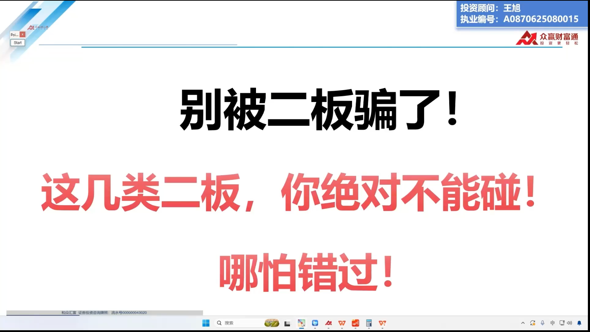

**什么是弱转强？** 低开后慢慢修复、最终封死涨停，极端形态是**地天板**（从跌停附近拉到涨停）。

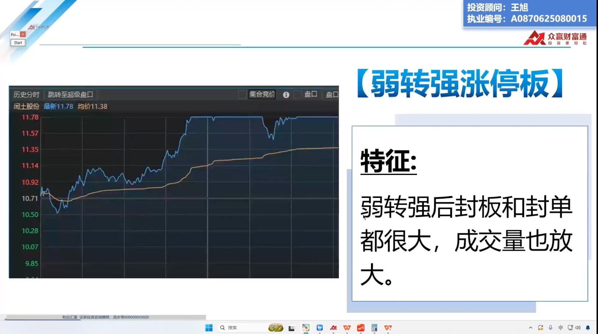

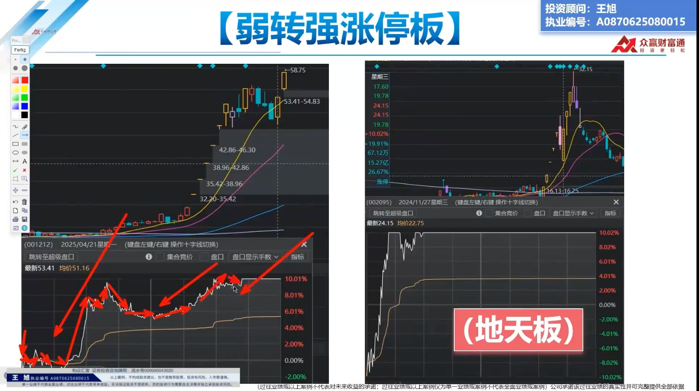

**盘口特征**：弱转强封板时，封板快、封单大、**成交量急剧放大**——这就是"巨量换手"。巨量换手的微观含义：看空的资金已经在这天离场，看好的资金留守其中——筹码在板上完成了一次彻底的大换血。

**为什么弱转强板不能直接做？三条硬理由：**

1. **控盘能力存疑。** 需要靠"低开—修复—拉涨停"这么大费周章的方式封板，说明主力对盘面的掌控力还不够强，护不住开盘的抛压。真正强的主力，从竞价开始就直奔主题。
2. **次日往往不继。** 案例：江苏索普（600746）2026-07-15 弱转强涨停后，次日冲高回落，随后几天持续走弱——弱转强板把当天的多头情绪一次性透支了。

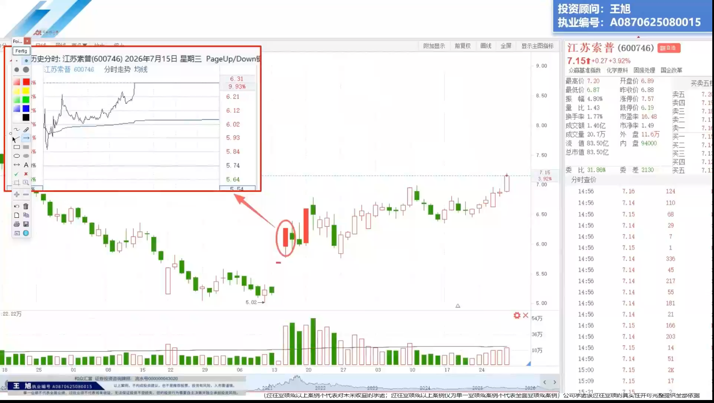

3. **同样的形态，位置决定生死。** 案例：合富中国（603122）——
   - **2024-01-25** 的弱转强二板出现在**高位加速区**，随后股价从 31.22 元持续低走，深度套牢；
   - **2025-10-29** 的弱转强则出现在**长期横盘后的低位**，随后走出主升行情。
   
   **同一个票、同一种分时，结局天壤之别——弱转强本身不是问题，问题是它出现在什么位置、什么情绪周期里。** 高位弱转强是主力借修复出货的经典舞台；低位弱转强才有"资金进场"的解释空间。

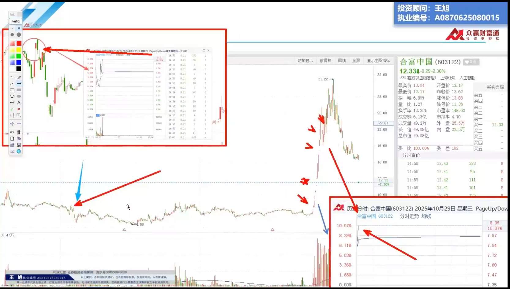

**若实在想跟踪弱转强，观察两点（13 图课件原话）：**

1. 需关注个股**次日表现**，是否继续走强；
2. 如果次日走强，**市场情绪则回暖**，否则情绪不稳。

注意第 2 点：弱转强板的次日表现不只是这一只票的去留依据，它同时是**市场整体情绪的温度计**——弱转强修复成功代表昨日的恐慌被化解，情绪周期有望重启；修复失败则说明市场还处在退潮期，全体打板策略都应降级。

另外补充一条课堂口述：若弱转强是**外围原因**（大盘大跌、隔夜外盘跳水等系统性因素）导致低开、随后修复走强，性质与自身走弱不同，或可区别对待——系统性错杀的修复，含金量高于个股利空下的挣扎。

**纪律（14 图）：**

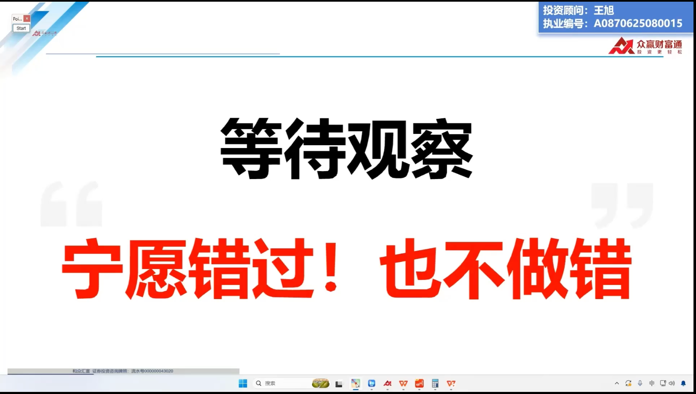

> 对于弱转强，**宁愿错过，也不做错。**

### 2.3 第二道坑：烂板涨停

**特征（15 图课件原话）**：走势弱势，多次涨停又多次打开，最终以涨停收盘。课堂口述还包括：中间长时间打开（可达1小时以上）、尾盘炸板又回封。

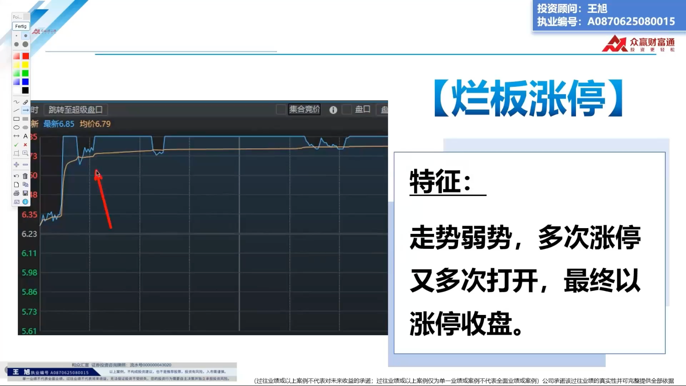

**为什么烂板不能打？** 烂板意味着封板资金实力不足、或多空分歧巨大，封单被反复消耗；即便勉强收盘涨停，这个板也是"千疮百孔"的——次日溢价和连板概率显著低于优质板。

**反面案例：**

- **万泽股份（000534）**：典型的二板烂板（盘中反复开板），结果**三板直接断板**，追高者当场被套。

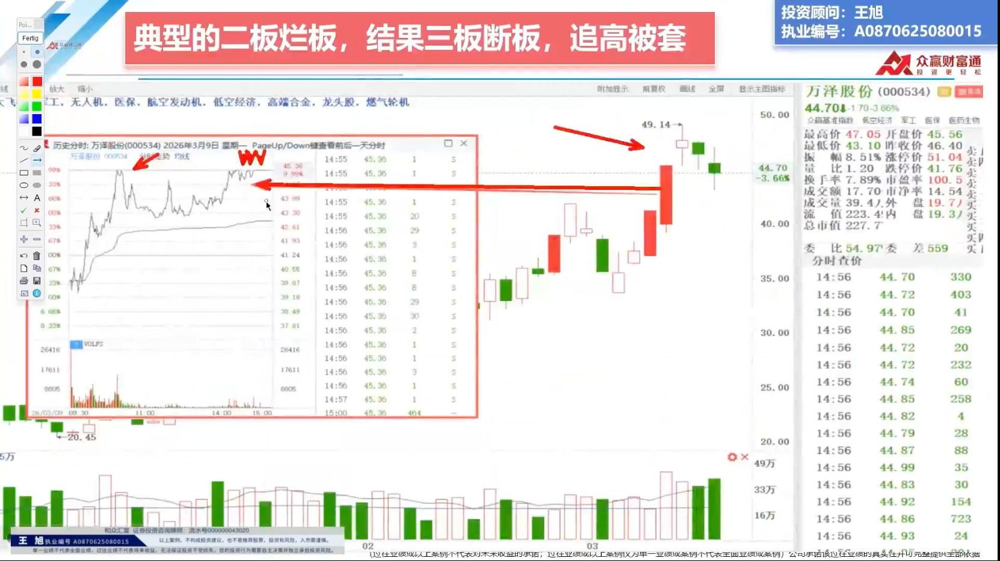

- **贤丰控股（002141）**：两次烂板涨停（2026-06-26、2026-07-06），封板后均出现长时间开板震荡，后续走势反复。

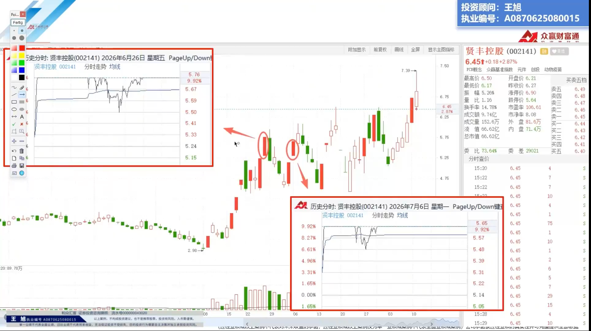

- **平潭发展（000592）**：左上分时图显示盘中三次炸板又勉强回封，随后股价连续大跌（右侧红色箭头一串）；对照右下 2025-10-24 的干净板（开盘直封、纹丝不动），质量高下立判。**同一个票，烂板与好板的结局完全两样——板的质量比票的名字重要。**

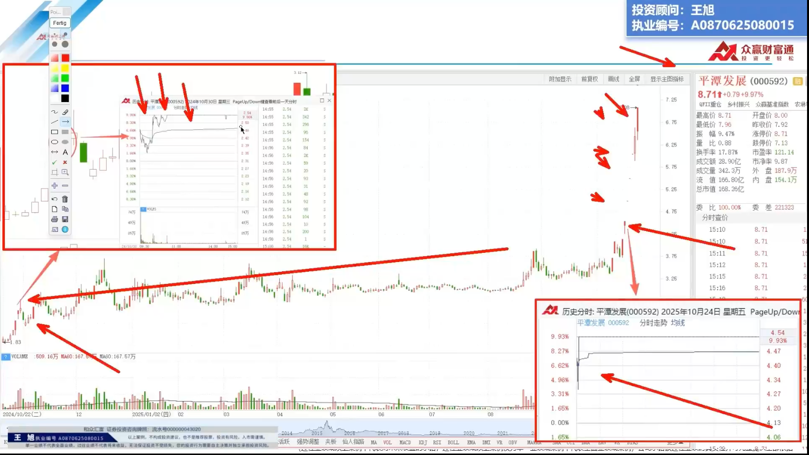

---

## 三、第二步：验板·一锤定音

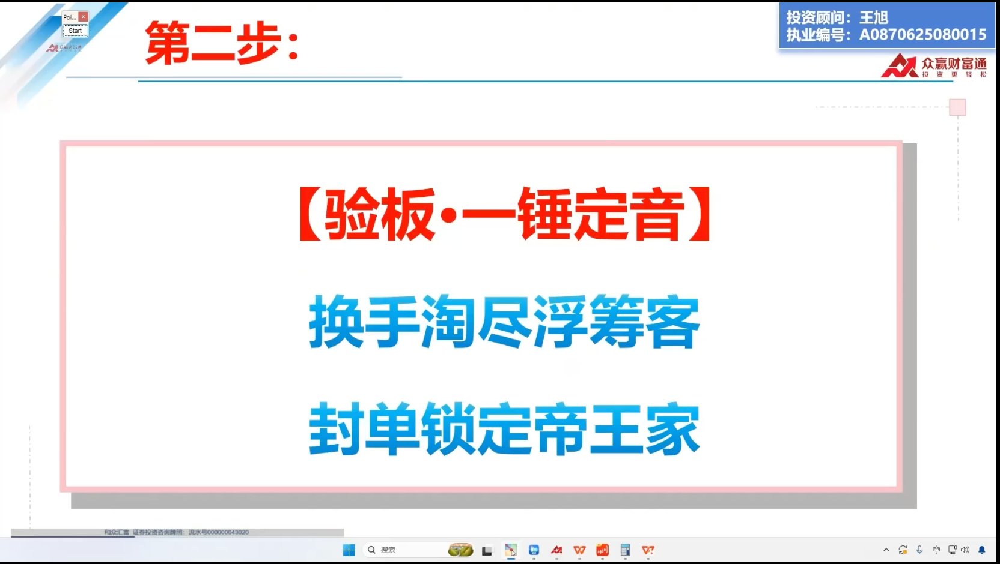

什么样的二板最适合"打出关键一击"？两大硬件标准 + 一种竞价形态。

### 3.1 首要标准：必须是换手板

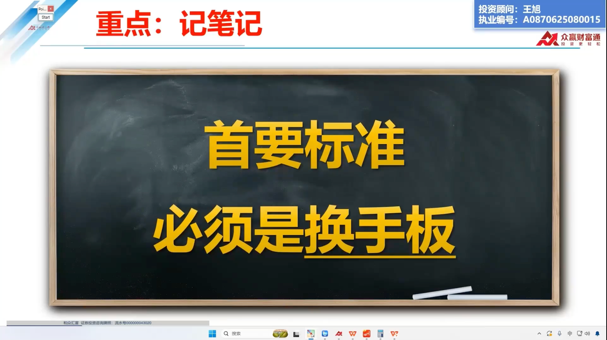

**什么是换手板？**（思维导图正式定义）**个股当日封住涨停板，但全天成交活跃、筹码充分交换，盘中经历过明显分歧后多方胜出封板。** 通俗说：不是一字涨停，盘中**每天都给买入和卖出机会**的涨停板（22 图中箭头所指的那些带实体、带成交量的板）。

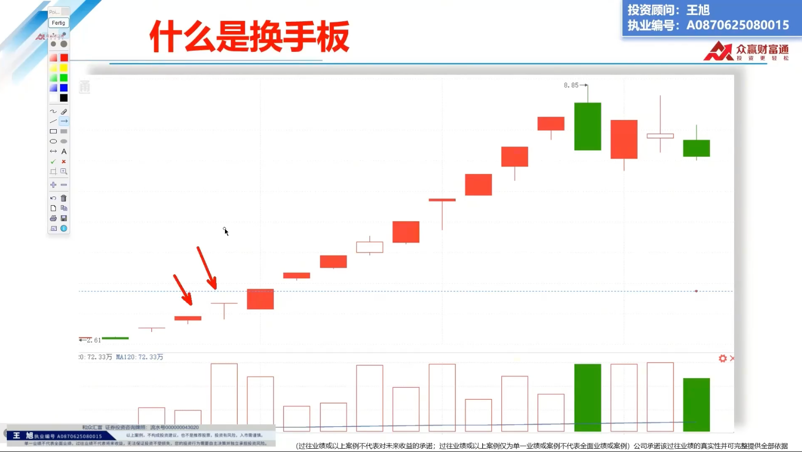

**你的笔记里留了一个问题："换手板可以理解下为什么？"——正面回答：**

一字板的问题是**没有成交 = 没有检验**。涨停价上没有人卖出，你就不知道：获利盘到底有多少？套牢盘到底多急？这些抛压不是不存在，只是被涨跌停制度暂时冻结了，全部留到开板那天集中释放。

换手板则相反：主力**敢让你买、也敢让你卖**——敢在涨停价上放任成交，说明它不怕抛压，而且正在把板上的筹码从旧持有人手中转移到新持有人手中。其经济学效果是：

1. **旧成本变新成本**：低位获利盘、高位套牢盘在涨停价离场，接手者的成本被抬高到板上——次日的抛压动机大幅减弱（刚买的人不会立刻砸）；
2. **抛压被实测**：换手率就是"抛压实测数据"，换手越充分，主力对次日抛压的把握越大；
3. **筹码归集**：大资金在板上边拉边收，控盘度进一步提升。

> 口诀（25 图）：**换手不够，板走不久；换手充分，连板到手。**

**正面案例：大有能源（600403）**——一串换手板（箭头所指每个板都有成交量配合）阶梯上行，从 3.60 元附近一路连板到 10.08 元。每个板都经历了真实的多空交换，所以每个板都走得稳。

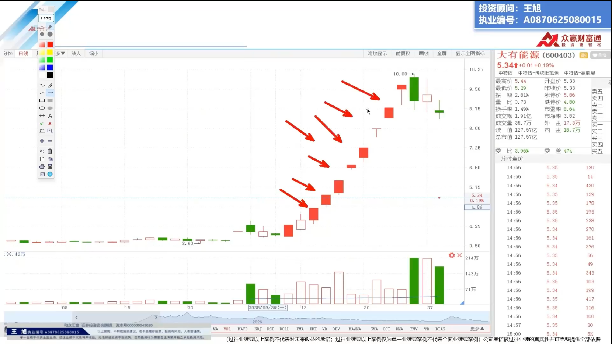

**反面案例：锋龙股份（002931）**——从 17.61 元起步，连续**一字板**无量飙升到 118.10 元，课件标题一针见血：**"看似风光，实则出货都出不去"**。无量一字意味着主力自己也没法兑现，这种上涨是"无根之木"；一旦开板，汹涌而出的获利盘+踏空追高盘瞬间兑现，股价雪崩。**一字板看似最强，实则是主力"不敢面对市场"——没有经过真实买卖盘检验的强势，不是强势，是泡沫。**

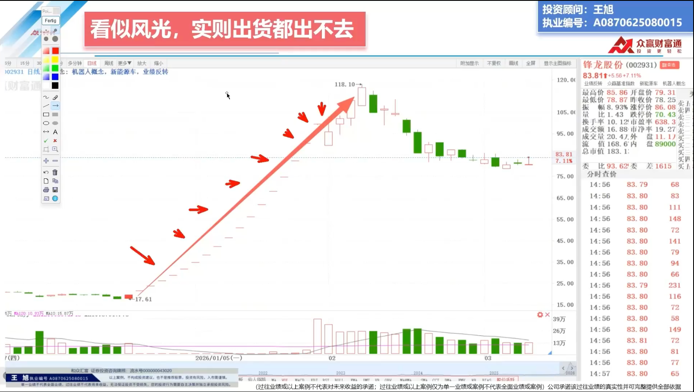

> ⚠️ 注意口径：一字板连板并非绝对不能做（极端情绪周期里的一字龙也有溢价），但对普通学习者，课程立场明确——**二板阶段优先换手板，绕开纯一字**。因为二板一字的"辨识度"和"可参与性"都最差：买不进（通道党专属）、验不了（无换手）、开板就是面。

### 3.2 硬件标准：涨停封成比大于 30%

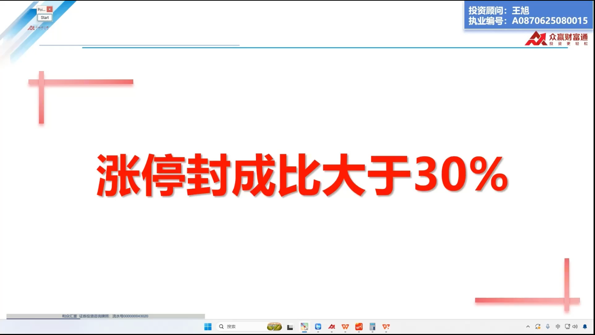

**一句话理解（27 图课件原话）**：封单是"**还想买但买不到的钱**"，成交是"**已经换手完的钱**"——比值越高，意味着场外抢筹的力量远大于场内的抛压，板越硬。

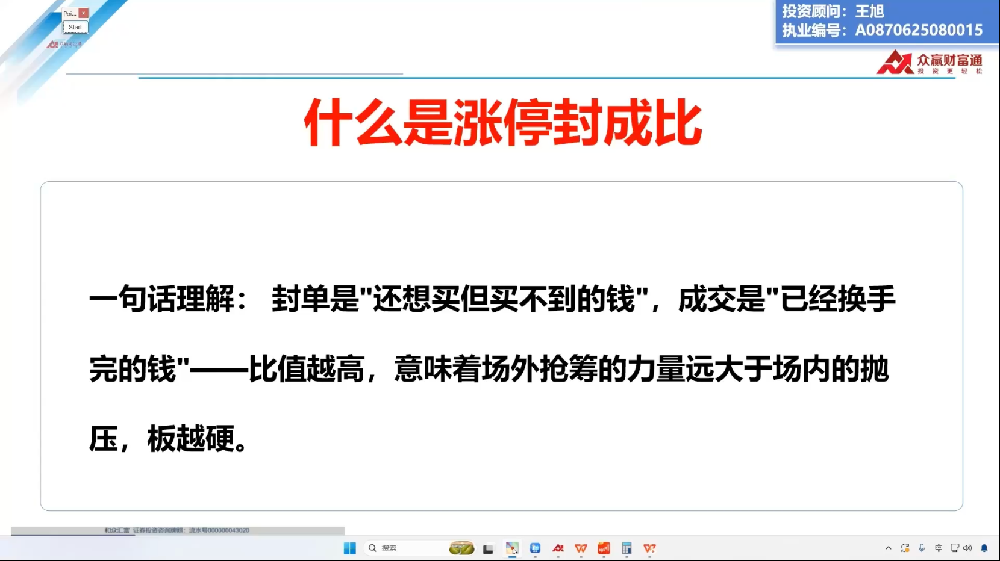

**定义与公式（28 图）**：

```
涨停封成比 = 涨停时收盘买一挂的封单 ÷ 当天成交量

例：20万手封单 ÷ 5万手成交量 = 400%（远大于30%，板极硬）
作用：封成比越高，主力越强，涨停越稳
```

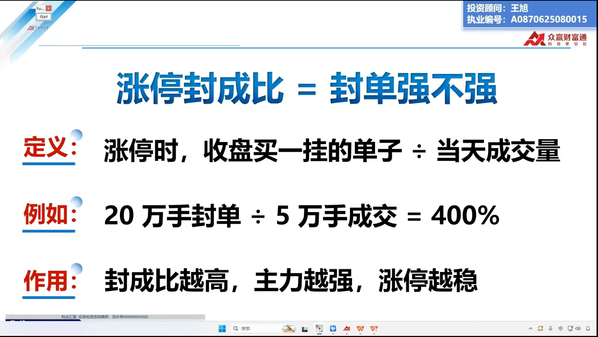

**金融含义**：封成比是"**未满足需求 / 已成交量**"的比值——成交量是今天已经被消化的抛压，封单是明天还在排队的买力。封成比 30% 是一条经验门槛：意味着场外买力至少有已成交换手的三成仍在排队，次日惯性高开的概率显著提升。

**但要和前面"不要盲目相信封单额"对照着看**：封单是**可以撤的**。封成比高只能说明"此刻"挂单凶猛，不能保证"一直"凶猛。所以封成比必须与换手板结合使用（29 图）：

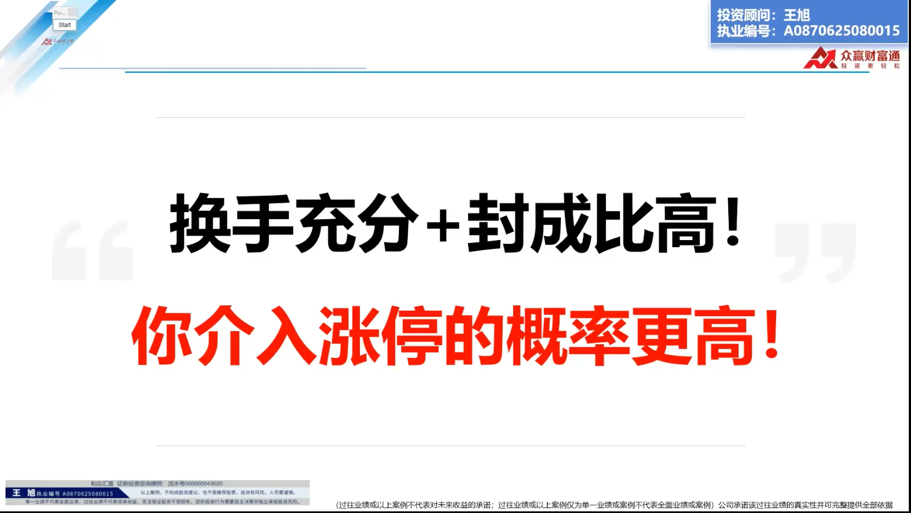

> **换手充分 + 封成比高 → 接入后涨停概率更高。** 换手验证"今天抛压已被消化"，封成比验证"明天买力仍在排队"——一个管过去，一个管未来，缺一不可。

### 3.3 最强竞价形态：U字与 V字吸筹

#### 竞价 U 字形态

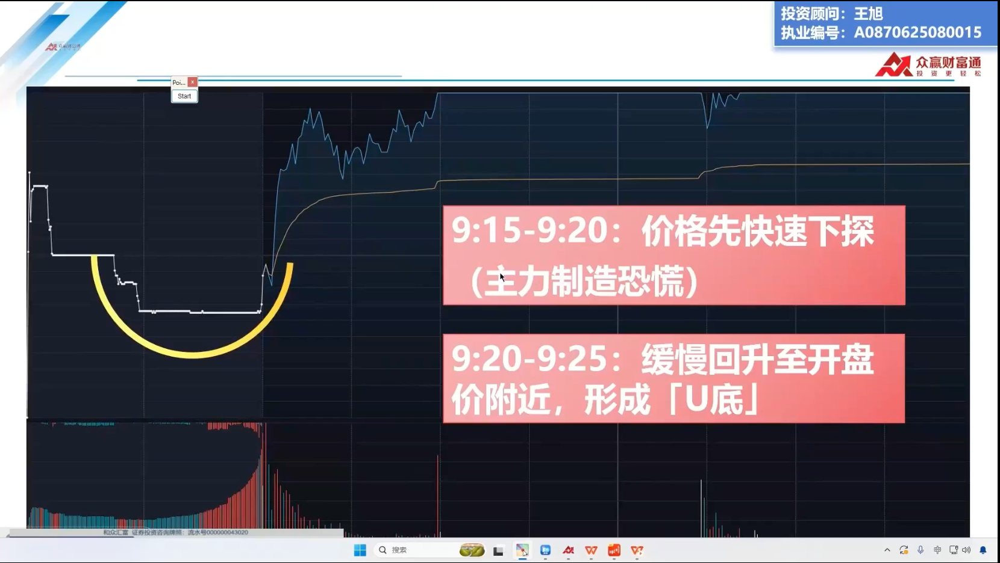

**机制拆解**（必须结合集合竞价规则看，31 图）：

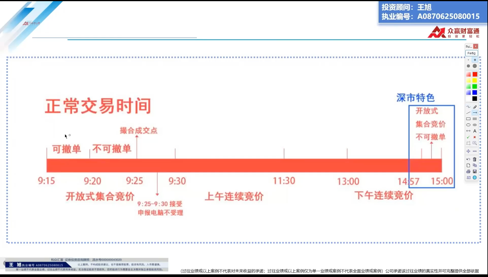

- **9:15–9:20（可撤单阶段）**：主力挂出大卖单把虚拟价格快速砸下去——**制造恐慌**。关键是这5分钟挂单**可以撤**，砸下去的卖单随时可以撤回，这是一次"假摔"。
- **9:20–9:25（不可撤单阶段）**：主力反手把价格缓慢拉回开盘价附近，形成 **U 底**。由于这个阶段**不可撤单**，拉回来的买单是真金白银的真实申报——**假摔之后的真抢**。
- **开盘后**：U 底确认 → 主力强势拉升。

**案例**：莲花控股（600186，U字形态 + 当日涨停 12.02 元）、祥鑫科技（002965，U字形态 + 涨停 31.11 元）。

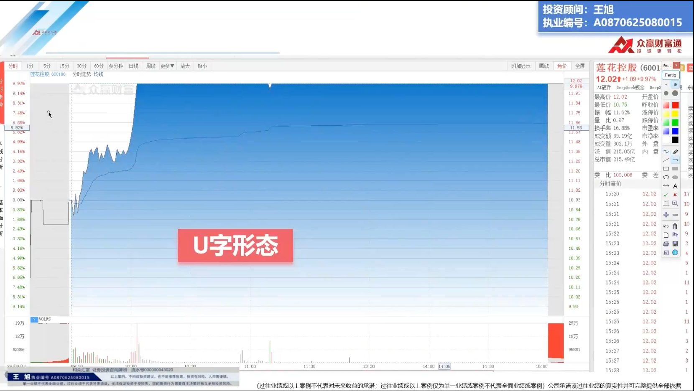

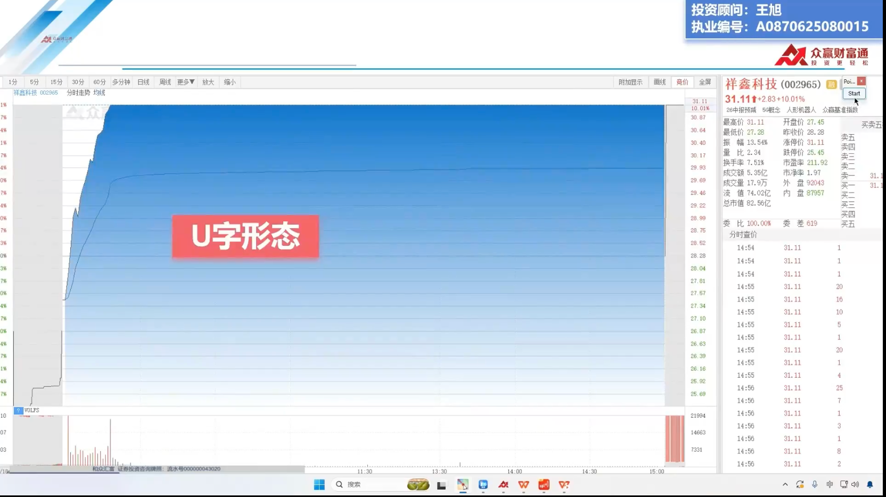

#### 竞价 V 字形态

V 字是 U 字的"急促版"：竞价中价格快速下探后**立即**回收，V 底停留时间更短——恐慌更短暂、买盘更急迫，通常对应更强的抢筹意愿。

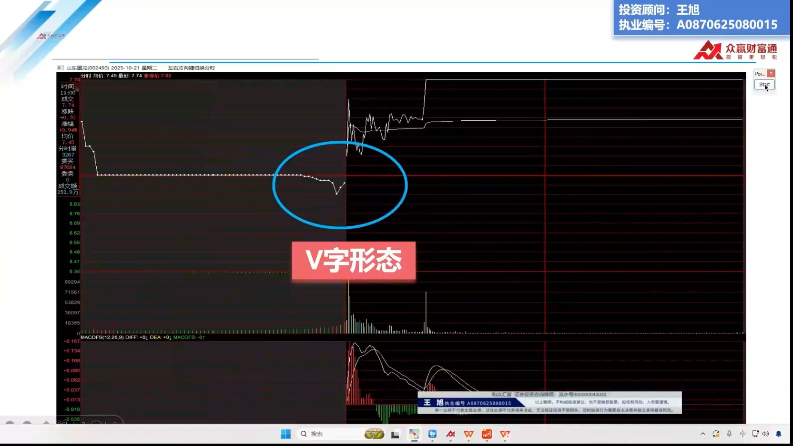

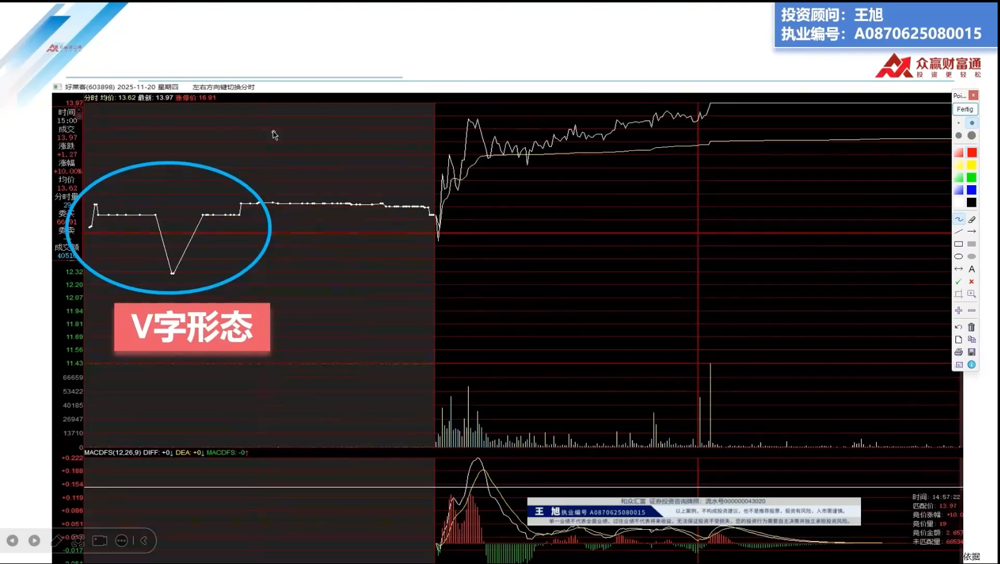

**竞价形态的共同逻辑**：先用可撤单/瞬时砸盘逼出恐慌筹码，再用不可撤的真实买单低位承接——这是**一日迷你版的"挖坑洗盘再吸筹"**，与 Day01 万人血坑的微观结构异曲同工，只是发生在 9:15–9:25 这十分钟里。

---

## 四、第三步：打板·一击封喉

### 4.1 一波流涨停：最强的进攻形态

**定义（36 图课件原话）**：**开盘5分钟内**，一波流**向上不回踩**——说明从竞价到开盘分时，主力强势出击。

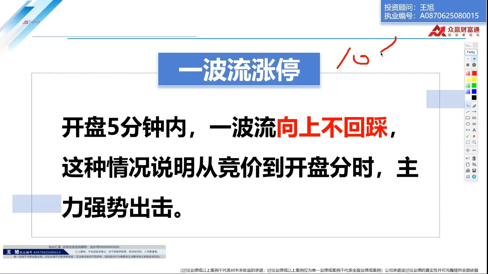

**信号意义（37 图）**：一波流通常是**主力推动最明确的信号**——资金**情绪急迫、拉升意图强**，不给场外资金任何低位上车的机会。

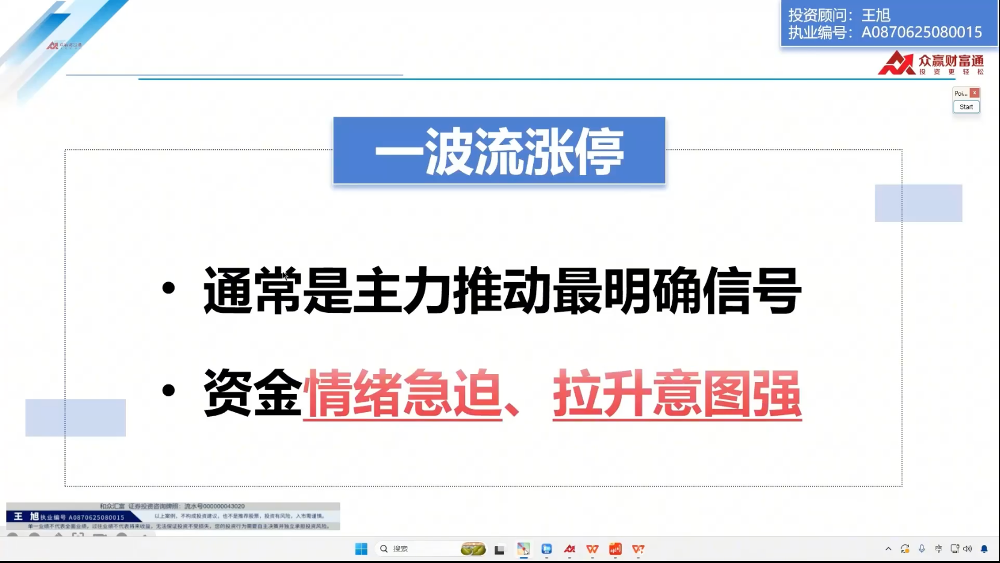

**买点**：**在接近封板时买入**（即"扫板"）——不等封死后排队（大概率买不到），也不在半山腰盲目追（未确认封板意愿），而是在股价即将触及涨停价的瞬间果断买入。

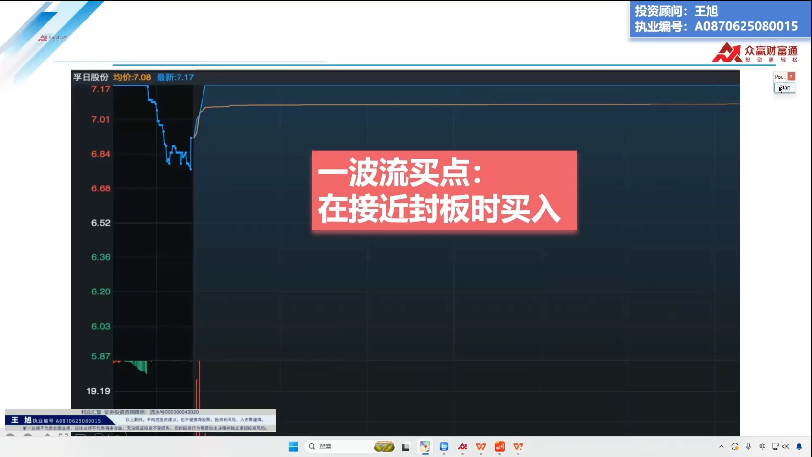

**为什么扫板而不是排板？** 扫板买的是"最后一跃"的确定性：当价格已经冲到涨停价下方一两个价位、大单持续扫货时，封板概率极高；若封死，你已持仓享受次日溢价；若瞬间炸板，因为你买在板价附近而非更高，止损距离也最短。**排板（封死后挂单）则相反：能成交的往往都是炸板单——成交即套牢，这就是"打板打出闷杀"的经典来源。**

**U字形态 + 一波流的组合案例**：华丰股份（605100）、中超控股（002471）——竞价U底洗出恐慌盘 → 开盘一波流直封，教科书式的"竞价骗筹 + 开盘锁仓"。

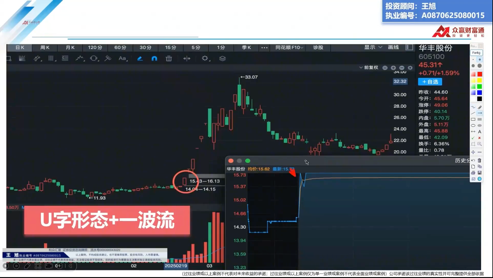

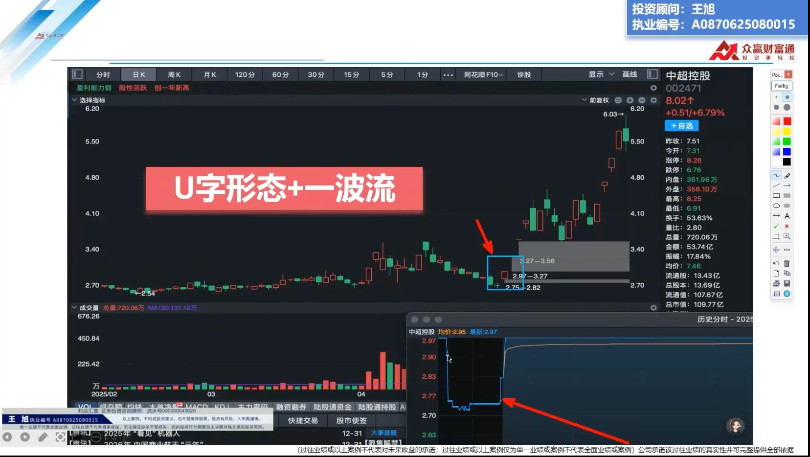

### 4.2 买不到一波流？把握"健康涨停节奏"（多波流）

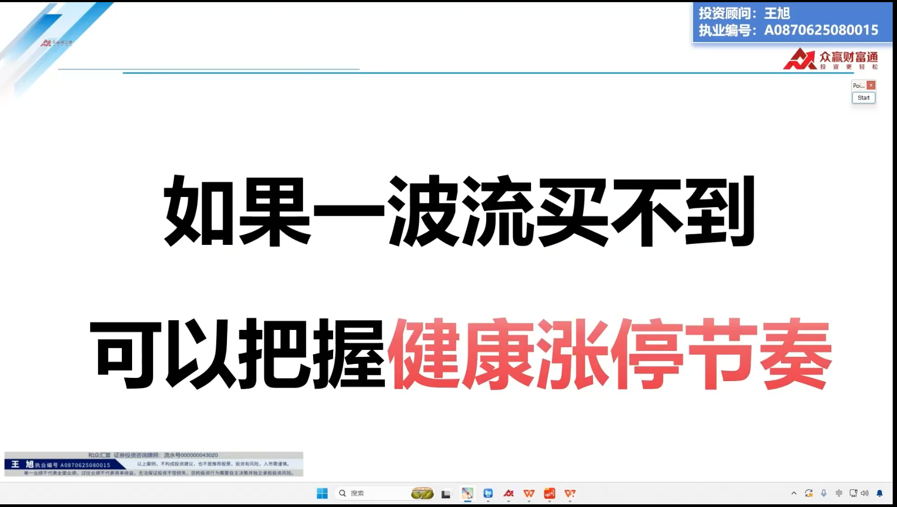

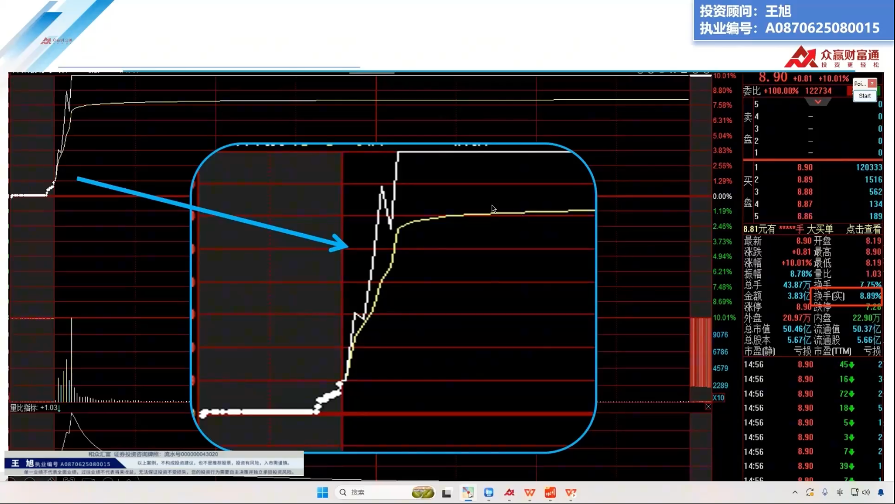

**多波流定义（43 图课件原话）**：开盘后快速**分批冲高，回踩但不破均线**，经过 **2 波以上有规律的拉升**，才到达涨停板。

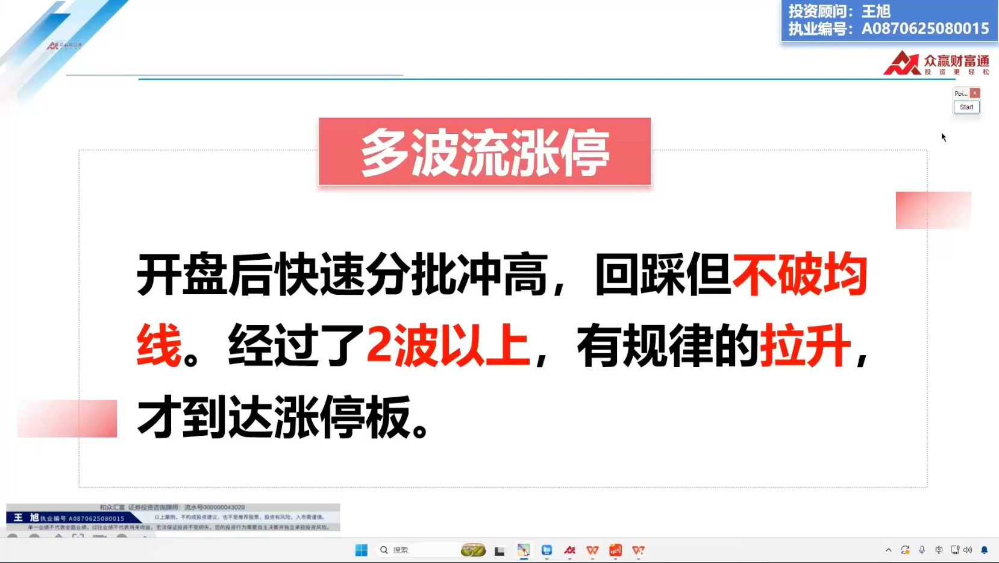

**典型形态是三波流（44 图）**：早盘快速拉升，但伴有回调（**不破均线**），同时**量能递增**，一般有三波拉升。

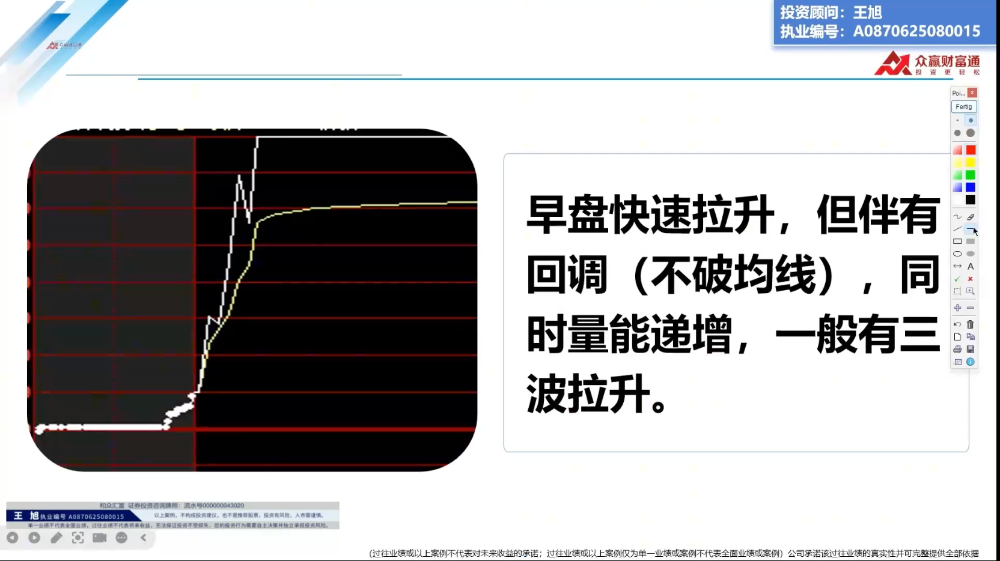

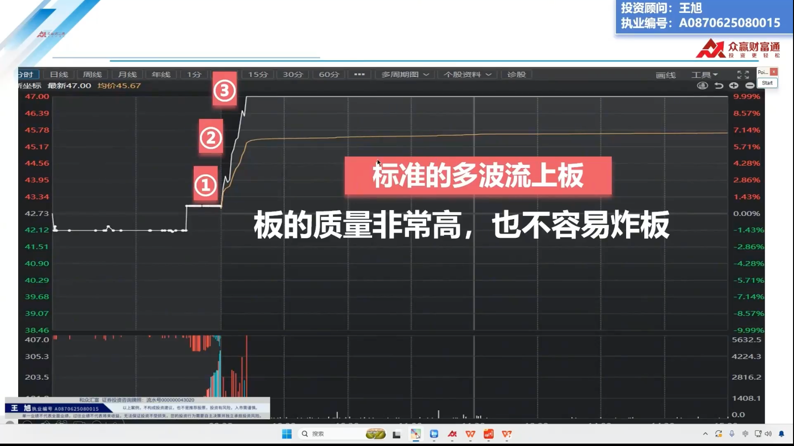

**多波流的主力在干什么？（46 图）——每一波回调都是有任务的：**

| 波次 | 回调目的 |
| --- | --- |
| 第一波回调 | **测试抛压**（试一下上方卖单有多重） |
| 第二波回调 | **清洗浮筹**（把不坚定的短线客洗下车） |
| 第三波加速 | **直接锁仓**（抛压测试完毕、浮筹清洗干净，一波拉到板上封死） |

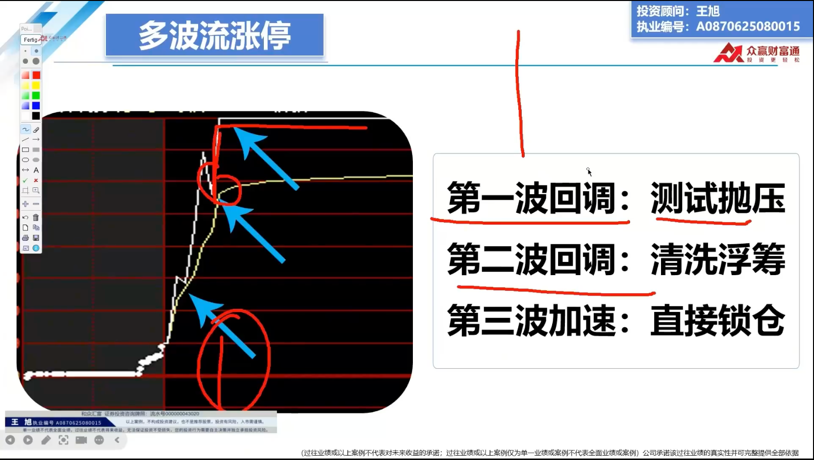

**铁律一：每一次拉升后调整，分时不能跌破均线（47 图）。** 原因：分时均线是当日全场持仓者的平均成本线，回踩不破 = 每次回落都有资金在均线附近主动承接——**不破均线是分时支撑很强的标志，也就是【承接】力强**。一旦跌破均线，说明承接失败、获利盘开始踩踏，多波流结构即告破坏。

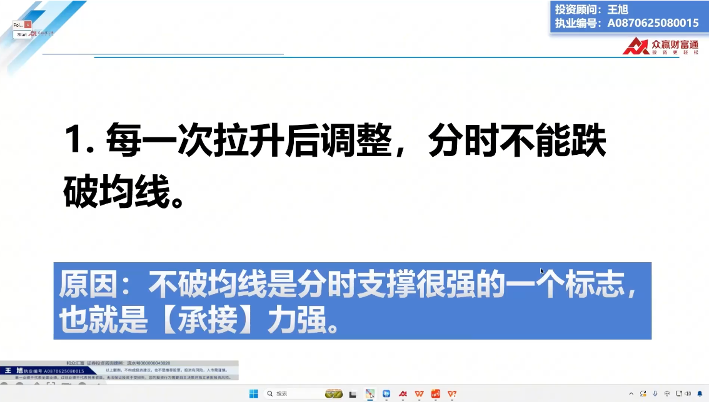

**铁律二：上板时间最好在10点之前，越早涨停越好（48 图）。** 原因：越早涨停，关注度越高，第二天的溢价也会越高。特别是板块高潮日，**如果下午才涨停，大概率是后排和跟风**——情绪最热的时候还没资格上板的票，本身就是地位的证明。

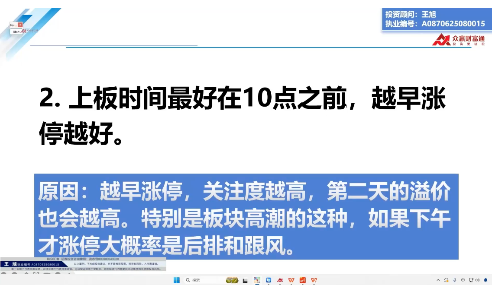

**金融含义补充**：早板享受的是"注意力溢价"——全市场复盘时，先封板的票占据情绪龙头的心智位；午后板则在"跟风梯队"里排班，次日溢价按梯队递减。10点是打板生态公认的情绪分水岭，与游资圈"十点前定龙头"的经验一致。

---

## 五、你的课程笔记理解核查

对照课堂截图与讲解逻辑，对 [课程记录.md](课程记录.md) 逐条核对：

### 5.1 理解到位的部分（绝大多数）

| 笔记要点 | 核查结论 |
| --- | --- |
| 二板定龙头 → 实际是"二板**辨**龙头" | ✅ 完全准确，这正是 06 图一字之差的精髓 |
| 不要盲目相信封单额、主力封单可能已撤走 | ✅ 准确，且与后文封成比形成"辩证对" |
| 弱转强定义（低开修复/地天板）、巨量换手 | ✅ 准确 |
| 看好的资金留守，不看好的已经离场 | ✅ 这正是巨量换手的正确微观解读 |
| 弱转强次日可能不涨、要看次日是否回暖 | ✅ 准确（见下方补充） |
| 弱转强宁错过不做错 | ✅ 与 14 图一致 |
| 烂板特征（多次开板、长时打开、尾盘炸板） | ✅ 准确 |
| 首选换手板、封成比>30%、充分换手+封成比高 | ✅ 准确 |
| U字/V字竞价吸筹形态 | ✅ 准确 |
| 一波流接近封板买入（扫板）、多波流、三波流锁仓 | ✅ 准确 |
| 每次调整不破分时均线 = 承接力强 | ✅ 准确 |
| 上板时间最好10点前 | ✅ 准确 |

### 5.2 需要修正笔误的地方（不影响理解，建议改笔记）

1. "弱转强时会**反生**巨量换手" → **发生**
2. "主力敢让卖也敢让卖" → **敢让买也敢让卖**（敢让你买、也敢让你卖——敢放任双向成交才是实力）
3. "可以**把我**健康涨停节奏" → **把握**
4. "上板时间**做好再**10点之前" → **最好在**

### 5.3 建议补充的理解点（笔记未记全或可加深）

1. **弱转强的次日观察是"双温度计"**（13 图后半句你漏了）：次日走强不仅决定这只票还能不能持有，更代表**市场情绪回暖**；次日走弱则情绪不稳，全体打板策略降级。弱转强板是情绪周期的信号弹，不只是个股信号。
2. **合富中国（12 图）其实是"一票两结局"的对照实验**：你记了 2024-01-25 高位弱转强失败，但同一张图右下还有 2025-10-29 低位弱转强成功走主升的另一半。**弱转强的成败，位置（高位/低位）是第一变量**——高位弱转强常是出货掩护，低位弱转强才有接力价值。只记失败案例会把"弱转强"一棍子打死，记全对照才知道该防的是"高位"而不是"形态"本身。
3. **"外围原因导致的弱转强或可持有"的前提**：系统性错杀（大盘暴跌带崩个股）后的修复，本质是错杀回归；个股自身利空（业绩、监管）后的弱转强，才是老师说的"宁愿错过"。区分点在于跌的原因在不在个股自身。
4. **一波流的硬标准建议补进笔记**："**开盘5分钟内 + 向上不回踩**"——你记了"涨停很快"，但这两个量化条件才是实操判据。
5. **你自己留的问题"换手板为什么好"**——见 3.1 节正文：一字板无成交=无检验，抛压被冻结到开板日集中释放；换手板在涨停价上实测抛压、抬高新持仓成本、完成筹码归集。一句话：**换手板是经过压力测试的涨停，一字板是没做过体检的涨停。**
6. **封成比与"封单可撤"的辩证**：封成比>30% 是必要条件不是充分条件——封单随时可撤，要结合换手（今天的诚意）+ 竞价形态（明早的意图）+ 分时结构（盘中的承接）综合判断，单看封成比容易被"虚假封单"骗进场。
7. **开篇"长上影线测压"**：你的问号保留得好。正确姿势是——低位+缩量长上影 → 偏试盘测压；高位+放量长上影 → 偏出货/分歧。单独一条影线说明不了任何事，必须带上下文。

---

## 六、实战检查清单（打板前逐项打勾）

| # | 检查项 | 标准 | 对应章节 |
| --- | --- | --- | --- |
| 0 | 市场情绪环境 | 周K/日K不处于明显退潮期；非极端冰点日 | 〇 |
| 1 | 排除弱转强 | 低开修复型、地天板二板 → 放弃（外围系统性错杀除外） | 2.2 |
| 2 | 排除烂板 | 盘中多次开板、长时间开板、尾盘炸板回封 → 放弃 | 2.3 |
| 3 | 换手板 | 非一字，盘中有真实成交，换手充分 | 3.1 |
| 4 | 封成比 | 收盘封成比 > 30%，且封单未频繁撤挂 | 3.2 |
| 5 | 竞价形态 | 9:15–9:25 出现 U 字或 V 字（可选加分项） | 3.3 |
| 6 | 分时结构 | 一波流（5分钟不回踩）或多波流（回踩不破分时均线） | 4.1/4.2 |
| 7 | 上板时间 | 10点前封板，越早越好；午后板视为跟风降级处理 | 4.2 |
| 8 | 买入方式 | 一波流：接近封板时扫板；忌封死后排板接炸板单 | 4.1 |
| 9 | 板块背景 | 板块高潮日只做前排，不碰后排跟风 | 4.2 |

---

## 七、金融视角的客观提示

1. **打板是A股独有的高风险交易范式。** T+1制度下，当日买入无法卖出——打板把"判断错误"的代价从浮亏放大为无法止损的隔夜风险。二板接力的胜率天花板本就不高，所谓"确定性二板"是相对概率优势，不是确定性本身。
2. **本课方法论的本质是"情绪+微观结构"双验证。** 换手/封成比验证的是资金真实度（微观结构），U/V竞价与上板时间验证的是情绪强度（行为金融）。它不看基本面，盈利来源是连板生态中的情绪溢价与博弈差价——这决定了它**强依赖情绪周期**：情绪主升期这套方法胜率陡增，退潮期同様的形态批量失效。这也是为什么弱转强的次日表现被当作"市场情绪温度计"。
3. **封单、竞价均可被操纵，证据链会被伪造。** 大资金可以虚假挂撤封单、用竞价对倒画U底。所以课程才反复强调多信号交叉验证（换手×封成比×分时×时间），单一信号永远不构成入场理由。
4. **案例展示存在幸存者偏差。** 课堂上的大有能源、华丰股份是成功样本；万泽股份、锋龙股份是反面样本——但真实交易中，"看起来符合全部标准却依然炸板闷杀"的样本比例，远比课件呈现的高。过往案例不代表未来收益。
5. **仓位与止损纪律先于一切形态。** 打板策略必须预设"炸板次日无条件处理"之类的退出规则，并把单笔仓位压到即使连续吃面也不伤本金的水平。用 Day01 的话说：别人猜板，我等信号；用风控的话说——**信号会骗人，仓位不会。**

> 风险提示：本文为课程学习笔记，仅作知识整理，不构成任何投资建议。打板/追板策略风险极高，不适合绝大多数投资者。投资有风险，入市需谨慎。

---

## 八、全课记忆点

1. 二板定龙头？——是**二板辨龙头**！
2. 弱转强，宁愿错过，也不做错！
3. 烂板出不了龙头，万泽、平潭血未干！
4. **换手不够，板走不久；换手充分，连板到手！**
5. 一字板看似风光，实则出货都出不去！
6. 封成比 = 封单 ÷ 成交，大于30%板才硬！
7. 竞价U底/V底——可撤阶段砸恐慌，不可撤阶段真抢筹！
8. 一波流买在**接近封板**，多波流守在**不破均线**！
9. 第一波测抛压，第二波洗浮筹，第三波锁仓点火！
10. **十点前封板是龙头，午后上板是跟风！**

---

## 九、本课资料索引

| 资料 | 性质 | 与本总结的关系 |
| --- | --- | --- |
| 直播截图 01–48 | 课堂实录（按授课顺序编号） | 本总结的主体素材 |
| [课程记录.md](课程记录.md) | 课堂笔记 + 个人理解 | 第五节已逐条核查 |
| 思维导图.png | 官方课程结构图 | 已嵌入文首；其"换手板"正式定义已并入 3.1 |
| 第二课预习资料.pdf | 课前预习材料 | 课前已消化，不重复总结 |
| **第2课 出勤奖励-分时实战进阶书.pdf** | **336页课后延伸教材**（出勤奖励） | **不在本总结范围内**，见下方说明 |

**关于《分时实战进阶书》**：这是一本与本课主题（分时/竞价/盘口）配套的**大部头延伸读物**，共 336 页，由四个子文档（书签为 11/22/33/44）合并而成。经抽样检视，其内容覆盖**盘口五档读法、普通高开 vs 巨量高开、高开后的主力意图（诱多/出货/真突破）、历史案例复盘**（如 2008 年印花税利好巨量高开盘中逃逸）等——是把本课"竞价与分时"主题向盘口微观层面加深的教材，而非本节课讲授内容的记录。

**为什么不并入本总结**：① 本课课堂讲授的知识点已被 48 张截图与思维导图完整覆盖，总结正文以"课堂所教"为边界；② 该书 336 页体量相当于数节课的教材，塞进单日总结会模糊重点。**建议**：把这本书当作 Day02 之后一周的精读材料单独消化，重点章节（盘口五档、高开分类）与本总结 3.3 节竞价形态、4.1 节一波流直接互补。若需要，后续可为这本书单独做一份精读笔记。

---

*资料来源：day02/课程记录.md、思维导图.png、直播截图 01–48；《分时实战进阶书》仅抽样检视未并入；整理日期：2026-10-13*
