# Day03 课程总结：《主线趋势龙》——从选股到止盈的完整操作

| 项目 | 内容 |
| --- | --- |
| 课程 | 第三课《主线趋势龙》（众赢财富通·五行擒龙系列） |
| 讲师 | 王旭（为为老师），执业编号 A0870625080015 |
| 课题 | 如何在完全避开监管的前提下，抓到一年数倍的主线趋势龙 |
| 学习目标 | 以主力控盘和热点题材为主，目标翻倍；在完全避开监管掌控的情况下，一年内实现几倍涨幅 |

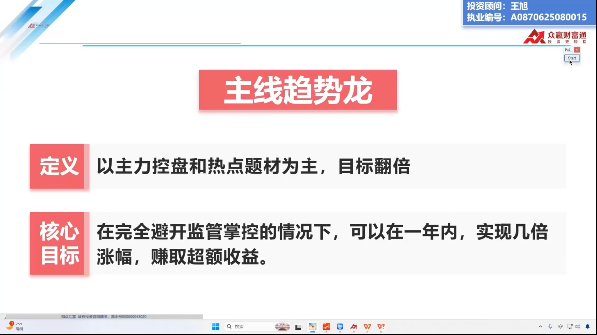

> **与 Day01 / Day02 的关系**：Day01 解决"**在哪只票上等**"（主力吸筹 → 低吸）；Day02 解决"**在哪个瞬间扣扳机**"（二板确认 → 打板）；Day03 换赛道——**不追连板妖股，改做中军趋势龙**，用几个月吃一波主升。Day01/02 吃情绪短差，Day03 吃市值+形态+题材+倍量柱的翻倍波段。

---

# 使用说明：这份总结怎么读

| 你要什么 | 看哪里 |
| --- | --- |
| **马上照着做** | 第一部分「四步操作总表」+ 第二部分「每步怎么做」各步骤末尾的「操作动作」 |
| **为什么要这么做** | 各步骤下的「理论与金融含义」 |
| **对着屏幕核对** | 各步骤下的截图（图下标了图上原文，没时间看图也能对照） |
| **买入前打勾** | 第七部分「操作检查清单」 |
| **完整走一遍** | 第六部分「若羽臣全流程复盘」 |

---

# 一、四步操作总表

课堂 28 图把整套打法收成三步，第四步是卖出：

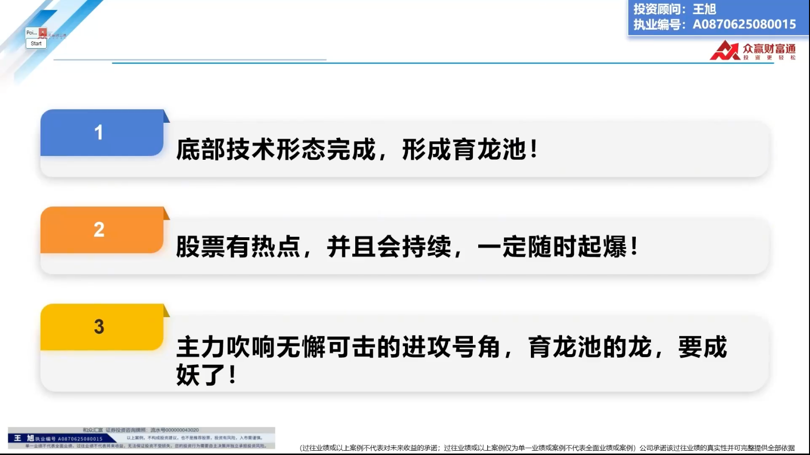

**图上原文（28.png）**：
> 1. 底部技术形态完成，形成**育龙池**
> 2. 股票有热点且持续，**随时起爆**
> 3. 主力吹响进攻号角，育龙池的龙要**成妖**

| 步骤 | 你做什么 | 通过标准 | 不通过怎么办 |
| --- | --- | --- | --- |
| **① 建池** | 筛出 200 亿+ 流值、已有育龙池的票，放进自选 | 市值≥200亿 + 一形两力成立 | 放弃，不进自选 |
| **② 等风** | 盯板块涨停家数，确认题材在主升 | 主升题材（涨停数>15 且持续增加） | 题材降温 → 不做 |
| **③ 扣扳机** | 突破平台时核对三铁律，通过才买 | 放量 + 20/40/60 多头 + MACD 零轴上 | 任一不满足 → 只看不买 |
| **④ 卖出** | 数倍量柱算保底目标，到位分批走 | 第三根倍量柱价 ×2 | 有效跌破 → 本轮统计清零重来 |

**一句话心法**：**先找池子够深的龙（形态+市值），再等风够大的题材（热点+涨停家数），最后等主力吹号（三铁律），用倍量柱算保底目标，不赚最后一分钱。**

---

# 二、Step ① 建池：找「育龙池」里的趋势龙候选

## 2.1 先筛市值——只做 200 亿以上的

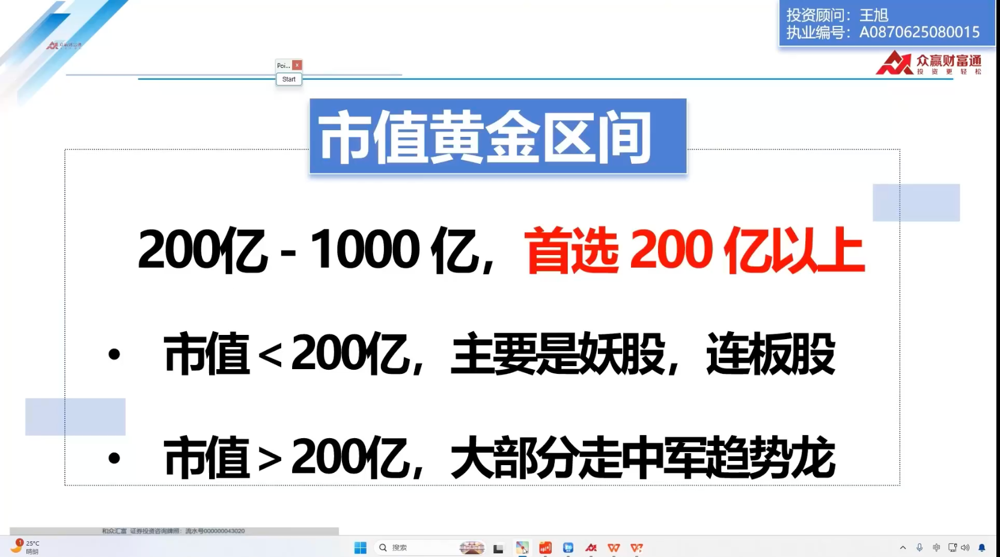

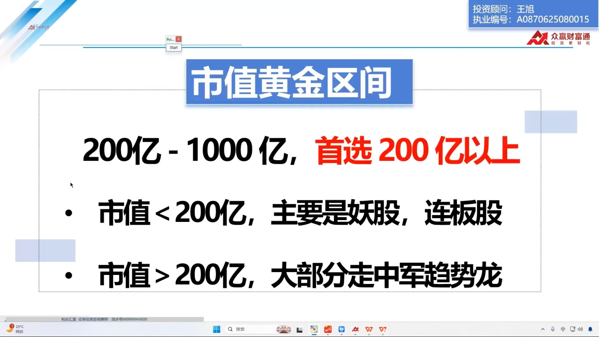

**图上原文（06/07.png）**：
> 市值黄金区间 **200 亿 – 1000 亿**，**首选 200 亿以上**。
> 看的是**流动市值（流值）**，不是总市值。

### 操作动作

1. 在行情软件把**流动市值**调出来（不是总市值）；
2. 流值 **< 200 亿** → 直接划掉（妖股/连板区，"没主"）；
3. 流值 **200 亿–1000 亿** → **主战场，优先**；
4. 流值 **> 1000 亿** → 可做，但拉升更慢，适合长线底仓。

| 流动市值 | 典型走势 | 谁在做 | 你做不做 |
| --- | --- | --- | --- |
| < 200 亿 | 妖股、连板股 | 游资/短庄，换手博弈 | **不做**（那是 Day02 打板的活） |
| **200–1000 亿** | **中军趋势龙** | **有格局的大主力** | **主战场** |
| > 1000 亿 | 大盘中军 | 市值管理团队 | 可做，慢 |

### 对照案例（确认你筛对了）

**德明利（001309）**：流值 710.29 亿、总市值 976.33 亿——稳稳在黄金区间。

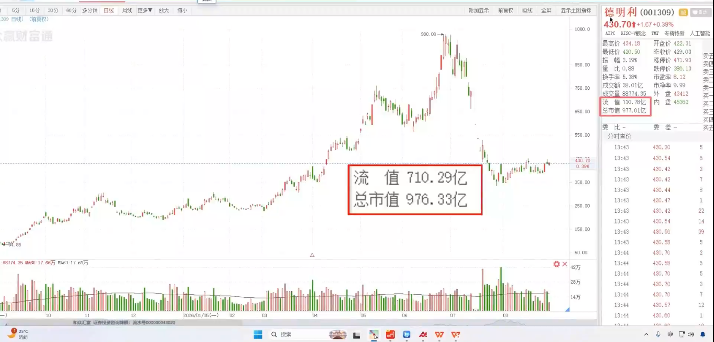

走势 54.85 → 980，**看着像妖股，其实是趋势龙**：

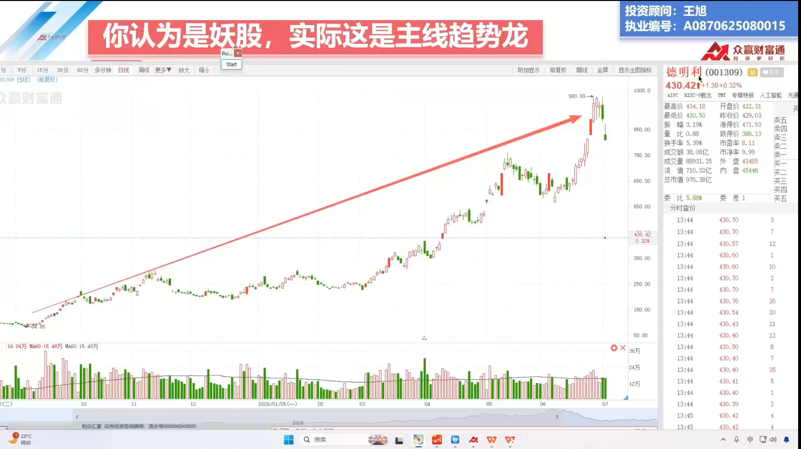

**利通电子（603629）**：流值约 430 亿 → 500 亿，股价 15.88 → 171.79。

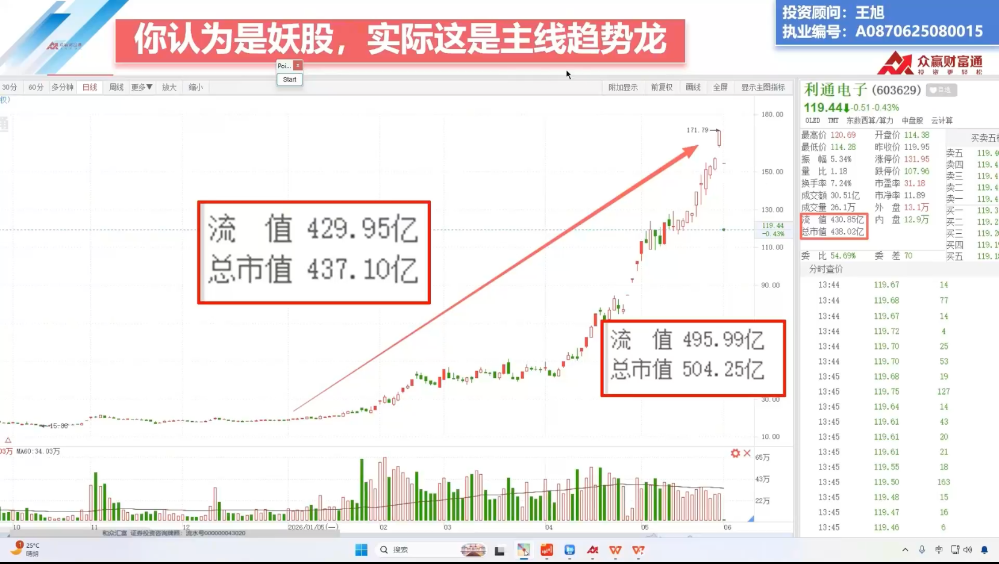

### 理论与金融含义

- **为什么看流值不看总市值？** 流值才是实际可以交易的筹码规模。总市值大但流值小的票，筹码被锁死，容易被少量资金控盘走妖，也更容易被监管盯上。
- **为什么 200 亿是个坎？** 200 亿以下，容纳不了大资金进出，多是游资一日游；200 亿以上才能装下"有格局的主力"，他们要做的是几个月的项目，不是一夜情。
- **市值大了还有主力吗？** 有。千亿/万亿票靠**市值管理团队**：先调研（看有没有人、有没有水电、有没有车有货进出）→ 现场开会（限制哪些人不能减持）→ **编故事减持出货**。所以大票也有主，只是退出方式更"花样"。

> 操作口诀：**流值 200 亿起步，200–1000 亿优先；不够 200 亿，再好看也不进池。**

---

## 2.2 再找育龙池——必须有超半年的箱体

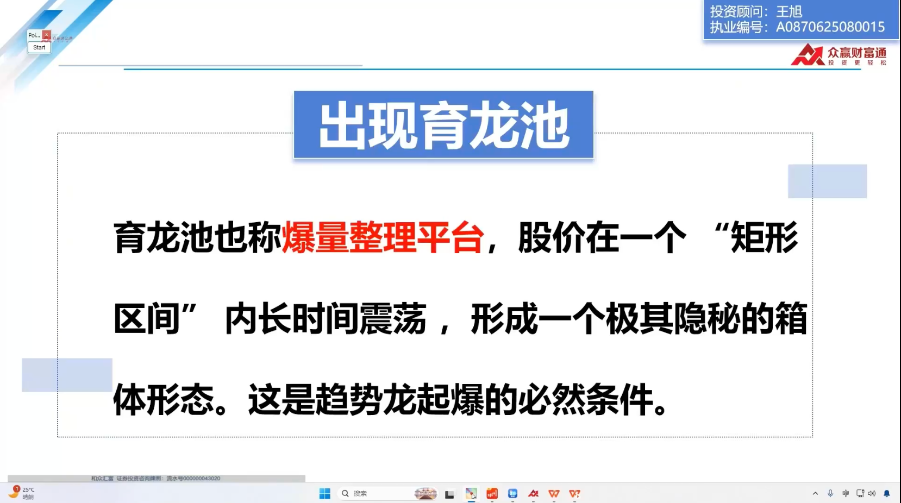

**图上原文（11.png）**：
> 出现**育龙池**：也称**爆量整理平台**、**箱体震荡平台**。
> 股价在**矩形区间长时间震荡**，极其隐秘的箱体。
> **趋势龙起爆的必然条件。**

### 操作动作（画育龙池）

1. 打开日 K，找**近一年以上**的走势；
2. 画一个**矩形**，把大部分 K 线框进去；
3. 标出**平台上沿**（多次冲不破的高点连线）和**平台下沿**（多次跌不破的低点连线）；
4. 数一数上沿、下沿各自被碰到几次。

### 硬标准：一形两力

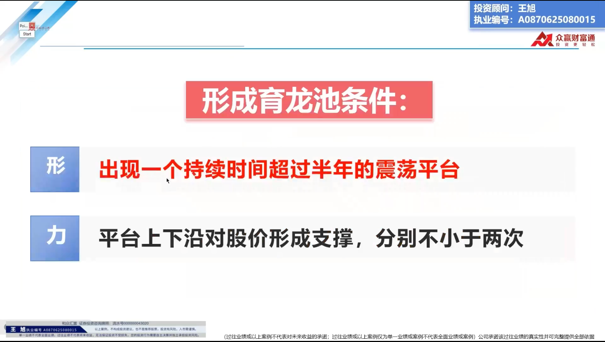

**图上原文（12.png）**：
> 形成育龙池条件 **一形两力**
> **形**：持续**超过半年**的震荡平台
> **力**：平台上下沿对股价的支撑分别**不小于两次**

| 要素 | 你数什么 | 不合格 |
| --- | --- | --- |
| **形** | 箱体持续 **≥ 6 个月** | 不够半年 → 不是育龙池，放弃 |
| **力** | 上沿支撑 **≥ 2 次**，下沿支撑 **≥ 2 次**（共至少 4 次） | 少于 2 次 → 箱体未经确认，放弃 |

### 对照案例（照着画）

**太极实业（600667）**——上下沿支撑均不小于两次：

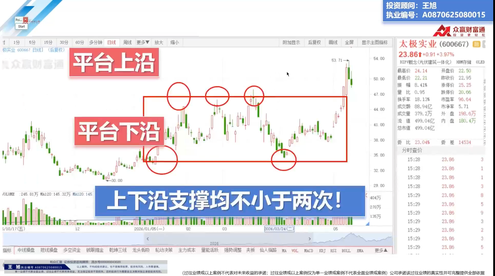

**热景生物（688068）**：

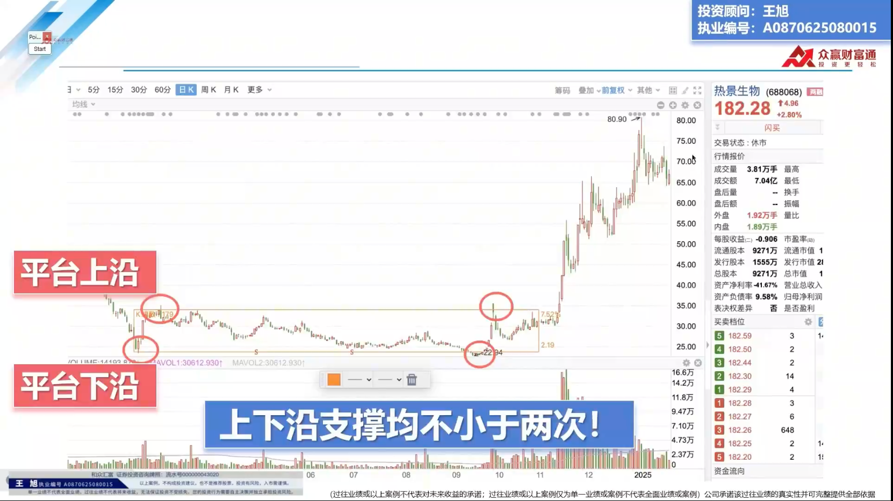

**工业富联（601138）**：

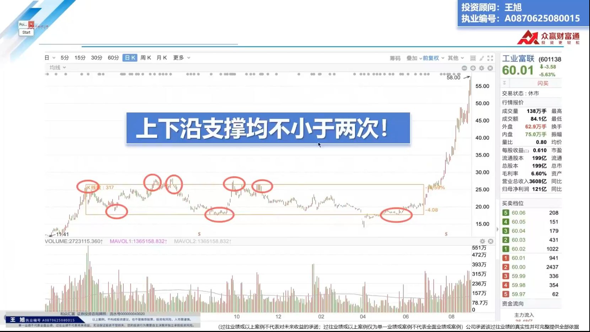

**新锐股份（688257）**：

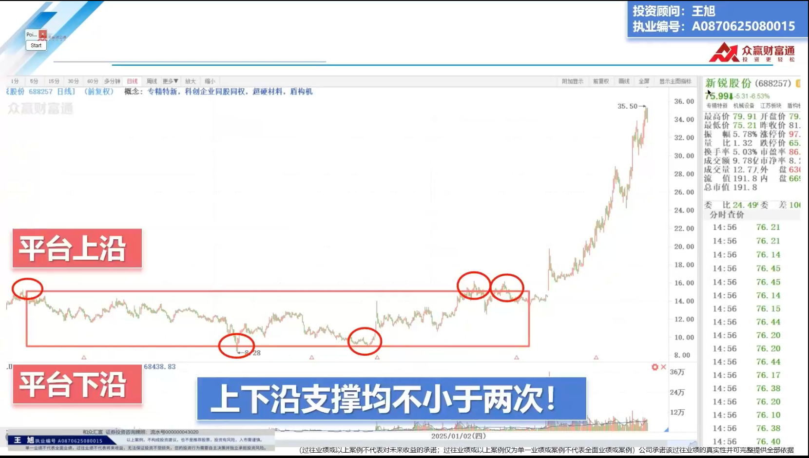

### 主力格局：平台越长，涨幅越大

课堂给出的对照（**看平台时长选票**）：

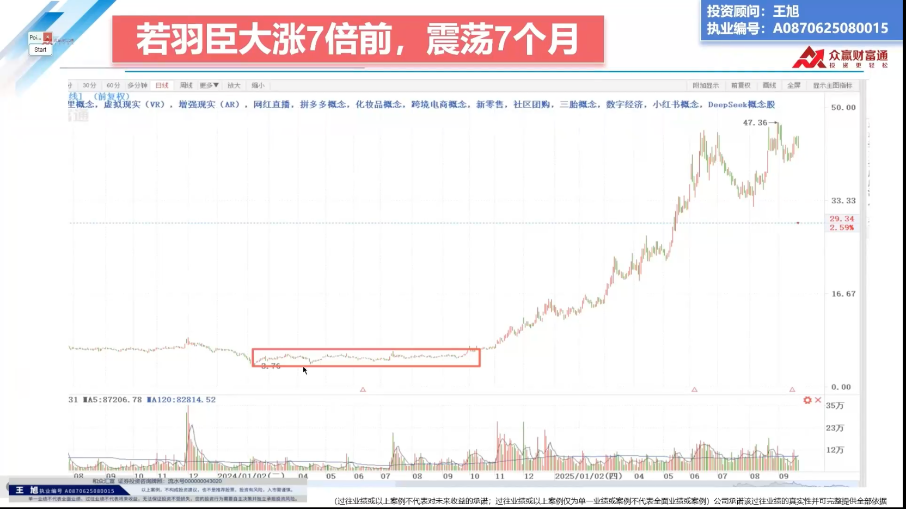

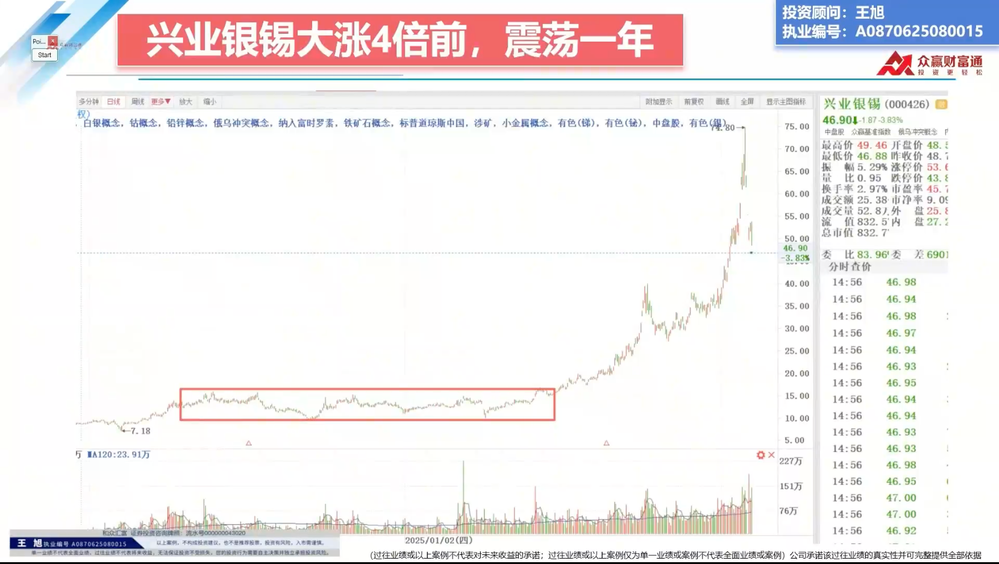

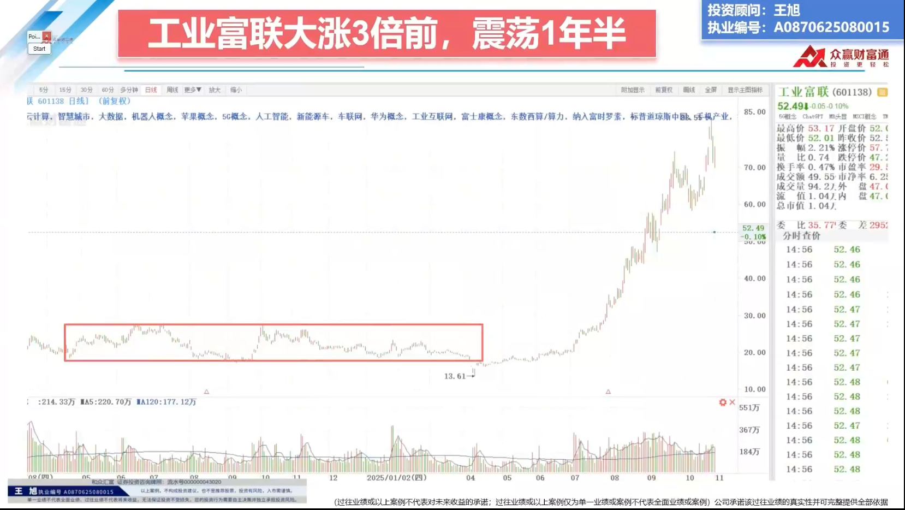

| 个股 | 起涨前平台 | 后续涨幅 | 操作启示 |
| --- | --- | --- | --- |
| 若羽臣 | 震荡 **7 个月** | **约 7 倍** | 平台越长目标越大 |
| 兴业银锡 | 震荡 **1 年** | **约 4 倍** | 一年平台对应几倍 |
| 工业富联 | 震荡 **1 年半** | **约 3 倍** | 超大盘涨幅相对小 |

### 理论与金融含义

- **育龙池 = 筹码搬家工程。** 主力在箱体里反复高抛低吸、洗浮筹、抬高市场平均成本。上下沿各两次以上的触碰，说明这个箱体是"被市场反复确认过的共识区间"，不是偶然波动。
- **为什么必须是"超半年"？** 半年级别才装得下建仓+洗盘+筹码归集。几周的横盘只能算震荡，不足以让主力完成项目准备。
- **为什么突破育龙池就能涨？** 箱体是供需平衡区；突破意味着主力完成控盘、开始进攻，空头筹码已被一次吃掉。**没有育龙池的拉升是无根之木。**

> 操作口诀：**半年箱体是形，上下沿各两次是力；一形两力不成立，再好的题材也不碰。**

---

# 三、Step ② 等风：确认题材在主升

选好池子后，**先不买**。等板块热度起来。

## 3.1 怎么找领涨板块：按涨停家数排序

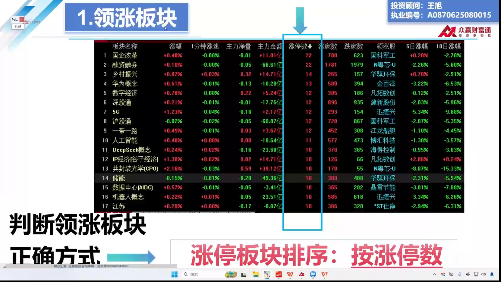

**图上原文（20.png）**：
> **1. 领涨板块 判断正确方式**
> 涨停板块排序，**按涨停数**

### 操作动作

1. 打开板块涨幅/涨停排行；
2. **按"涨停家数"从多到少排序**（不是按涨幅！）；
3. 看排最前面的几个板块是真题材还是噪音。

## 3.2 先做减法：这些"板块"直接划掉

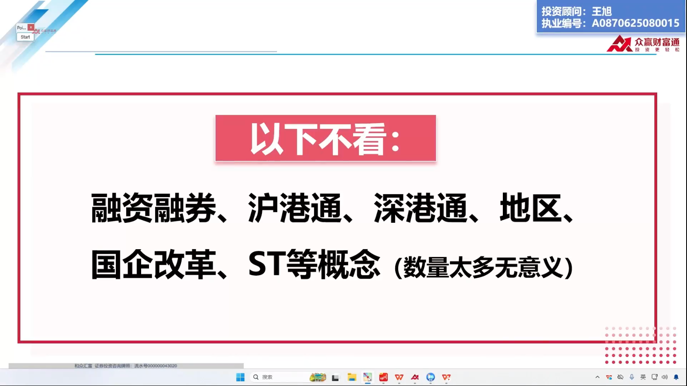

**图上原文（21.png）**：
> **以下不看**：融资融券、沪港通、深港通、地区、国企改革、ST 等概念
> 数量太多无意义

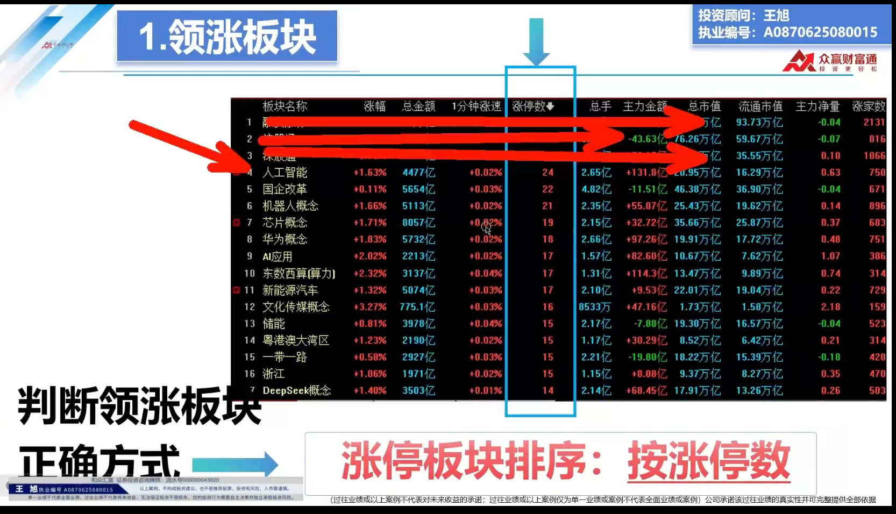

**操作动作**：在排序表里把下面这些**先划掉**——

- 资金属性：融资融券
- 交易通道：沪港通、深港通
- 地域：XX 地区
- 所有制：国企改革
- 风险警示：ST

留下来的才是真题材：**人工智能、机器人、芯片、商业航天**……

### 理论

这些标签是**资金/通道/地域/所有制/风险**分类，不是产业题材。它们的涨停家数天然多（覆盖几乎全市场），排在前面纯属噪音。**先减法后排序**，否则你会被"融资融券第一"误导。

## 3.3 阈值：涨停家数 > 15

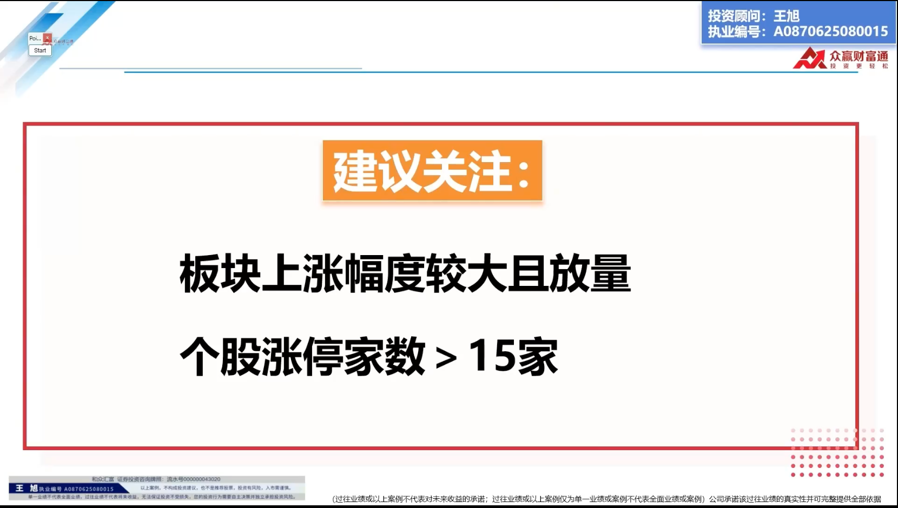

**图上原文（23.png）**：
> **建议关注**：
> 1. 板块上涨幅度较大且**放量**
> 2. 个股**涨停家数 > 15 家**

### 操作动作

看中的板块必须同时满足：

1. 板块**涨得多 + 放量**；
2. 板块内**涨停家数 > 15**（不是涨停 15 家，是**超过 15 家**）。

不满足 → 还不是主升题材，继续等。

## 3.4 判断是不是主升浪：涨停家数要持续增加

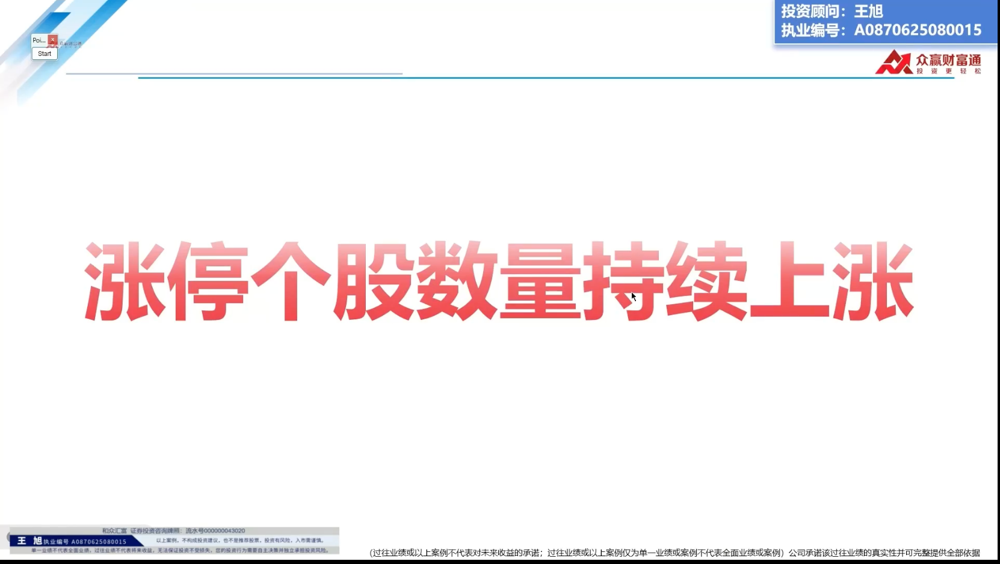

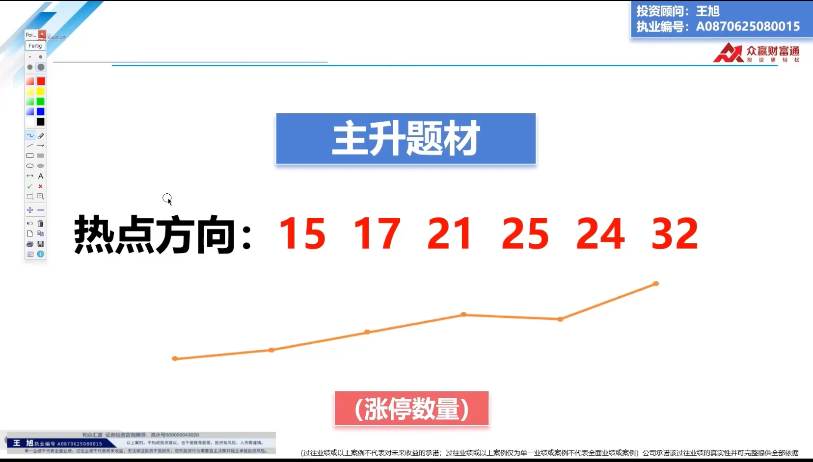

**图上原文（25.png）**：热点方向涨停家数 **15 → 17 → 21 → 25 → 24 → 32**（持续抬升）

**课堂口述**：主升题材**每年才会出现 3–5 个**，只要出现就是**大主线**，**不会只涨 3–5 天就结束**。

**案例：商业航天（886078）**——板块指数整整涨了约 **2 个月**，**贴着 5 日、10 日均线涨，没有跌破过**。

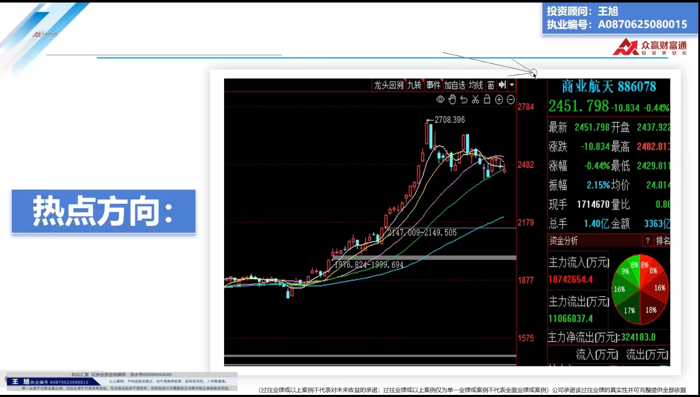

## 3.5 题材降温：立刻停手

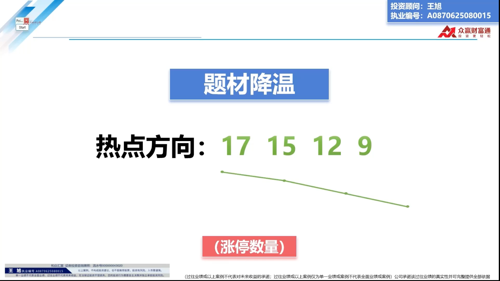

**图上原文（27.png）**：涨停家数 **17 → 15 → 12 → 9**（持续下降）= 题材降温

### 操作动作

- 涨停家数**折线上行**（15→17→21→…）→ 可以做，随时准备起爆；
- 涨停家数**折线下行**（17→15→12→9）→ **立刻不做**，池子里的票也先别碰。

### 理论与金融含义

- **为什么看涨停家数不看板块指数？** 指数可以被权重股带着假涨；涨停家数必须是真金白银打上去的，是"板块情绪的脉搏"。
- **持续增加 = 主升**（资金持续进场）；**持续减少 = 退潮**（资金撤离）。
- **Step② 的等待意义**：趋势龙要求"随时起爆"——池子建好了、题材还在升温，你就处在"进可攻退可守"的位置。题材一旦确认主升，你的候选票起涨只是时间问题。

> 操作口诀：**先划掉融资融券沪港通，再按涨停家数排序；>15 且折线上行才能等起爆，折线下行一律不做。**

---

# 四、Step ③ 扣扳机：突破买入三铁律

**前提**：票已在育龙池 + 题材已主升。现在等**突破平台**的那一刻。

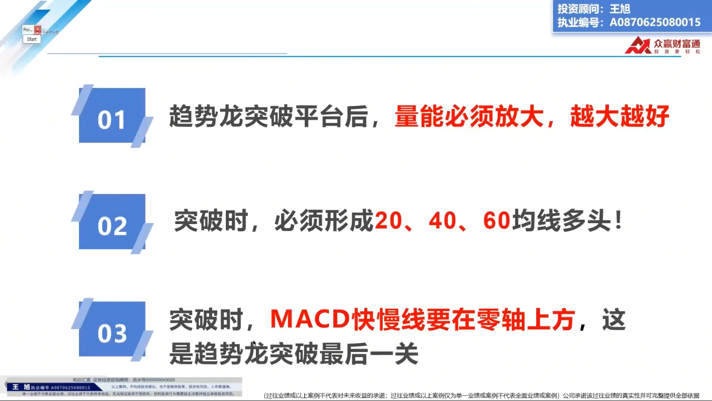

**图上原文（29.png）三条铁律**：
> **01** 突破平台后**量能必须放大，越大越好**
> **02** 突破时必须形成 **20/40/60 均线多头**
> **03** 突破时 **MACD 快慢线在零轴上方**（趋势龙突破最后一关）

**三条是"与"不是"或"**——必须同时满足，缺一条就降级观察，不降级买入。

## 4.1 铁律一：突破必须放量

### 操作动作

1. 看突破当日（或突破前后几日）的成交量柱；
2. 必须**明显高于平台期平均水平**，越大越好；
3. 缩量上涨 = 假突破，不买。

### 对照案例

**菲林格尔**：平台运作几个月后突破——"**此平台运作时间几个月突破怎能不放量？**"

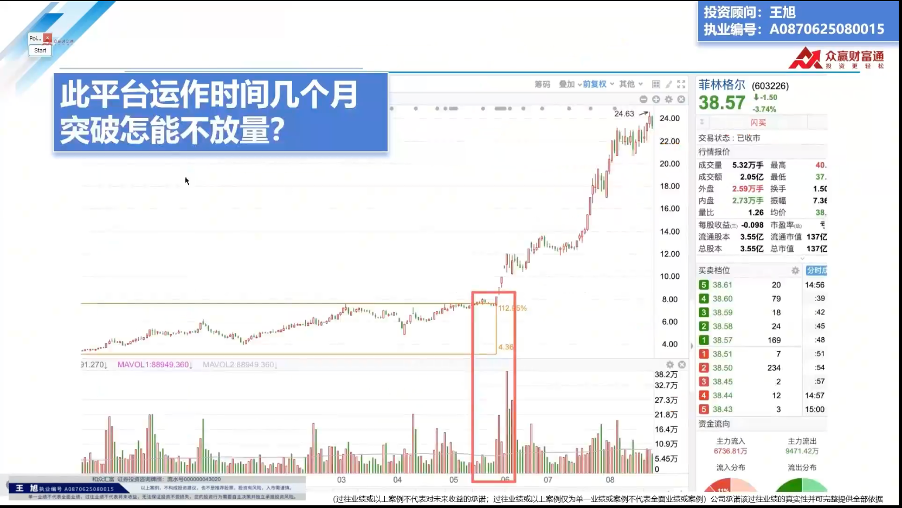

**华建集团**：

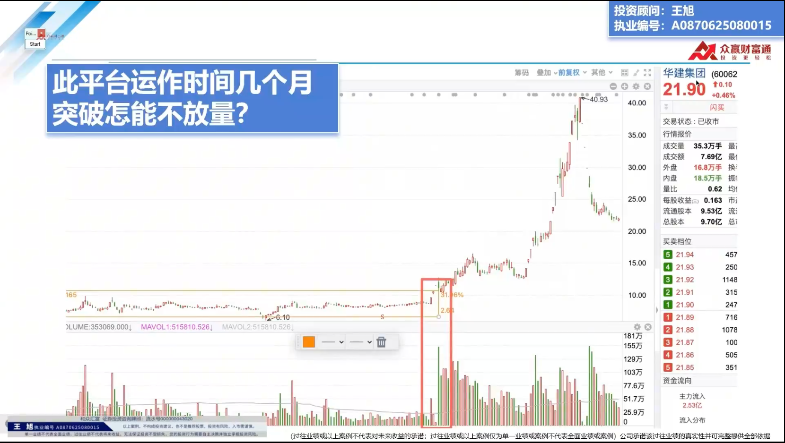

**兴业银锡**：课件原话"**这一定是铁律！**"

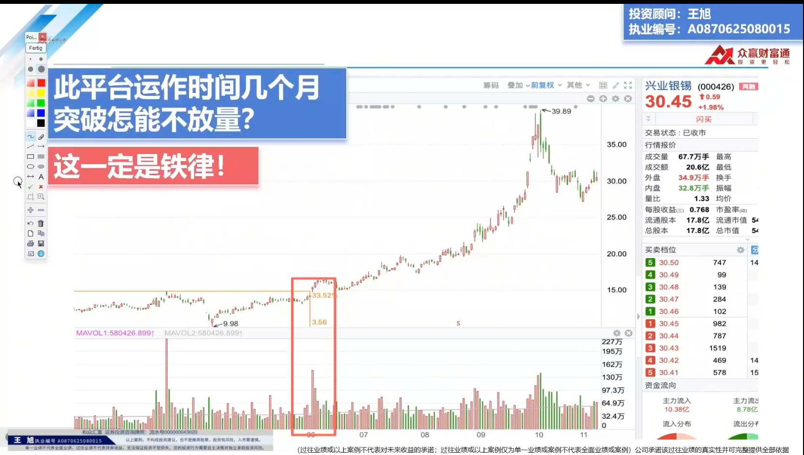

### 理论

平台期缩量是"没人理"；突破期放量是"主力亮明态度"。长期横盘后突然放出倍量/天量，意味着空头筹码被一次吃掉——**没有量的突破是假突破，有量的突破才是发令枪。**

## 4.2 铁律二：20/40/60 均线多头

### 操作动作

1. 在日 K 上调出 **20 日、40 日、60 日**均线（不要用 5/10 日）；
2. 突破时检查三线是否：
   - **向上发散**
   - **互不交叉**
   - **20 在上、40 中、60 在下**（按序排列）

### 为什么是 20/40/60？

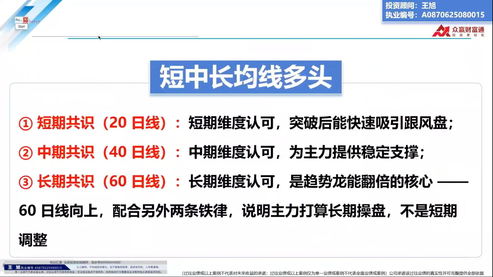

**图上原文（33.png）**：

| 均线 | 含义 | 作用 |
| --- | --- | --- |
| **20 日** | **短期共识** | 吸引跟风 |
| **40 日** | **中期共识** | 稳定支撑 |
| **60 日** | **长期共识** | **翻倍核心**——主力长期操盘，非短期调整 |

**5 日 / 10 日**留给连板用（连板股不能跌破 10 日均线），趋势龙不看。

### 对照案例

**横河精密（300539）**：均线向上发散、不交叉、20/40/60 按序排列。

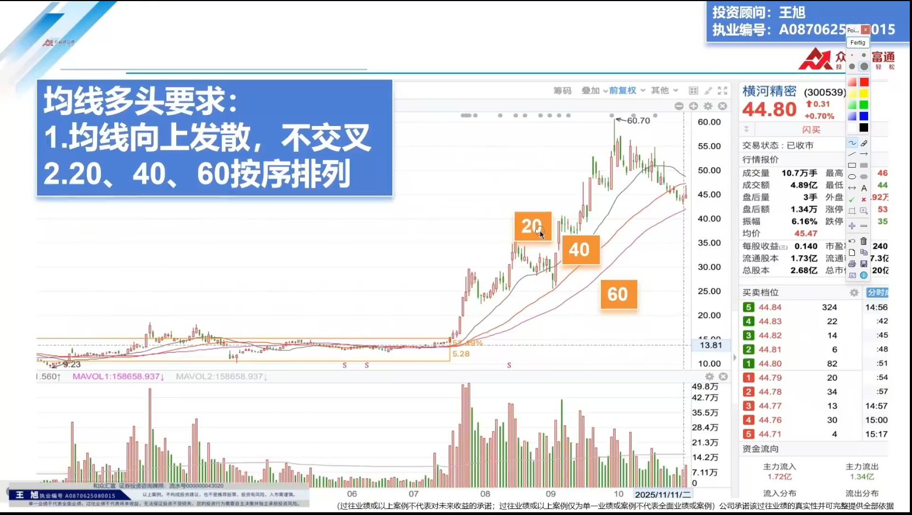

**新锐股份**："之前杂乱无章，**开始起爆的那一刻，均线改为多头**。"

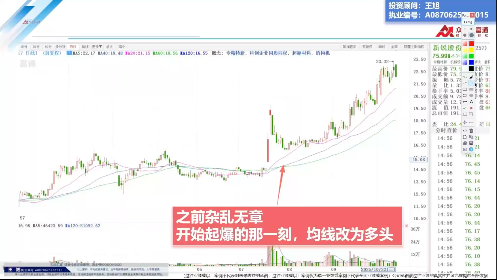

**南网能源（003035）**：

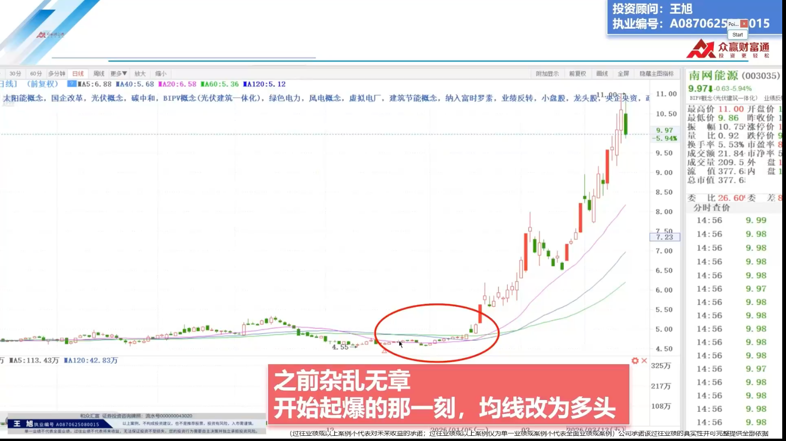

### 理论

均线 = 全体持仓者的平均成本线。20/40/60 多头 = 短期买入者赚钱、中期赚钱、长期也赚钱——**全场无套牢盘，向上只有奖励、没有阻力**。60 日托底说明主力至少做了三个月以上布局，这正是"翻倍核心"的技术表达。

## 4.3 铁律三：MACD 快慢线在零轴上方

### 操作动作

1. 打开 MACD（12, 26, 9）；
2. 突破平台时，**DIF、DEA 必须在零轴上方**；
3. 加分项：突破零轴后**回踩零轴不跌破**（压力变支撑）。

### 怎么用 MACD

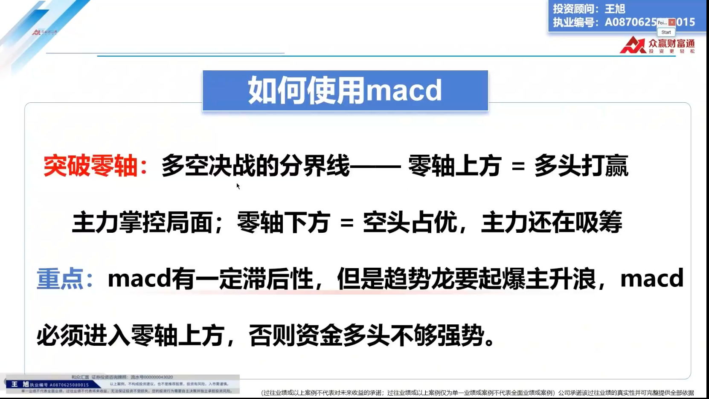

**图上原文（38.png）**：
> **突破零轴 = 多空决战分界**
> **零轴上方 = 多头打赢 / 主力掌控**
> **零轴下方 = 空头占优 / 主力还在吸筹**
> MACD 有**滞后性**，但趋势龙**主升浪必须进入零轴上方**

### 对照案例

**工业富联**：突破时 MACD 在零轴上方。

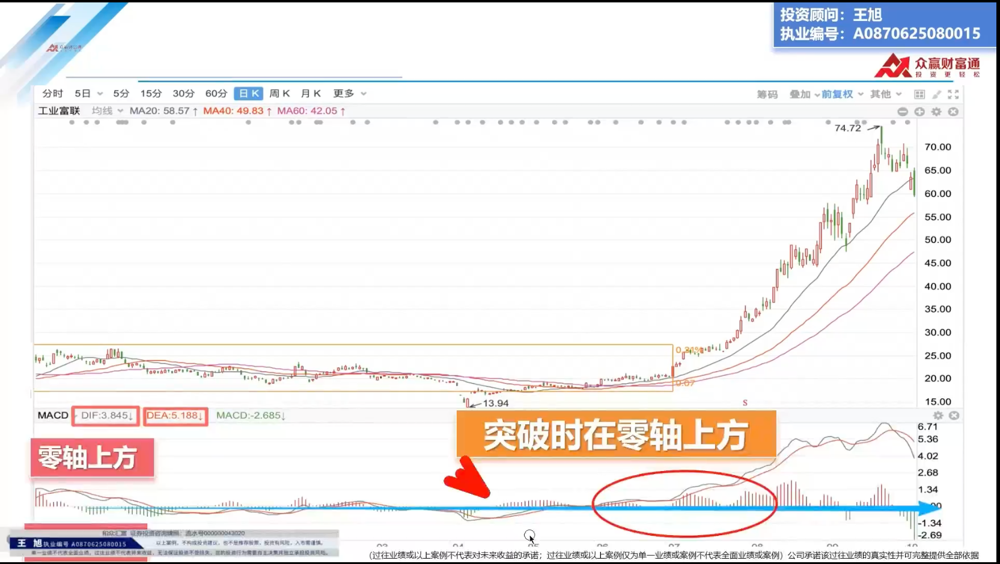

**汇金股份**：突破时在零轴上方。

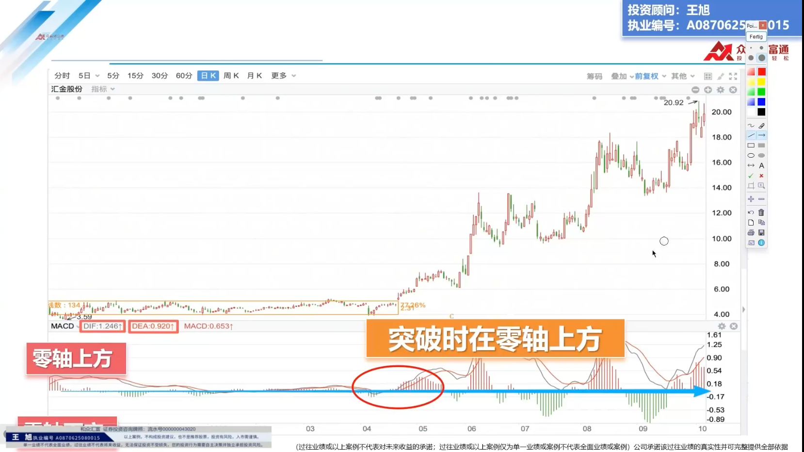

**浙江荣泰**：突破时零轴上方。

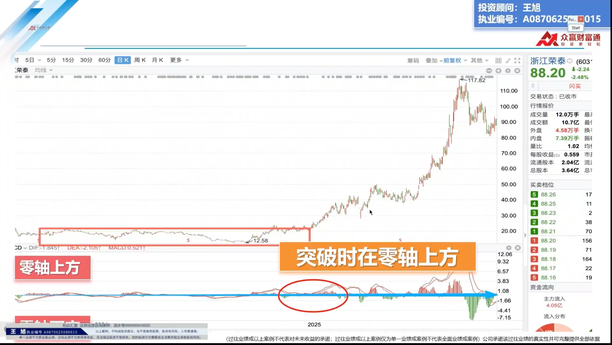

> **课堂口述补充（与 39 图配合记）**：MACD **几次回踩零轴线都没有跌破**——零轴由压力变成支撑，是趋势龙突破的加分确认。截图本身展示的是"突破时位于零轴上方"，口述补充的是"回踩不破"，两者是同一逻辑的两个阶段。

### 理论

MACD 是趋势指标、有滞后性——对趋势龙反而合适，因为我们抓的是几个月的主升，不是一两天的拐点。零轴是多空分水岭：快慢线爬上零轴 = 中期动能翻多；配合放量突破，就是**形态+量能+动能**三重共振，即"趋势龙突破的最后一关"。

## 4.4 买入操作汇总

| 检查项 | 软件上怎么看 | 通过 |
| --- | --- | --- |
| 放量 | 成交量柱 vs 平台期均量 | 明显放大，越大越好 |
| 均线多头 | 日 K 20/40/60 | 向上发散、不交叉、20>40>60 |
| MACD | DIF/DEA | 均在零轴上方 |

**三条全过 → 买入。任一不过 → 只看不买。**

> 操作口诀：**突破不放量，假突破；均线乱如麻，没共识；MACD 零轴下，主力还在吸筹。三关都过，才是进攻号角。**

---

# 五、Step ④ 卖出：腾云之法算保底目标

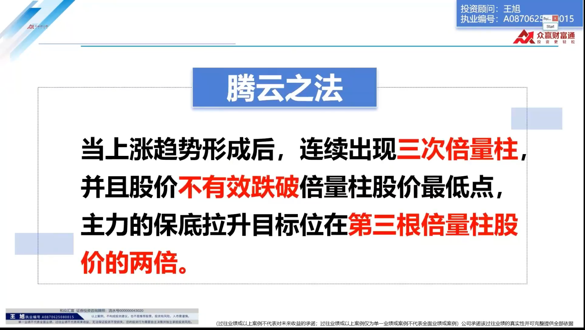

**图上原文（41.png）**：
> 上涨趋势形成后，连续出现**三次倍量柱**，且股价不**有效跌破**倍量柱股价最低点
> → 主力**保底拉升目标位 = 第三根倍量柱股价的两倍**

## 5.1 两个必懂术语

| 术语 | 定义 | 你盯什么 |
| --- | --- | --- |
| **倍量柱** | **今天成交量 ≥ 昨天的 2 倍**，一定是**连续两个交易日** | 看成交量柱，跟昨天比 |
| **有效跌破** | **跌破前高位（倍量柱最低点）且没有收回来** | 看 K 线是否收在最低点之下且不收复 |

## 5.2 操作算法（照着数）

```
1) 突破育龙池后，上涨趋势形成 → 开始数倍量柱
2) 每出现一根倍量柱：
     · 记下该倍量柱当日（或对应）股价最低点
     · 后续若 有效跌破 该最低点 → 本轮统计作废，从零重新数
     · 若 未跌破 → 继续数下一根
3) 连续数满 3 根倍量柱，且都没被有效跌破：
     ★ 保底目标位 = 第三根倍量柱股价 × 2
4) 持有纪律：
     · 不到保底目标 → 不卖（别被洗下车）
     · 到了目标附近 → 分批止盈，不要赚最后一分钱
     · 目标之后的拉高段 = 主力出货段，不再追、不再接
5) 若第三根之后仍未跌破，可把新一段再算一次（×2 递推）
```

## 5.3 案例一：若羽臣——两段目标接力

**第一段**：倍量柱 1、2、3 均未跌破；倍量柱 4 有效跌破 → **本轮统计结束**。

第三根约 **8.5 元** → **第一目标 = 8.5 × 2 = 17 元**（17 之前不考虑出货）。

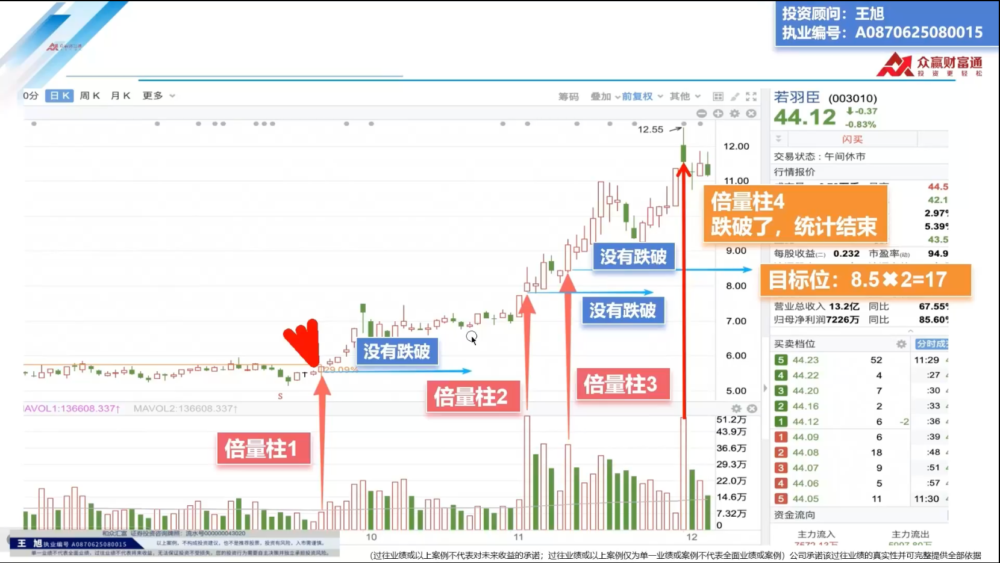

**第二段**：跌破后重新统计，再次出现连续三次倍量柱且未跌破。

第三根约 **17 元** → **第二目标 = 17 × 2 = 34 元**。后续确实涨到 34。

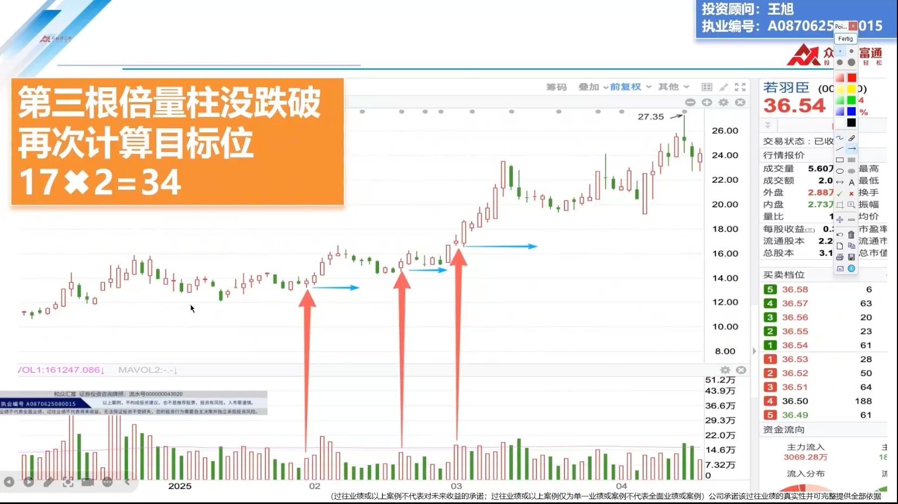

**课上强调**：
- **34 块钱绝对不能提前卖**（保底目标，不到不走）；
- 但到了 34 附近，**不要赚最后一分钱**——后续虽超过 34，主力在慢慢拉高出货，**不要再接**。

## 5.4 案例二：兴业银锡——39.78 就是答案

突破箱体后三次倍量柱，第三根**最低价 20 元** → **目标 = 20 × 2 = 40 元**。

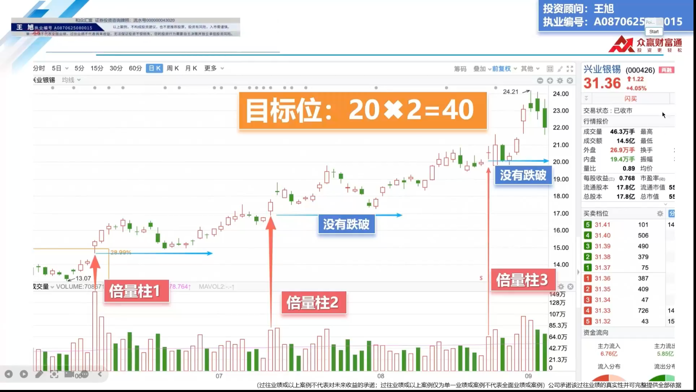

结果：**主力首次出货位 39.78——就差几毛钱！**

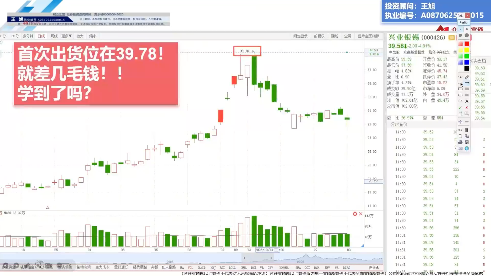

**图上原文（45.png）**："首次出货位在 **39.78**！就差几毛钱！！学到了吗？"

## 5.5 案例三：中孚实业——九块钱以内完全送你

三次倍量柱，第三根约 **4.5 元** → **目标 = 4.5 × 2 = 9 元**。

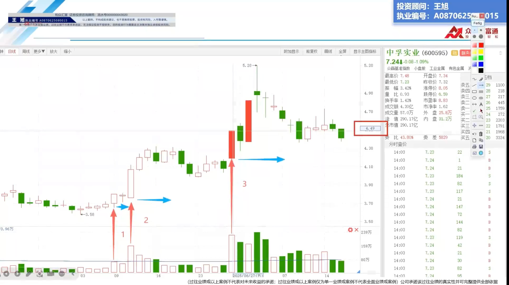

后续涨到 9 元上方（图中标线 9.00，最高 10.83）。

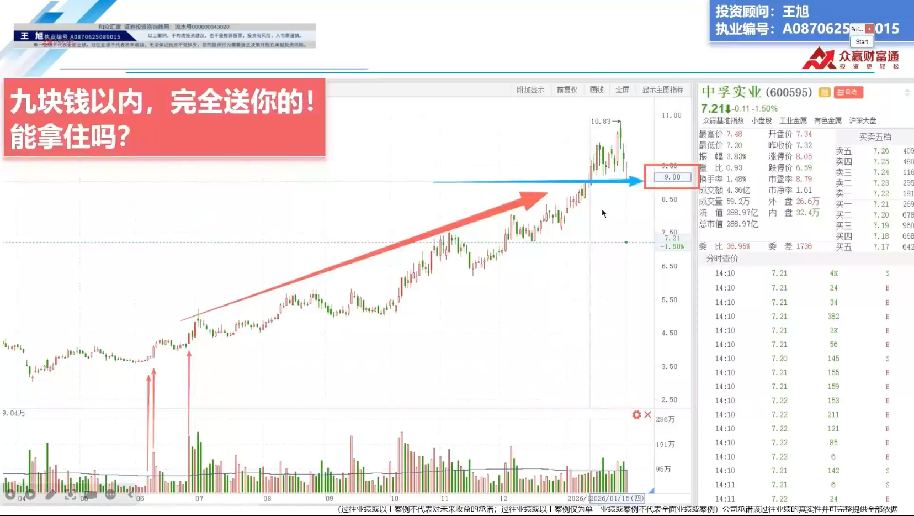

**图上原文（47.png）**："**九块钱以内，完全送你的！能拿住吗？**"

## 5.6 理论与金融含义

- **倍量柱 = 主力加仓的指纹。** 连续三次放量却不破自己的最低价，说明每次加仓后都拒绝让价格跌回成本区——**锁仓+护盘**的双重证据。
- **为什么 ×2？** 经验上的"保底翻倍目标"，对应主力拉升段的启动成本到出货区的距离。用**第三根**而不是第一根，因为第三根是**最后一次确认性加仓**。
- **为什么是"保底"不是"预测"？** 20→39.78、4.5→9、8.5→17、17→34 都很精准，但它给的是下限参考，不是天花板。
- **为什么要"不要赚最后一分钱"？** 到目标后往往还有冲高，那是**拉高出货**。你多赚的每一分钱，都在跟主力抢出货窗口。
- **有效跌破为什么要清零？** 一轮统计描述的是一次连续的加仓-护盘过程。过程被打断，说明主力节奏变了，旧目标位作废。

> 操作口诀：**连三倍量不破，第三根价乘二；不到不卖，到了不贪，破了清零重来。**

---

# 六、若羽臣全流程复盘（把四步串起来）

用课堂第一案例把整条链走一遍：

| 阶段 | 若羽臣实际发生了什么 | 对应步骤 |
| --- | --- | --- |
| 选票 | 流值落在黄金区间；上涨前**震荡 7 个月**形成育龙池（一形两力） | Step ① 建池 |
| 等风 | 踩中持续主升题材（不是 3–5 天的杂毛热点） | Step ② 等风 |
| 买入 | 突破平台时放量 + 均线改多头 + MACD 零轴上方 | Step ③ 三铁律 |
| 第一段持有 | 连续三次倍量柱不跌破 → 8.5×2 = **17**，不到不出货 | Step ④ |
| 第一段结束 | 倍量柱 4 有效跌破，统计清零 | 重新数 |
| 第二段 | 再次连续三次倍量柱 → 17×2 = **34** | 再算一次 |
| 卖出 | 34 前坚决持有；到 34 附近分批走，不赚最后一分钱 | 纪律 |

**结果**：区间 2024-10-08 ~ 2025-10-16，6.39 → 48.56，**+647.90%（约 7 倍）**，主力机构净买 23.06 亿。

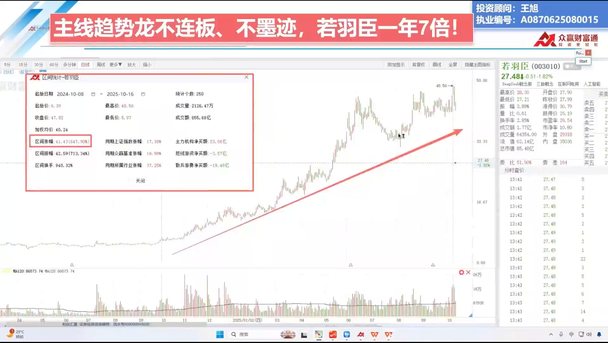

**图上原文（02.png）**："主线趋势龙**不连板、不墨迹**，若羽臣一年 7 倍！"

另外两个同款：

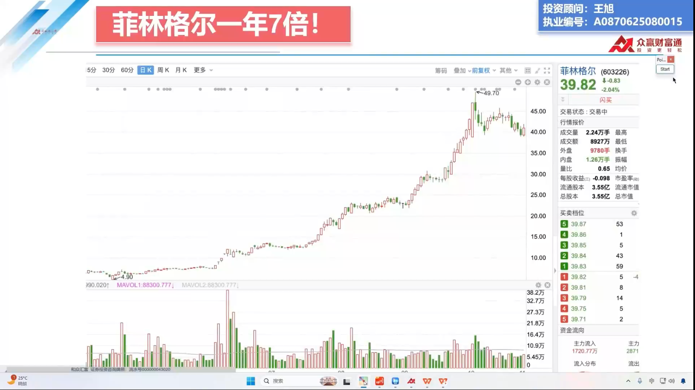

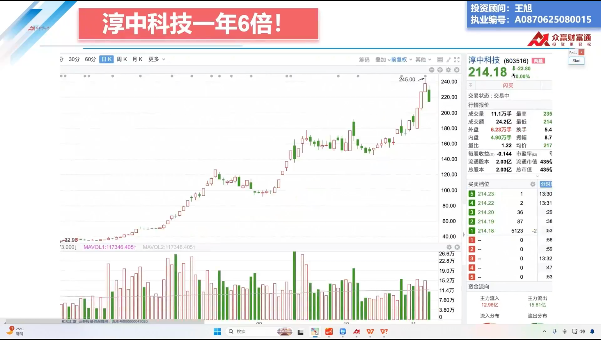

---

# 七、操作检查清单（买入前逐项打勾）

| # | 步骤 | 检查项 | 标准 | 不过则 |
| --- | --- | --- | --- | --- |
| 1 | ① 建池 | 流动市值 | ≥ 200 亿（200–1000 亿优先） | 划掉 |
| 2 | ① 建池 | 育龙池形 | 箱体持续 ≥ 6 个月 | 划掉 |
| 3 | ① 建池 | 育龙池力 | 上沿 ≥2 次、下沿 ≥2 次 | 划掉 |
| 4 | ② 等风 | 板块类型 | 已剔除融资融券/沪港通/ST 等噪音 | 重排 |
| 5 | ② 等风 | 题材热度 | 涨停家数 >15 且板块放量上涨 | 继续等 |
| 6 | ② 等风 | 主升确认 | 涨停家数折线**持续上行** | 降温则不做 |
| 7 | ③ 买入 | 铁律一 | 突破**放量**（越大越好） | 不买 |
| 8 | ③ 买入 | 铁律二 | **20/40/60 多头**（发散、不交叉、按序） | 不买 |
| 9 | ③ 买入 | 铁律三 | **MACD 零轴上方**（回踩不破加分） | 不买 |
| 10 | ④ 卖出 | 目标位 | 已数出连续三次倍量柱，算出 ×2 | 等待 |
| 11 | ④ 卖出 | 卖出纪律 | 不到不卖；到了不贪；破了清零 | 执行 |

---

# 八、理论对照表（为什么要这么做）

| 操作 | 背后的理论 |
| --- | --- |
| 只做 200 亿+ 流值 | 装得下有格局的大主力；<200 亿是游资连板区，"没主" |
| 只做超半年育龙池 | 半年才装得下建仓+洗盘+筹码归集；箱体是被确认的共识区间 |
| 一形两力 | 形=时间换空间；力=上下沿被反复测试，突破才有意义 |
| 按涨停家数找题材 | 指数会假涨，涨停家数是真金白银的情绪脉搏 |
| 涨停数>15 且持续增加 | 主升题材每年仅 3–5 个，是大主线，不只涨几天 |
| 降温立刻不做 | 退潮期同形态批量失效，先保命再谈收益 |
| 突破必须放量 | 无量假突破；放量=空头筹码被一次吃掉 |
| 20/40/60 多头 | 短中长期共识向上，全场无套牢盘；60 日是翻倍核心 |
| MACD 零轴上方 | 多空决战分界；主升浪必须由多头掌控 |
| 倍量柱 ×2 | 主力加仓指纹；第三根=最后确认性加仓成本 |
| 不赚最后一分钱 | 目标后是拉高出货段，与主力抢出货窗口必输 |

---

# 九、为什么会出现趋势龙？（监管背景）

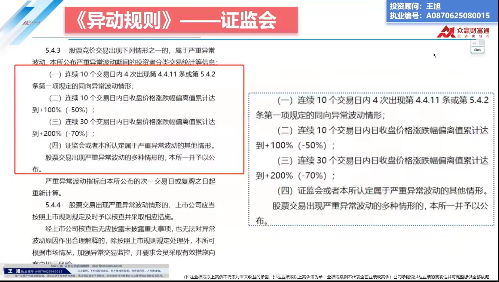

课堂引用证监会/交易所《异动规则》**严重异常波动**认定：

| 情形 | 标准 |
| --- | --- |
| 连续 10 个交易日内 | **4 次同向**异常波动 |
| 连续 10 个交易日 | 涨跌幅偏离值累计 **+100%**（或 **-50%**） |
| 连续 30 个交易日 | 涨跌幅偏离值累计 **+200%**（或 **-70%**） |

**理论推论**：

- 涨停连板容易撞上"10 日 4 次同向 / 10 日 +100%"，一被认定就特停、核查、监管函；
- 趋势龙把同样的涨幅**摊到几个月甚至一年**，用"涨不停、少涨停"走出 3–7 倍；
- 结果：**更大涨幅、更高确定性、更小风险**——这就是趋势龙诞生的制度原因。

> **连板赚监管红线上的刀尖钱，趋势龙赚远离红线的复利钱。**

---

# 十、金融视角的客观提示

1. **趋势龙不等于低风险。** 降低的是"特停+连板断板"这类短周期风险，仍承担基本面、流动性、主力资金链风险。"目标翻倍"是策略目标，不是承诺。
2. **方法本质是三重过滤**：市值+育龙池（滤掉无主小票/短庄）→ 涨停家数（滤掉退潮题材）→ 三铁律（滤掉假突破）。三者都对，仍可能遇到"形态完美但主力弃庄"。
3. **案例有幸存者偏差。** 若羽臣、兴业银锡、中孚实业是成功样本；课堂没有系统展示"符合全部标准却腰斩"的样本。过往案例不代表未来。
4. **倍量柱 ×2 是经验规则，不是数学定理。** 用它做分批止盈参考线，不要做满仓赌一把的预言。
5. **市值管理团队的"编故事出货"是双刃剑。** 跟庄的下半场（出货段）最危险——"不要赚最后一分钱"说的就是这一段。
6. **本课偏中线波段，与 Day01/02 短线打法不可混用仓位。** 趋势龙拿几个月，用打板的止损节奏很容易在洗盘中被洗下车。

> 风险提示：本文为课程学习笔记，仅作知识整理，不构成任何投资建议。趋势跟踪/跟庄策略风险较高，不适合所有投资者。投资有风险，入市需谨慎。

---

# 十一、全课记忆点

1. **主线趋势龙：主力控盘 + 热点题材，目标翻倍，避开监管，一年几倍！**
2. 连板撞红线（10 日 +100% / 30 日 +200%），**趋势摊开做，涨幅更大、确定性更高、风险更小！**
3. **流值 200–1000 亿，首选 200 亿以上！** 不够 200 亿，再好看也不进池。
4. **育龙池是起爆的必然条件！** 一形两力：形超半年，上下沿支撑各两次。
5. **先划掉融资融券/沪港通/ST，再按涨停家数排序！**
6. **涨停 >15 且折线上行 = 主升题材**（每年 3–5 个）；折线下行 = 降温，不做！
7. **三铁律同时满足才买：放量突破 + 20/40/60 多头 + MACD 零轴上方！**
8. **腾云之法：连三倍量不有效跌破 → 第三根价 ×2 是保底目标！**
9. **不到目标不卖，到了目标不贪——不要赚最后一分钱！**（39.78 就是给 40 的答案）
10. **有效跌破 → 本轮统计清零，重新数。**

---

# 十二、笔记核查与勘误

对照 47 张截图，对 [课程记录.md](课程记录.md) 的修正与补充：

**笔误**：
1. "玉龙池" → **育龙池**
2. "避开监掌控" → "避开**监管**掌控"
3. 07 图笔记写"看流动市值"——06/07 都是「市值黄金区间」整页，"看流动市值"是图中子句
4. 28 图不只是"运作步骤"，是**三步总结原文**（见本文开篇）
5. 39 图截图是"汇金股份突破时零轴上方"；"MACD 几次回踩零轴没有跌破"是**口述补充**，建议分两行记
6. 笔记末尾空标题「趋势龙第一目标位」= 腾云之法案例（若羽臣/兴业银锡/中孚实业），已在第五部分补全

**建议补进笔记的口述要点**：
- 监管三条线都记全（10 日 4 次 / 10 日 +100% / 30 日 +200%）
- 一形两力的"力"要上沿、下沿**分别**数两次
- 涨停排序**先减法**（划掉噪音概念）再排序
- 倍量柱必须看**连续两个交易日**；有效跌破后**清零重来**
- 三铁律是**与**不是**或**

---

# 十三、本课资料索引

| 资料 | 性质 | 与本总结的关系 |
| --- | --- | --- |
| 直播截图 01–47 | 课堂实录 | 全部已嵌入正文，并摘录图上原文 |
| [课程记录.md](课程记录.md) | 课堂笔记 | 第十二节已核查勘误 |
| 第三课预习资料.pdf | 课前预习 | 与直播截图重复，不重复总结 |
| **第3课 出勤奖励-个股天穹之眼.pdf** | 课后延伸《个股天穹之眼》 | 见下方框架摘要 |

**关于《个股天穹之眼》**：课后延伸材料，副标题"中国股市：终于有人把个股异动讲明白了"，是一套**个股异常变动的五维监控**，与本课互补——**买入用三铁律，持有用五维监控**：

| 维度 | 监控要点（示例阈值） |
| --- | --- |
| 价格波动 | 单日成交量超 5 日均值 150%（或低于 50%）预警；振幅超布林带 30%；MACD/RSI 顶底背离；股东户数离散度周增 15% 预警派发 |
| 基本面 | 经营现金流环比降 50% 且与净利润背离；负债率破行业均值+2σ；核心高管离职后 60 日波动率升 40%；问询函后 3 日平均跌约 7.2% |
| 资金 | 主力吸附指数（大单净流入/成交额×√换手率>0.75 强势）；北向单日净买入占流值 0.5% 跟踪；融资余额增速/股价涨幅>3:1 过热 |
| 舆情 | 负面舆情占比突增 20% 且持续 3 日；搜索热度周环比 +500%；股东户数增幅/股价涨幅>1.5 |
| 监管 | 连续 3 日涨跌幅偏离值超 20% 进重点监控；业绩预告修正>30% 专项核查；反垄断/环保处罚后首日平均超额收益约 -4.8% |

**实战口诀**：机会 = 量价齐升 + 北向流入 + 舆情正向；风险 = 财务异常 + 融资过热 + 监管问询。

**不并入正文的原因**：本课主线是"选票—等风—买入—止盈"闭环；天穹之眼是**持仓监控**工具。建议单独做精读笔记。

---

*资料来源：day03/直播截图 01–47、课程记录.md、第三课预习资料.pdf、《第3课 出勤奖励-个股天穹之眼.pdf》；整理日期：2026-10-14*
