# Day04 课程总结：《追最热的资金，打最容易的板》——暴力连板妖股的全程作战图

| 项目 | 内容 |
| --- | --- |
| 课程 | 第四课《追最热的资金，打最容易的板》（众赢财富通·五行擒龙系列续课） |
| 讲师 | 王旭（为为老师），执业编号 A0870625080015 |
| 课题 | 暴力连板妖股：如何用「龙潭 + 锁峰 + 缺口三空破阵」快速进场、潇洒离场 |
| 今日战法 | **快速进场潇洒离场** |

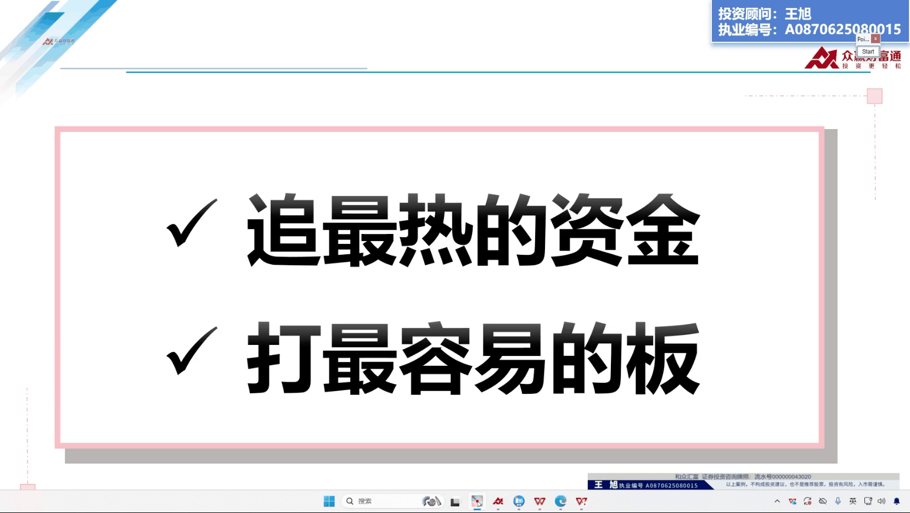


> **与 Day01–Day03 的关系**：
> - Day01 低吸解决"**在哪只票的底部埋伏**"；Day02 打板解决"**哪一个二板值得打**"（单日动作）；Day03 趋势龙解决"**几个月的翻倍波段怎么做**"。
> - Day04 换回**短线连板赛道**，但比 Day02 更完整——它给出的是**一只妖股从建仓到出货的全程日线语言**：市值定赛道 → 龙潭锁峰验成色 → 三个缺口定买点、加仓点、卖点。
> - 与 Day03 恰好以 **200 亿流动市值** 为分界：**200 亿以上走趋势（Day03 的活），200 亿以内才走得动连板（本课的活）**。

---

# 使用说明：这份总结怎么读

| 你要什么 | 看哪里 |
| --- | --- |
| **马上照着做** | 第一部分「三步操作总表」+ 各步骤末尾的「操作动作」 |
| **为什么要这么做** | 各步骤下的「理论与金融含义」 |
| **对着屏幕核对** | 各步骤下的截图（图下标了图上原文） |
| **买入前打勾** | 第七部分「操作检查清单」 |
| **看全所有案例** | 第六部分「案例总表」（市值/龙潭/锁峰/三类缺口逐张归档） |
| **完整走一遍** | 第五部分「一只完整的龙头股全景图」 |

---

# 一、三步操作总表

| 步骤 | 你做什么 | 通过标准 | 不通过怎么办 |
| --- | --- | --- | --- |
| **① 看市值** | 先确认票的流动市值 | **200 亿以内**（约 50–150 亿最佳） | >200 亿 → 那是趋势龙，不做连板 |
| **② 验形态** | 找龙潭、数锁峰 | 箱体震荡 **≥3 个月** + 上下沿支撑点有**放量峰** | 无箱体/无量峰 → 放弃 |
| **③ 看缺口** | 用「缺口三空破阵」定进出 | 筹码起爆缺口**入场**、情绪加速缺口**加仓**、能量枯竭缺口**离场** | 对不上号 → 不动 |

**一句话心法**：**先确认这是连板选手（市值≤200亿），再确认主力已经做完功课（龙潭三个月+锁峰量堆），最后跟着缺口走——起爆缺口进、加速缺口加、枯竭缺口出。**

---

# 二、Step ① 暴力连板看市值：200 亿是天花板

妖股起飞第一关不是形态，是**盘子大小**。主力做连板追求"最少的资金、最大的收益"，市值就是资金效率的天花板。

## 2.1 合格线：200 亿以内

**课堂口径**：市值要求 **200 亿以内**；200 亿是主力"**拉得动、控得住**"的黄金线。

为什么？

- 主力想做连板，要用**最少的资金获取最大的收益**，不需要对抗太大的抛压；
- **热点仍在**，主力很容易利用市场合力拉出连板；
- **热点结束**，主力也能很快离场——不像趋势龙盘子大，主力需要很长时间才能出货，只能边拉边出。

### 对照案例（连板龙头的市值 ✅）

**合富中国（603122）**：流值 **49.24 亿**、总市值 49.24 亿——典型连板龙头盘子。

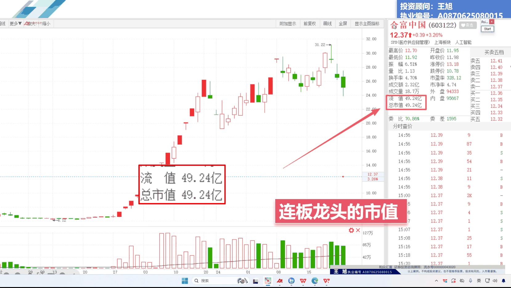

**平潭发展（000592）**：流值 **133.48 亿**、总市值 134.65亿。

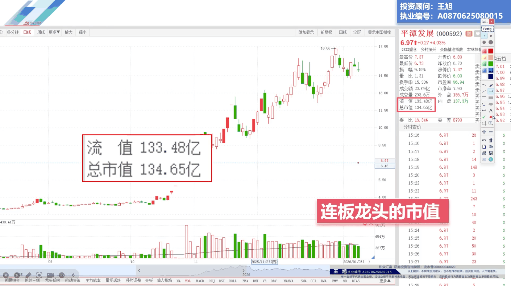

### 反面案例：市值太大走趋势 ❌

**长飞光纤（601869）**：流值 **1625.5 亿**、总市值 3311.9 亿——图上标注"**市值太大会走趋势**"，一路贴均线爬升，走不出连板。

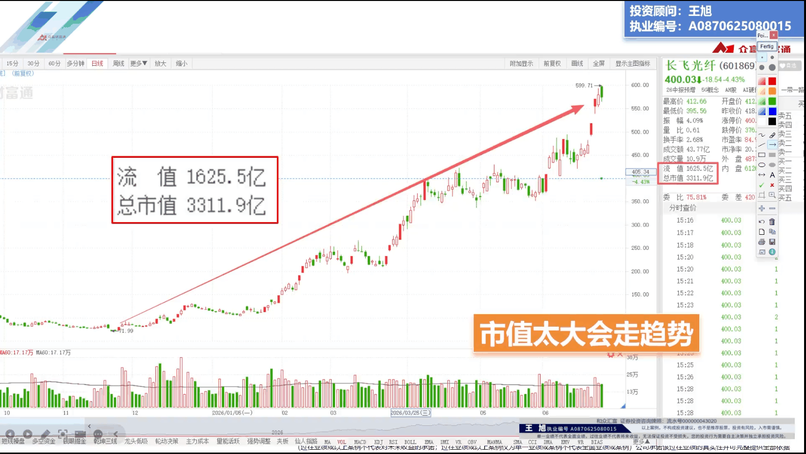

**大金重工（002487）**：流值 **215.77 亿**、总市值 253.11 亿——刚过 200 亿线，同样"**市值太大会走趋势**"。

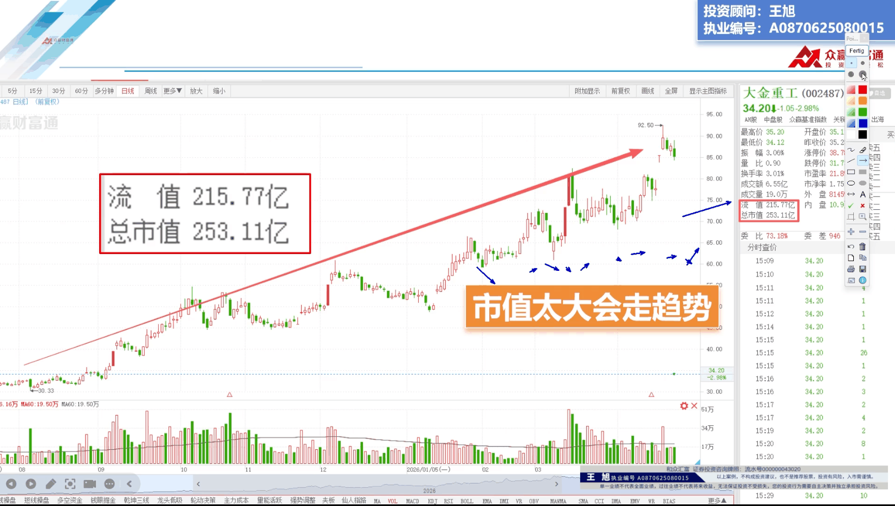

| 流动市值 | 走势性质 | 谁在做 | 对应战法 |
| --- | --- | --- | --- |
| **≤ 200 亿** | **暴力连板妖股** | 短庄/游资，快速项目制 | **本课（Day04）** |
| > 200 亿 | 趋势龙（涨不停、少涨停） | 有格局的大主力/市值管理 | Day03 趋势龙 |

### 理论与金融含义

- **200 亿在这门课里出现了两次，方向正好相反**：Day03 说"200 亿以下没主、不做"，本课说"200 亿以上拉不动、不做"。两者拼起来才是完整地图——**200 亿以下玩情绪连板，200 亿以上玩趋势波段**。
- 连板是**资金效率生意**：主力用几个亿就能撬动 50 亿流通盘的封单与接力；换成 200 亿+ 的票，同样的钱连一个板都封不稳。
- 小票的另一面是**出货也快**：热点退潮时大票边拉边出磨一个月，小票主力说走就走。所以本课的战法才叫"快速进场潇洒离场"。

> 操作口诀：**连板只看 200 亿以内；市值太大走趋势，那是另一套打法。**

---

# 三、Step ② 选股：明显的主力控盘行为 = 龙潭 + 锁峰

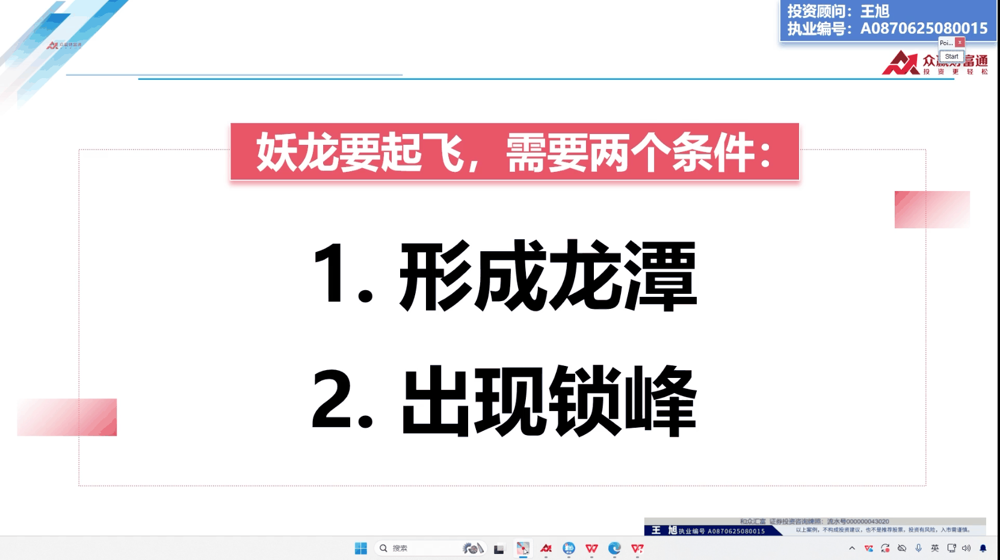

**图上原文（07.png）**：
> 妖龙要起飞，需要两个条件：
> **1. 形成龙潭　2. 出现锁峰**

## 3.1 龙潭——箱体藏妖

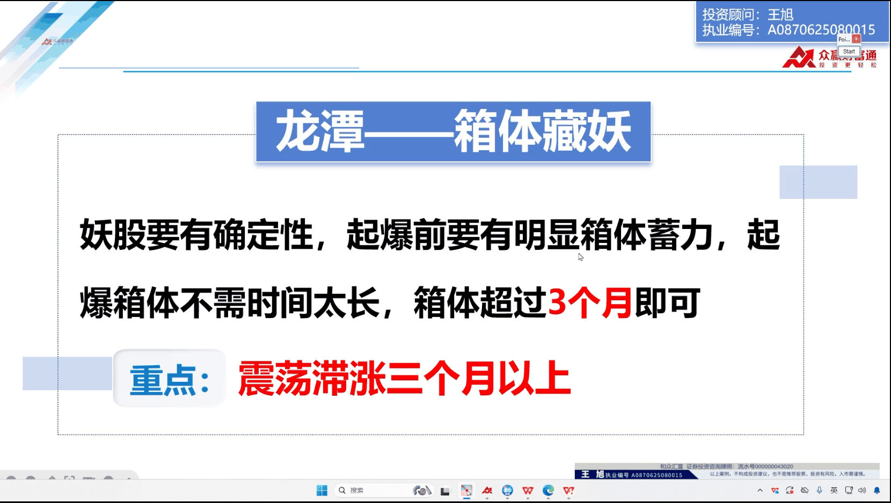

**图上原文（08.png）**：
> 妖股要有确定性，起爆前要有明显**箱体蓄力**，起爆箱体不需时间太长，**箱体超过 3 个月即可**
> **重点：震荡滞涨三个月以上**

### 操作动作（画龙潭）

1. 打开日 K（至少回看近一年）；
2. 画矩形框住震荡区，标出**上沿**（多次冲不破的高点）和**下沿**（多次跌不破的低点）；
3. 数箱体持续时间：**≥ 3 个月**才算龙潭；
4. 确认是"**震荡滞涨**"——大盘涨它不涨，主力在压着收集。

### 对照案例

**华电能源（600726）**——课堂互动题："有没有明显的震荡平台？"（红框内约 2.4–2.8 元长期横盘，随后一口气 4.27）

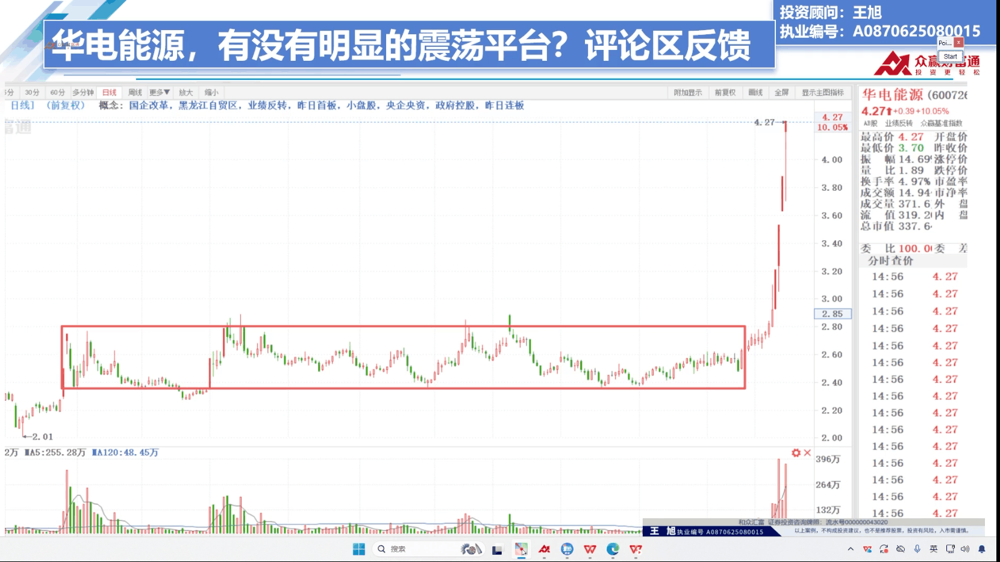

**大有能源（600403）**——"震荡滞涨三个月以上，才起爆"（流值 194.85 亿，正好卡在 200 亿线下）

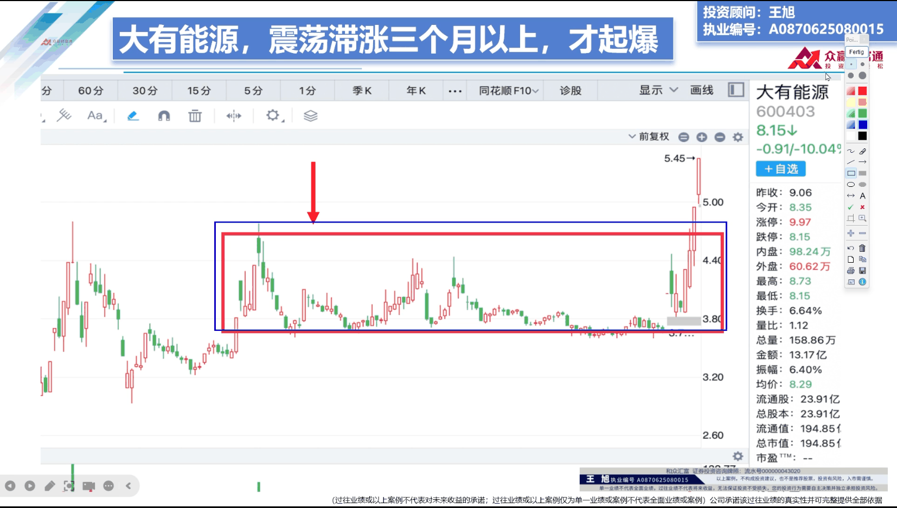

**淳中科技（603516）**——同款口诀。箱体约 35–40 元横了三个月+，图中一排蓝色箭头数着上沿被反复触及，随后涨到 226.93。

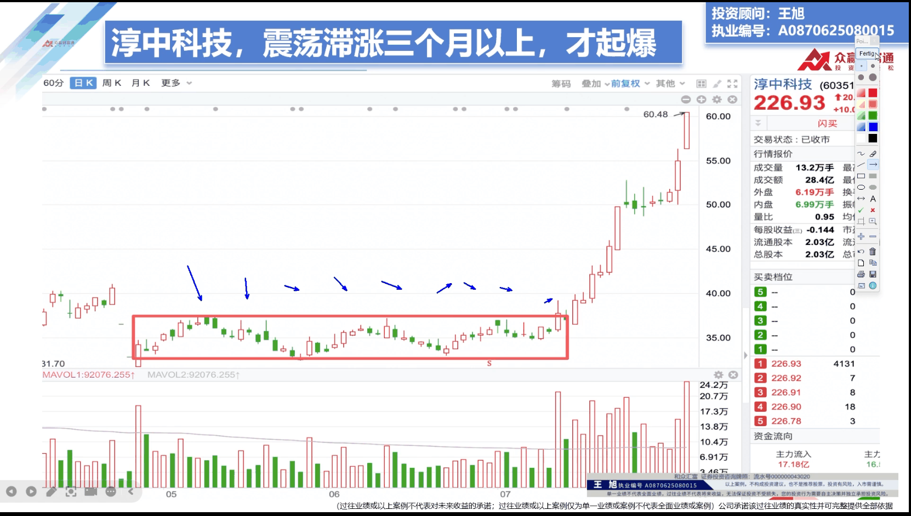

**豫能控股（001896）**——互动题（箱体约 5.25–6.75，五个箭头标出上沿触及次数）

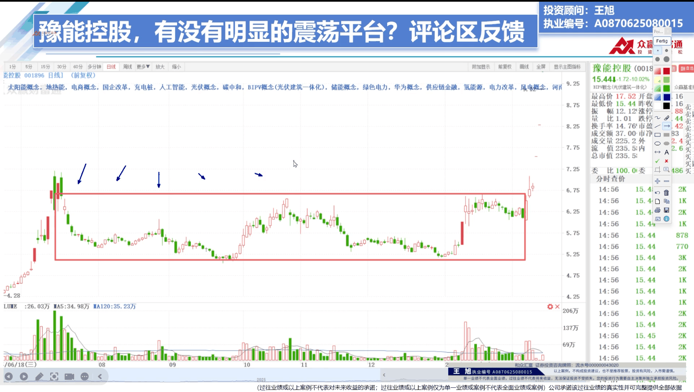

### 龙潭 vs 育龙池（Day03）：为什么一个 3 个月、一个 6 个月？

| | 育龙池（Day03 趋势龙） | 龙潭（Day04 连板妖股） |
| --- | --- | --- |
| 时长要求 | **超过半年**（6 个月+） | **超过 3 个月** |
| 量能要求 | 箱体内**不要求放量**（时间换筹码） | **必须出现放量锁峰**（3 个月装不下"悄悄吸"，必须有明牌抢筹痕迹） |
| 目标周期 | 几个月翻倍波段 | 几天到几周的连板 |
| 主力类型 | 有格局的大主力 | 短庄/游资，快进快出 |

**为什么龙潭只要 3 个月？** 妖股主力的项目周期短——3 个月足够完成"压价收集 → 洗浮筹"；拖到半年反而说明主力控盘不果断。**但也因为时间短，收集必须更暴力**，所以龙潭之内必须有锁峰（放量证据），而育龙池可以安静地磨。

> 操作口诀：**龙潭=箱体藏妖，震荡滞涨三个月以上；时间不够或一路阴跌不涨的，都不是潭。**

## 3.2 锁峰——潭底有峰


**图上原文（13.png）**：
> 什么叫出现**锁峰**？
> 1. 箱体**上下沿支撑点**所对应的量能，**必须是放量堆，像小山峰一样**！

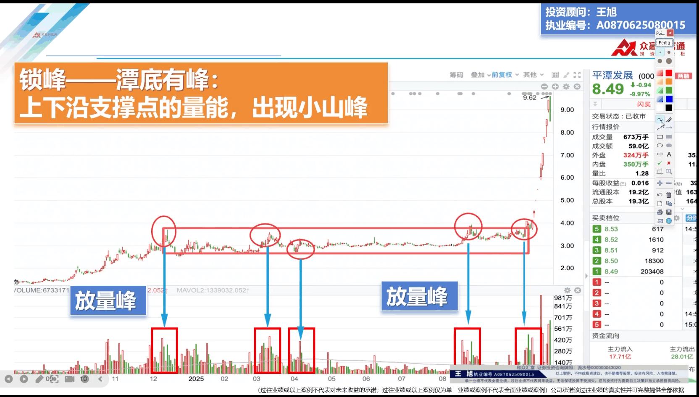

### 操作动作（找锁峰）

1. 在龙潭矩形上标出股价**每次触碰上沿、下沿**的位置；
2. 对准这些位置看下方成交量：必须是一坨一坨的**放量堆**（像小山峰），不是单根孤量；
3. 上沿、下沿的支撑点**都要有**量峰——上沿放量 = 主力高位接筹码不让它掉下去（或压着洗）；下沿放量 = 跌到潭底被一口吃掉；
4. 找不到"峰"的箱体，只有形没有魂，放弃。

### 对照案例

**平潭发展**——潭底五处放量峰（12 月、3 月两峰、4 月、8 月、9 月），上沿下沿全有"山峰"，随后暴力连板。


**蓝丰生化（002513）**——两处放量峰对应箱体上下沿支撑点。

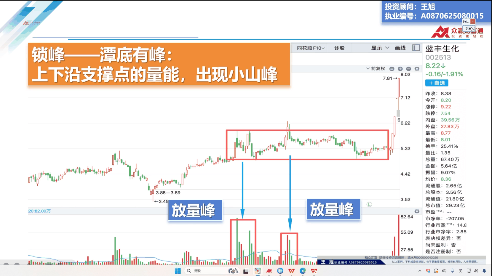

**首开股份（600376）**——两个量峰锁住箱体，股价从 3 元附近启动涨到 8.85。

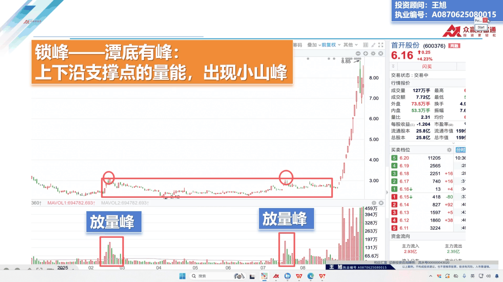

### 随堂检验（评论区互动）

- **华电能源，有没有过锁峰？**

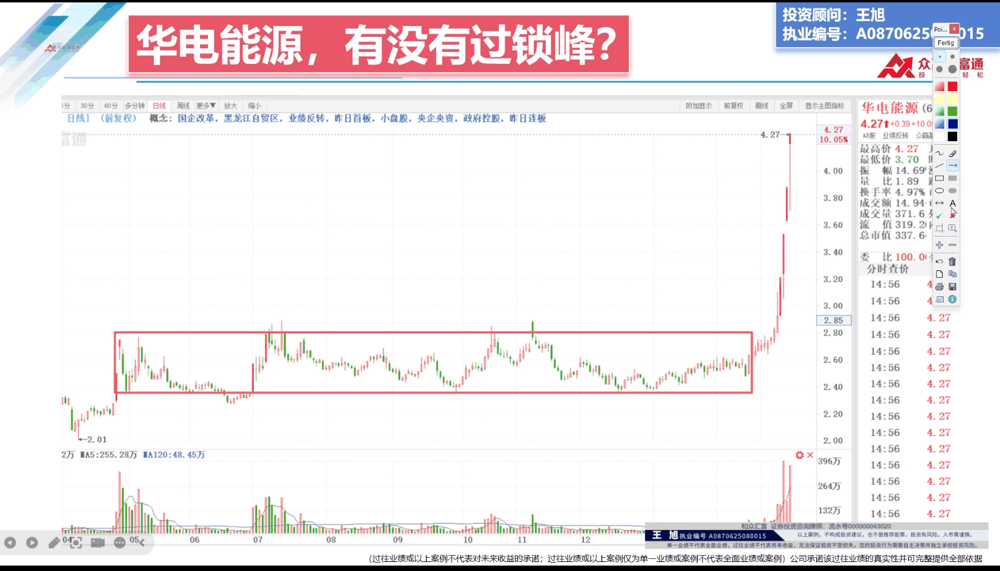

- **豫能控股，有没有过锁峰？**

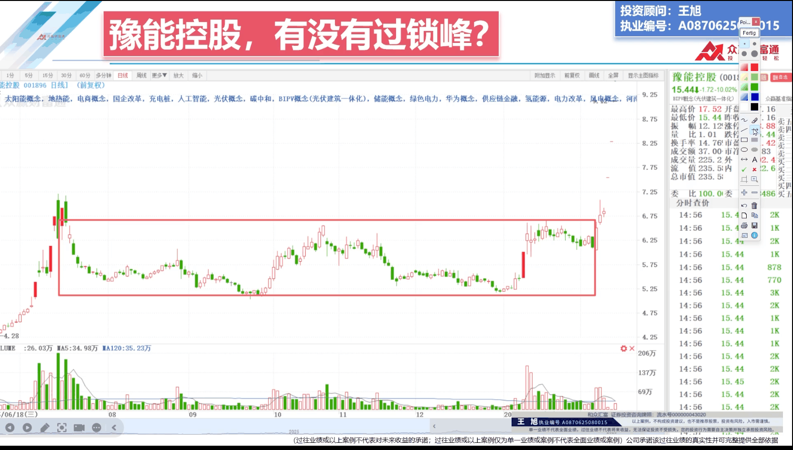

（对照 14–16 的标准答案自行核对：箱体上下沿触碰点下方是否有成片放量堆。）

### 理论与金融含义

- **锁峰 = 主力在箱体内真实动过钱的证据。** 3 个月的横盘可以是"没人玩"，也可以是"主力在收"；区分办法就是看**触碰上下沿时有没有人真金白银接**。放量堆出现在支撑点，说明每次价格到位都有资金兑现"这个位置我守"。
- **为什么强调"上下沿"而不是箱体中间？** 中间的量只是日常换手；上下沿是**多空前线**，前线上的放量才是攻防工程。
- **"锁"字的含义**：量峰锁住潭底筹码——散户在反复震荡中交出筹码，主力在峰堆里锁仓，为跃龙潭做弹药。

> 操作口诀：**潭底锁峰方藏真龙；上下沿支撑点必须是放量堆，像小山峰；有潭无峰，白忙一场。**

---

# 四、Step ③ 情绪缺口，主升来临：为为独创「缺口三空破阵」


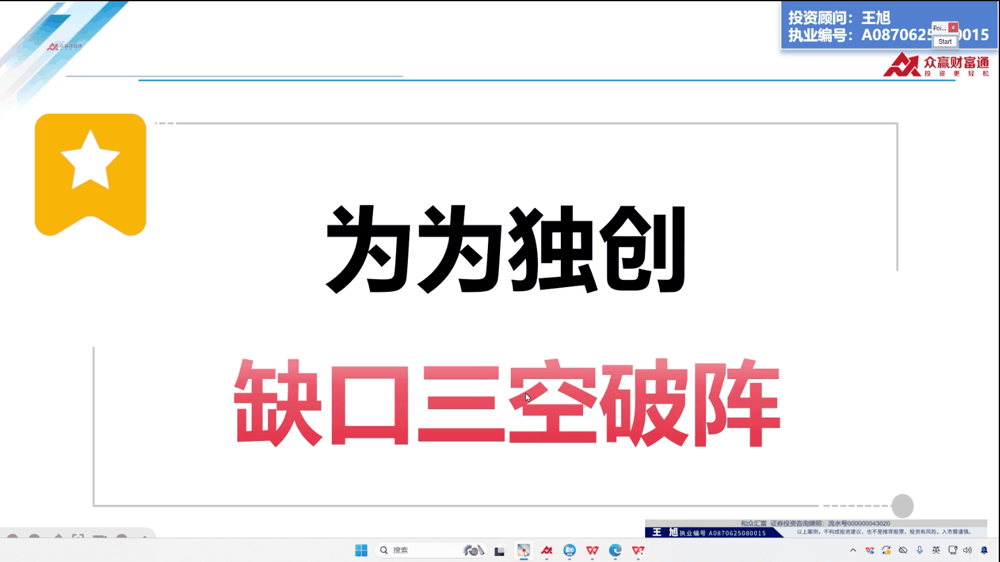

## 4.0 先认缺口

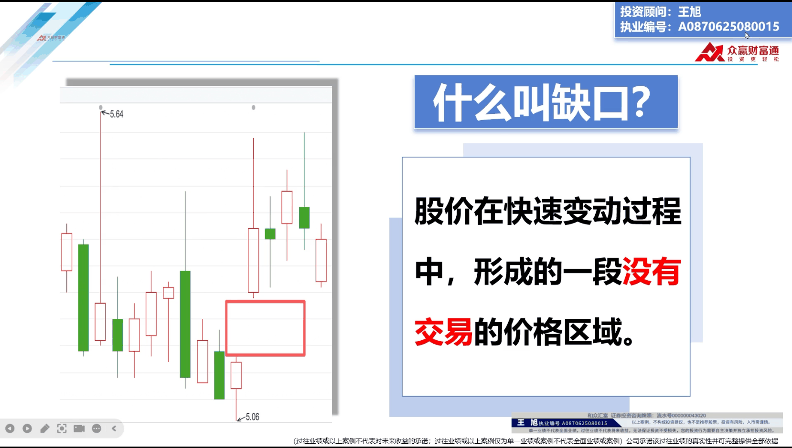

**图上原文（21.png）**：
> 什么叫**缺口**？股价在快速变动过程中，形成的一段**没有交易**的价格区域。

**课堂口述补充**：没有情绪的缺口（普通跳空）需要回补后才能买；**本课只做主升浪板块中的情绪缺口，不需要等回踩、不需要等回补。**

三个缺口构成一只妖股的完整生命周期：

| 顺序 | 缺口名称 | 类型 | 动作 |
| --- | --- | --- | --- |
| ① | 筹码起爆缺口 | **入场型** | 买 |
| ② | 情绪加速缺口 | **加仓型** | 加 |
| ③ | 能量枯竭缺口 | **离场型** | 卖 |

---

## 4.1 筹码起爆缺口（入场型）


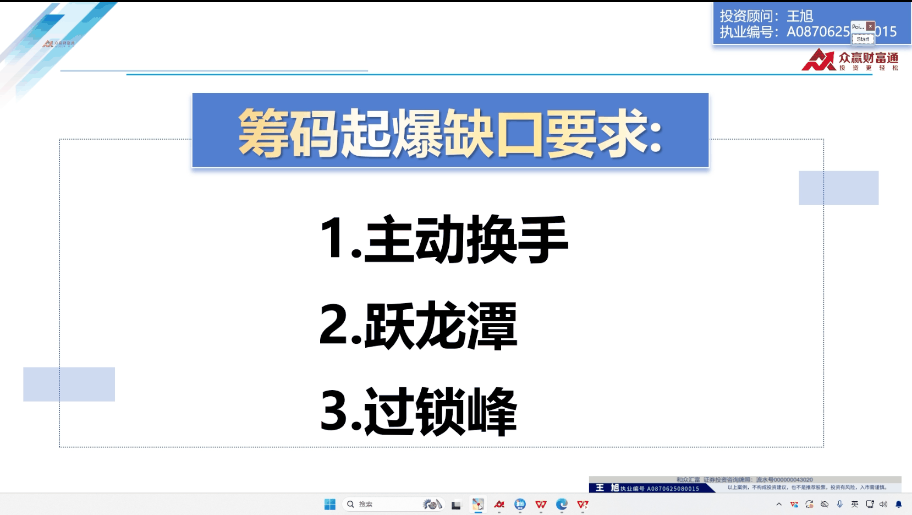

**图上原文（23.png）三个要求，缺一不可**：
> **1. 主动换手　2. 跃龙潭　3. 过锁峰**

### 逐条拆解

| 要求 | 屏幕上怎么认 | 不合格长什么样 |
| --- | --- | --- |
| **主动换手** | 跳空对应的涨停必须是**换手涨停**（有真实成交换手） | 一字板/无换手板 = 没人被洗出来，抛压没测过 |
| **跃龙潭** | 缺口把股价**整段跃出龙潭箱体**（站上箱体上沿之上） | 缺口还在箱体内部 = 没跃出，不算 |
| **过锁峰** | 缺口后的量能/价格**盖过前期量峰对应位置** | 过不了锁峰 = 上沿套牢区没吃掉 |

### 案例一：吉视传媒（601929）——认准"换手涨停"的缺口

图中蓝圈是非换手涨停留下的缺口（1.95–2.11），红圈是**换手涨停**留下的缺口（2.48–2.49、2.97–3.03）——只有后者才能当起爆缺口用。

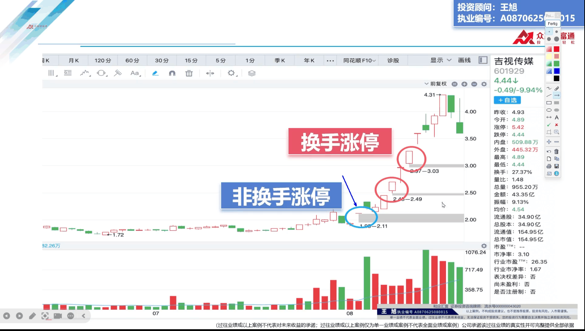

### 案例二：大有能源——标准三件套

"①入场信号：形成筹码起爆缺口，**条件缺一不可：跃龙潭、过锁峰、换手封板**"，图中标注 1.跃龙潭（跃出箱体）、2.过锁峰（量能盖过量峰）、3.筹码起爆缺口"**神挡杀神**"。

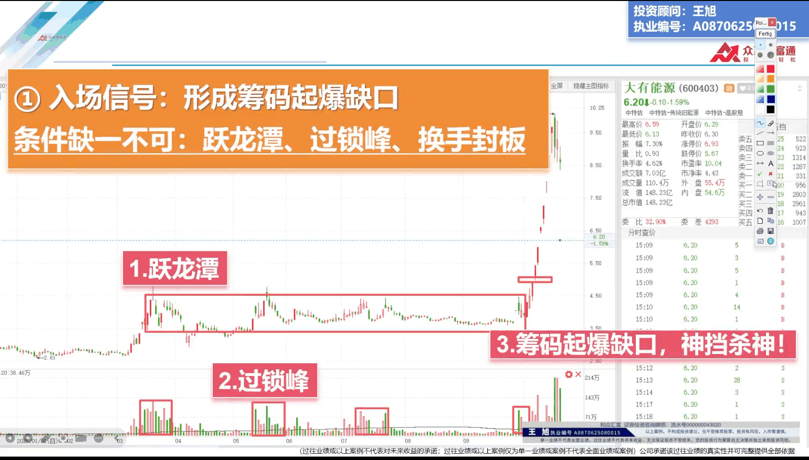

### 案例三：白银有色（601212）——买点就在缺口

同款标注，橙色箭头直接指向起爆缺口位置为**买点**。

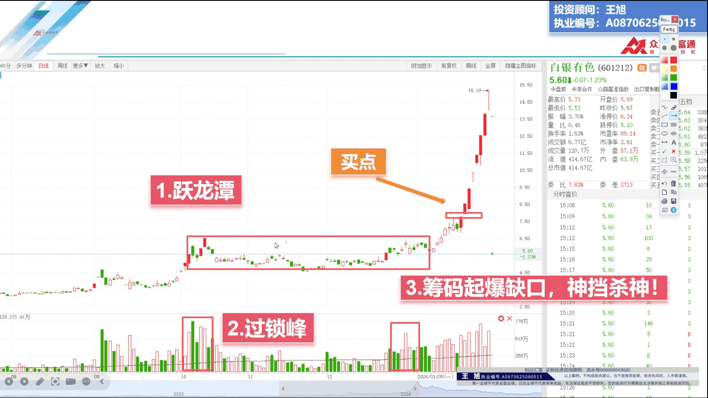

### 案例四：圣阳股份（002580）——不连板也暴涨

图上原文："**筹码起爆缺口，就算不继续连板，短期也加速暴涨！这就是主力逻辑！**"

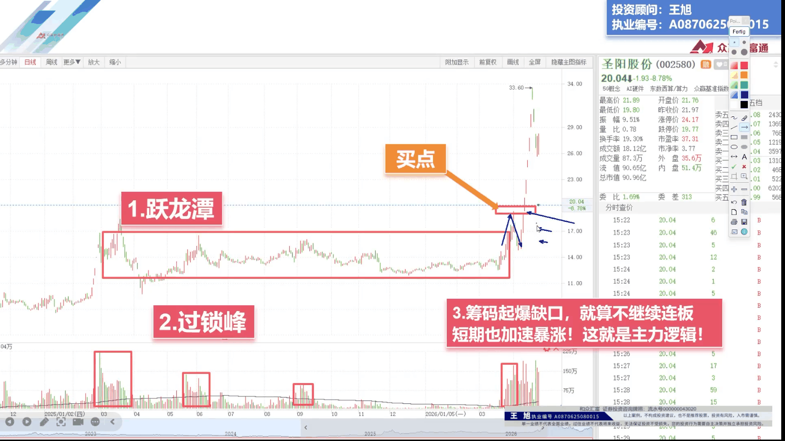

### 买不进去怎么办？


**图上原文（28.png）**：
> 出现筹码起爆缺口 → **次日开盘买入！**

**课堂口述补充**：起爆缺口当天往往直接涨停买不进——**次日开盘（或集合竞价）买入**，竞价分析方法用 Day02 的 U/V 形态、撤单逻辑。**不要怕买得晚、成本更高，要买确定性。**

### 理论与金融含义

- **起爆缺口是"主力摊牌"的瞬间。** 三个月箱体里所有的吸筹、洗盘，都在跃龙潭那一刻兑现成意图公开——跳空本身就是最贵的表态（主力愿意用真空区抬高所有踏空者成本）。
- **为什么必须换手涨停？** 一字板跳空看似强，实际没有测试抛压；换手涨停+跳空 = 顶着抛压硬吃出来的真空区，上方无套牢、下方有接盘，是"干净的缺口"。
- **为什么"过锁峰"？** 锁峰对应的位置是前期主力放量攻防的成本区；缺口能盖过它，说明**新一波资金比旧峰更强**，套牢盘一次性解放。

> 操作口诀：**主动换手、跃龙潭、过锁峰，缺一不可；起爆缺口神挡杀神，买不进就次日开盘买，要确定性不要低成本。**

---

## 4.2 情绪加速缺口（加仓型）


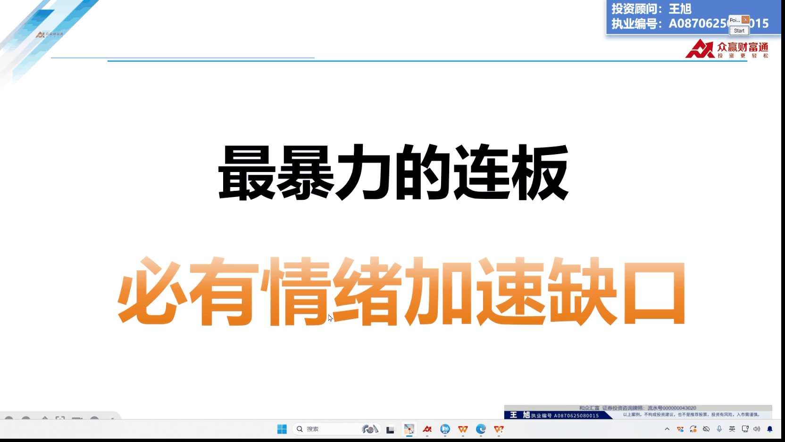

**图上原文（31.png）**：
> **最暴力的连板，必有情绪加速缺口**

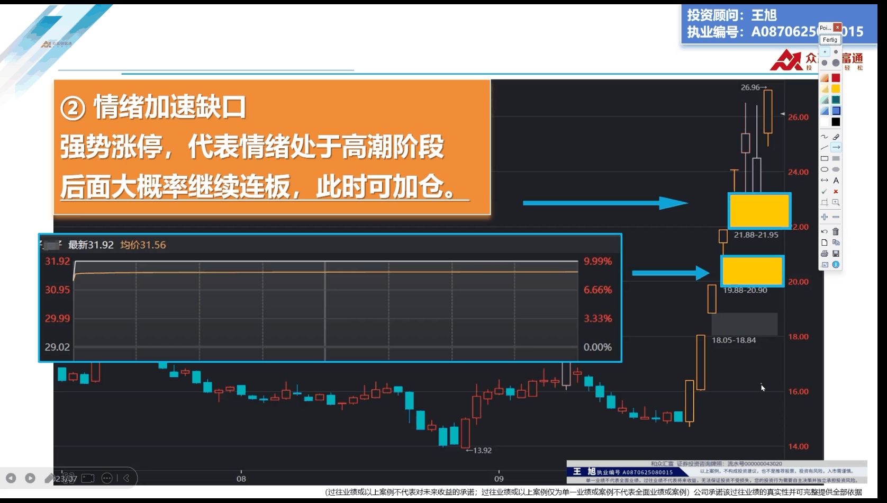

**图上原文（32.png）**：
> ② 情绪加速缺口：**强势涨停，代表情绪处于高潮阶段，后面大概率继续连板，此时可加仓。**

### 怎么认

- 位置：**起爆缺口之后的第二个（及以后）缺口**，大概率就是情绪加速缺口；
- 分时形态：**高开秒板、一字板**——图示 19.88–20.90、21.88–21.95 两段黄色缺口对应的分时都是开盘即封；
- 配套判断：结合 Day02 的竞价/分时知识——越早封板越是真加速。

### 操作动作

1. 已持有底仓 → 见情绪加速缺口**可以加仓**；
2. 即使不加仓，**也绝对不要减仓**；
3. 出现加速缺口 = 主力还在车上（见下）。

### 案例一：合富中国——起爆之后连环加速

完整标注：1.跃龙潭 → 2.过锁峰 → 3.筹码起爆缺口"神挡杀神"（买点）→ **4.情绪加速缺口**（上方一连串红色箭头指认多个加速缺口）。

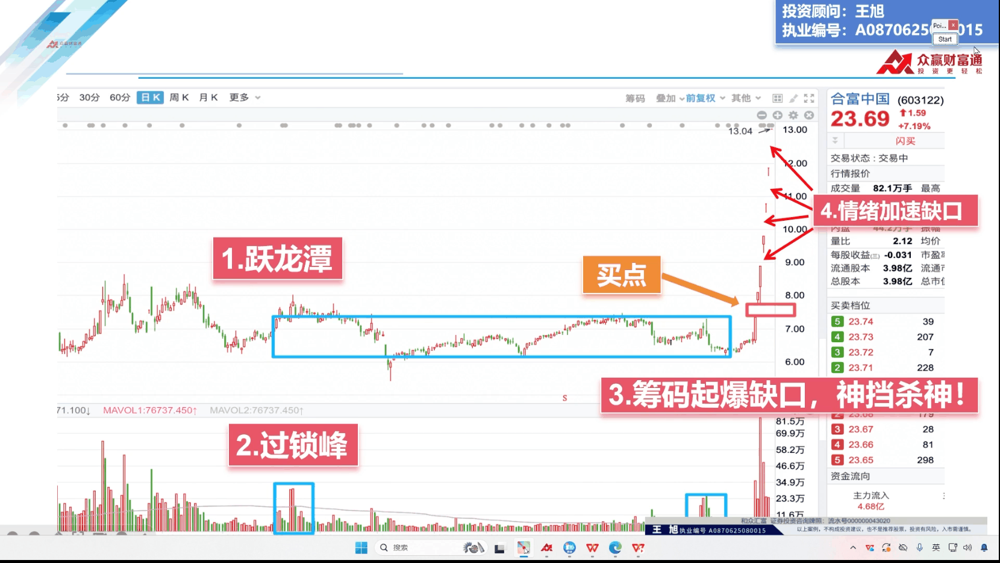

### 案例二：摩恩电气（002451）——主力绝不出货

三个连续缺口被红框标出。图上原文："记住：**情绪加速缺口！代表主力绝不出货**"。

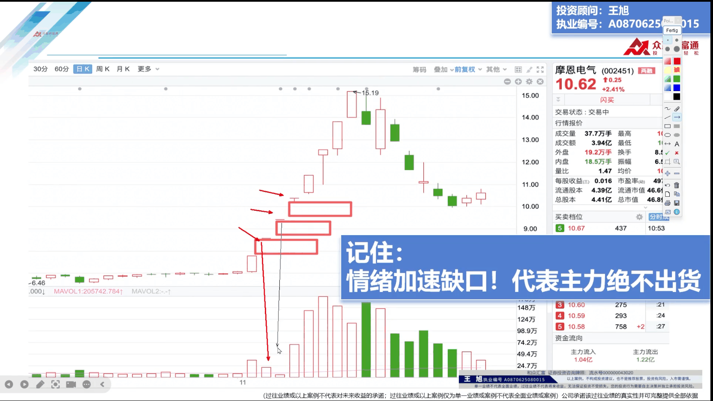

### 特殊情形：加速途中被"拔网线"——出不去，必须再拉

情绪加速段如果被监管、利空硬生生打断，主力**筹码出不去**，结局是**再次拉高出货**：

| 案例 | 发生了什么 | 图上标注 |
| --- | --- | --- |
| 盈新发展（000620） | 连续情绪加速后中断下跌，随后再度拉回 4.09 | "连续情绪加速 / 出不去，必须再次拉高出货" |
| *ST双成（002693） | 受监管一次性跌停 | 同上 |
| 天普股份（605255） | 监管"拔网线"，出不去必须再拉 | 同上+"像变魔术一样，学到了吗" |

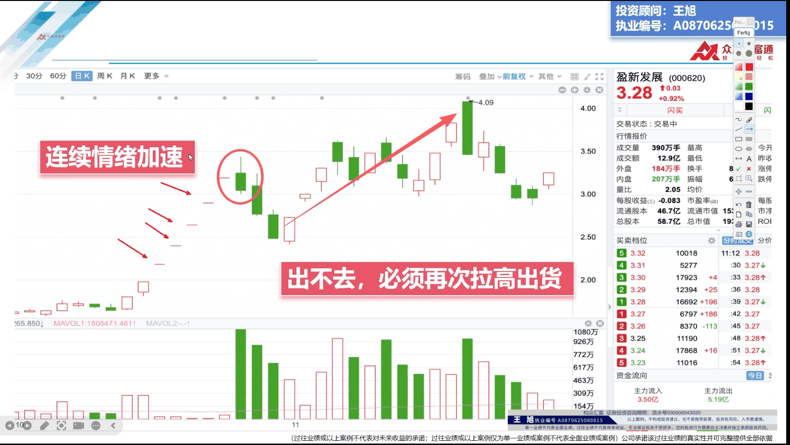

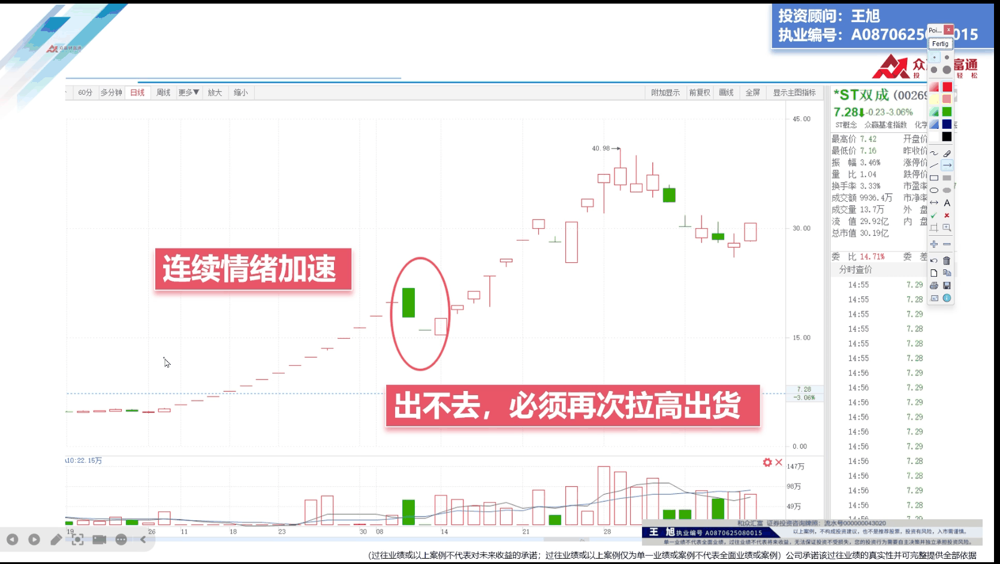

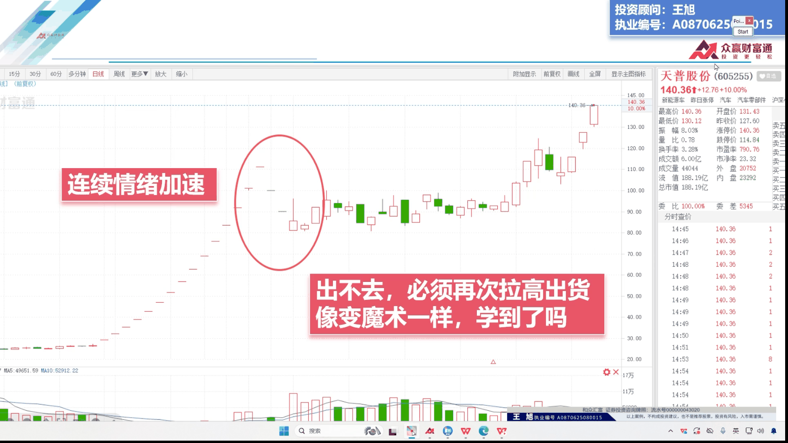

### 理论与金融含义

- **加速缺口 = 情绪高潮的燃料箱。** 高开秒板/一字意味着买盘愿意在更高位抢筹，主力几乎不用花对倒的钱就能推升——这是连板主升最省力的一段。
- **"主力绝不出货"的逻辑**：加速缺口段成交极度萎缩（想买买不到），主力手里巨量筹码在这个区域**根本卖不出去**——所以出现加速缺口反而说明主力还被锁在车上，行情没完。
- **"拔网线后必须再拉"的逻辑**：被迫中断时主力仓位还重，砸出来的跌停只是流动性事故；等监管/利空钝化，主力必须**再拉一波才能把货出在高位**。这不是基本面修复，是出货工程——所以那波拉升是**最后的逃命波**，不是第二春。

> 操作口诀：**最暴力的连板必有加速缺口；见加速缺口可加仓、绝不减仓——主力还锁在车上；中断下跌别绝望，它还得拉高再出一次。**

---

## 4.3 能量枯竭缺口（离场型）

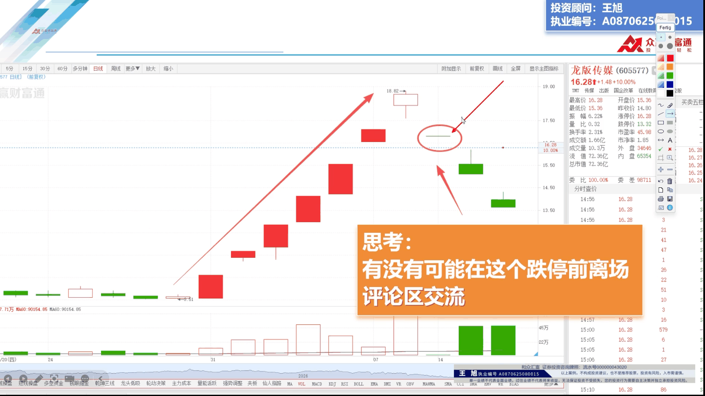

（38.png：龙版传媒 605577 连续涨停后一字被砸跌停——课堂思考题"有没有可能在这个跌停前离场"，答案就是下一页的经典卖点。）


**图上原文（39.png）**：
> ③ **能量枯竭缺口：烂板涨停，情绪转差，这里出经典卖点。**

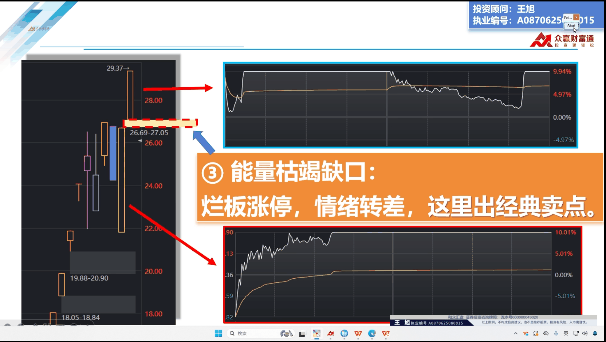

### 怎么认

- 日线：**烂板涨停**留下的跳空（反复开板勉强回封，甚至涨停后回落）；
- 分时：39.png 上下两张分时对比——上图高开后反复开板、尾盘勉强回封（坏）；下图开盘后一路封死（好）。**烂板分时 + 缺口 = 能量枯竭**；
- 口径：**只要出现能量枯竭缺口，不管是不是最高点，都标志主力已经在出货。**

### 案例一：时空科技（605178）——两次枯竭，两次都在出货

"**两次能量枯竭缺口，都在出货！**"两张历史分时（2025-10-31、2025-11-17）都是典型烂板：开板、回封、再开板。

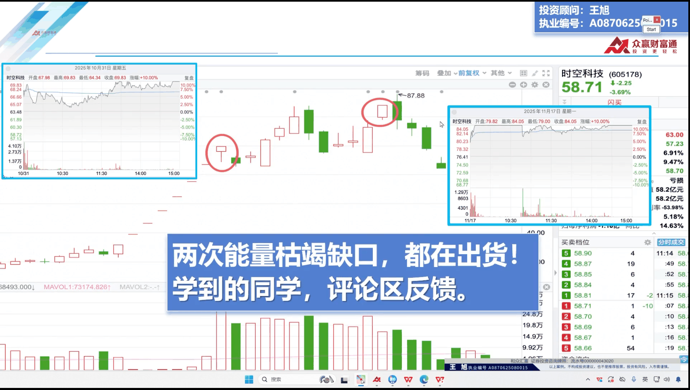

### 案例二：时代万恒（600241）——烂板分时实锤

历史分时（2026-10-12）涨停后反复开板。图上原文："时代万恒出现能量枯竭缺口，出货！悟了吗？同学们。"

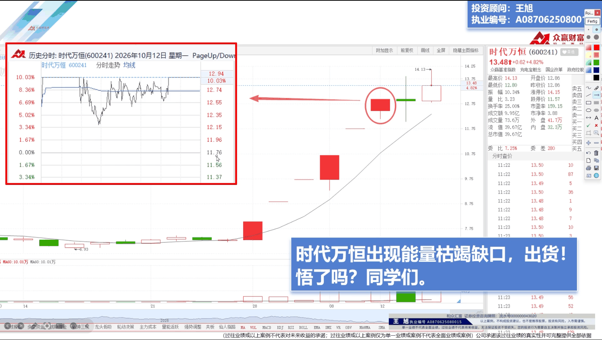

### 案例三：湖南黄金（002155）——不识别卖点的代价

"**这两波，跌的狠不狠？你怕不怕**"——两波从 43.67 附近下来的急跌，就是枯竭后没走的结果。

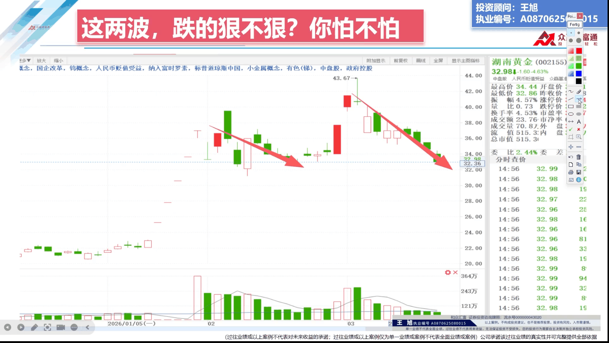

### 特例：没有能量枯竭缺口怎么离场？

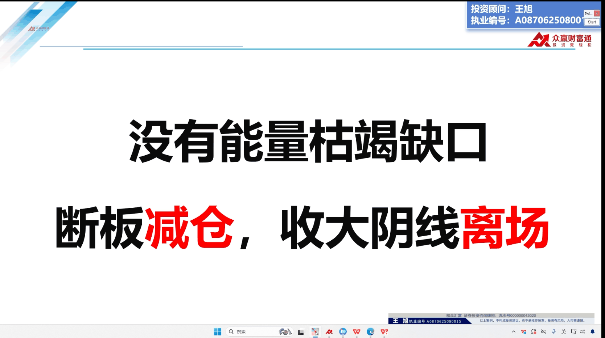

**图上原文（44.png）**：
> **没有能量枯竭缺口 → 断板减仓，收大阴线离场**

**案例：丽人丽妆（605136）**——高位大阴线：高开 12.56 后瀑布式下杀收 -8.93%，分时全天单边下行。按规则：断板（当天没封住）先减仓，收出大阴线直接离场。

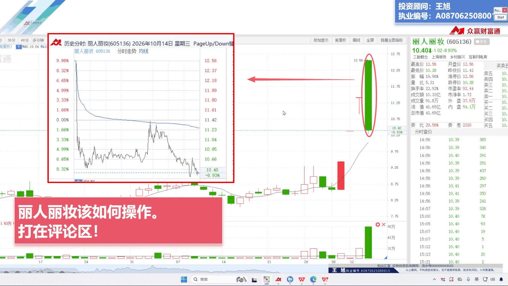

### 理论与金融含义

- **枯竭缺口是"最后一口气"的缺口。** 前面的缺口靠抢筹能量顶出来的；烂板涨停说明**买盘力量已经接不住抛盘**——跳空还在，能量已经空了。
- **为什么"不管是不是最高点"都要走？** 枯竭缺口出现时价格往往还在高位甚至刚创高，给人"还能涨"的错觉。但它标记的不是价格顶，而是**情绪顶**——接下来的下跌通常又快又深（湖南黄金两波）。
- **断板减仓 / 大阴线离场是保底网。** 大多数妖股出货不会标准地给你一个枯竭缺口，所以用更粗的信号兜底：**封不住 = 主力松手，减仓；大阴线 = 主力走了，清仓。**

> 操作口诀：**烂板涨停出枯竭缺口，不管是不是最高点都是卖点；没有枯竭缺口也别慌——断板减仓，大阴线离场。**

---

# 五、一只完整的龙头股：全景作战图

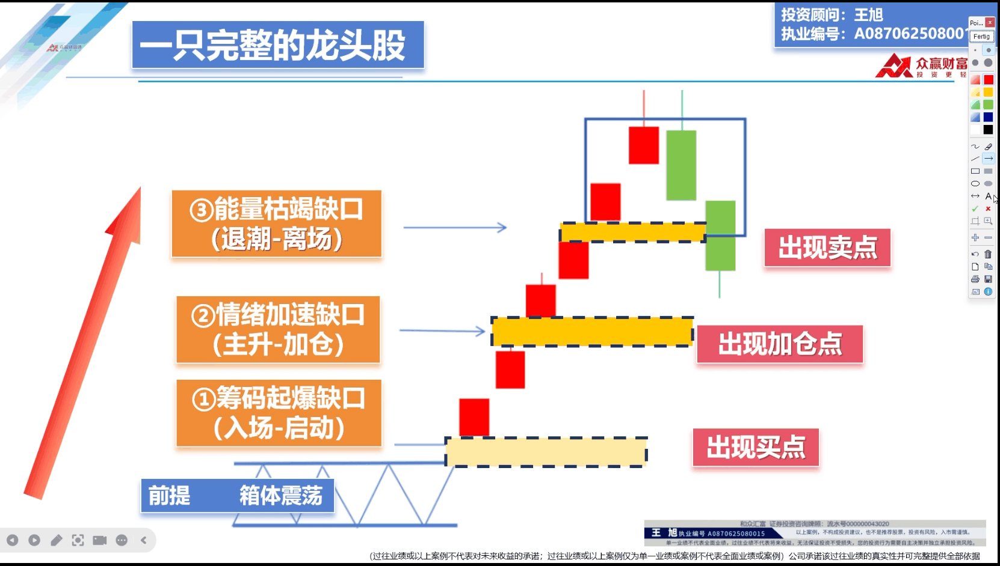

**图上原文（46.png）**：

> **前提：箱体震荡**（龙潭）
> ① 筹码起爆缺口（入场-启动）→ **出现买点**
> ② 情绪加速缺口（主升-加仓）→ **出现加仓点**
> ③ 能量枯竭缺口（退潮-离场）→ **出现卖点**

一只妖股的完整时间轴：

```
[ 龙潭：箱体≥3个月 + 上下沿锁峰量堆 ]        ← 只看不做，进自选
        ↓
[ ①筹码起爆缺口：主动换手+跃龙潭+过锁峰 ]    ← 买点（当天涨停买不进→次日开盘/竞价买）
        ↓
[ ②情绪加速缺口：高开秒板/一字 ]            ← 加仓点（不加也绝不减）
        ↓  （可出现多个；若被监管中断→还会拉高出货一波）
[ ③能量枯竭缺口：烂板涨停 ]                ← 卖点（经典离场）
   （若没有③：断板减仓 → 收大阴线离场）
```

**收官总结口诀（47.png 黑板）**：


> **龙潭锁峰现缺口，牛起主升翻倍走。**

---

# 六、案例总表（本课全部案例归档）

## 6.1 市值篇（定赛道）

| 个股 | 代码 | 流动市值 | 结论 |
| --- | --- | --- | --- |
| 合富中国 | 603122 | **49.24 亿** | ✅ 连板龙头的市值 |
| 平潭发展 | 000592 | **133.48 亿** | ✅ 连板龙头的市值 |
| 大金重工 | 002487 | **215.77 亿** | ❌ 市值太大走趋势 |
| 长飞光纤 | 601869 | **1625.5 亿** | ❌ 市值太大走趋势 |

## 6.2 龙潭篇（找箱体）

| 个股 | 代码 | 龙潭特征 | 备注 |
| --- | --- | --- | --- |
| 华电能源 | 600726 | 明显震荡平台（约 2.4–2.8 元） | 课堂互动题 |
| 大有能源 | 600403 | 震荡滞涨 3 个月以上才起爆 | 流值 194.85 亿，卡线合格 |
| 淳中科技 | 603516 | 箱体 35–40 元横 3 个月+，上沿多次触及 | 后涨至 226.93；Day03 曾作趋势龙案例 |
| 豫能控股 | 001896 | 明显震荡平台（约 5.25–6.75 元） | 课堂互动题 |

## 6.3 锁峰篇（验量能）

| 个股 | 代码 | 锁峰形态 |
| --- | --- | --- |
| 平潭发展 | 000592 | 潭底 **5 处**放量峰，上下沿齐全 |
| 蓝丰生化 | 002513 | 两处放量峰对应上下沿支撑点 |
| 首开股份 | 600376 | 两处量峰锁箱体，3 元附近启动涨到 8.85 |
| 华电能源 / 豫能控股 | — | 随堂检验："有没有过锁峰？" |

## 6.4 筹码起爆缺口篇（买点）

| 个股 | 代码 | 教学点 |
| --- | --- | --- |
| 吉视传媒 | 601929 | 换手涨停缺口 vs 非换手涨停缺口的分界 |
| 大有能源 | 600403 | 跃龙潭+过锁峰+换手封板三件套，"神挡杀神" |
| 白银有色 | 601212 | 买点标准位置标注 |
| 圣阳股份 | 002580 | "就算不连板，短期也加速暴涨——这就是主力逻辑" |

## 6.5 情绪加速缺口篇（加仓点）

| 个股 | 代码 | 教学点 |
| --- | --- | --- |
| 合富中国 | 603122 | 起爆后连环加速缺口的完整样板 |
| 摩恩电气 | 002451 | 三连加速缺口 = "主力绝不出货" |
| 盈新发展 | 000620 | 加速被中断 → 出不去，必须再拉高出货 |
| *ST双成 | 002693 | 监管一次性跌停 → 同上 |
| 天普股份 | 605255 | "拔网线" → 拉高出货"像变魔术" |

## 6.6 能量枯竭缺口篇（卖点）

| 个股 | 代码 | 教学点 |
| --- | --- | --- |
| 龙版传媒 | 605577 | 思考题：跌停前能不能提前离场？ |
| 时空科技 | 605178 | 两次枯竭缺口（两次烂板分时）都在出货 |
| 时代万恒 | 600241 | 烂板分时实锤枯竭 |
| 湖南黄金 | 002155 | 不识别卖点的代价：两波急跌 |
| 丽人丽妆 | 605136 | 特例：无枯竭缺口 → 大阴线（-8.93%）离场 |

## 6.7 收官练习篇（找买点）

| 个股 | 代码 | 教学点 |
| --- | --- | --- |
| 汉森制药 | 002412 | 龙潭+锁峰后"出现买点" |
| 神奇制药 | 600613 | 箱体走完又隔了三四个月才来情绪缺口——耐心等缺口 |

## 6.8 标准样板：合富中国全流程

合富中国是本课把三步串起来的主线案例：

| 阶段 | 合富中国实际走势 | 对应步骤 |
| --- | --- | --- |
| 定赛道 | 流值 49.24 亿，200 亿以内 ✅ | Step ① |
| 验形态 | 龙潭箱体 + 锁峰量堆 | Step ② |
| 买入 | 筹码起爆缺口（换手封板、跃龙潭、过锁峰）——买点 | ① 入场缺口 |
| 加仓 | 之后一连串情绪加速缺口 | ② 加速缺口 |
| 持有依据 | 加速缺口 = 主力绝不出货 | 纪律 |
| 离场 | 等能量枯竭缺口/断板/大阴线 | ③ 离场缺口 |

---

# 七、操作检查清单（实战前逐项打勾）

| # | 步骤 | 检查项 | 标准 | 不过则 |
| --- | --- | --- | --- | --- |
| 1 | ① 定赛道 | 流动市值 | **≤ 200 亿** | 划掉（走趋势的票换 Day03） |
| 2 | ② 验形态 | 龙潭 | 箱体震荡 **≥ 3 个月**、震荡滞涨 | 不进自选 |
| 3 | ② 验形态 | 锁峰 | 上下沿支撑点有**成片放量堆** | 有潭无峰，放弃 |
| 4 | ③ 买 | 缺口类型 | 是**筹码起爆缺口**（第一个情绪缺口） | 不是则继续等 |
| 5 | ③ 买 | 主动换手 | 对应**换手涨停**，不是一字/无换手 | 不买 |
| 6 | ③ 买 | 跃龙潭 | 缺口把股价带出箱体上沿 | 不买 |
| 7 | ③ 买 | 过锁峰 | 盖过前期量峰位置 | 不买 |
| 8 | ③ 买 | 时机 | 当天买不进 → **次日开盘/竞价买**（要确定性） | 不追高抢单 |
| 9 | 持 | 加速缺口 | 见②情绪加速缺口 → **可加仓、绝不减仓** | 执行纪律 |
| 10 | 持 | 异常中断 | 加速途中暴跌/跌停 → 等**再拉高出货波** | 别在恐慌坑里交筹码 |
| 11 | 卖 | 枯竭缺口 | 烂板涨停缺口出现 → **直接卖**（不必等最高点） | 执行 |
| 12 | 卖 | 兜底规则 | 没有枯竭缺口：**断板减仓、大阴线离场** | 执行 |

---

# 八、理论对照表（为什么要这么做）

| 操作 | 背后的理论 |
| --- | --- |
| 只做 200 亿以内 | 连板是资金效率生意；>200 亿拉不动控不住，只会走趋势 |
| 龙潭只要 3 个月 | 妖股主力项目周期短；拖得越久控盘越弱 |
| 龙潭必须带锁峰 | 时间短 → 收集必须暴力 → 上下沿必有放量证据 |
| 锁峰看上下沿不看中间 | 上下沿是多空前线，前线上的量峰才是攻防工程 |
| 起爆缺口三要求 | 换手=测过抛压；跃龙潭=意图公开；过锁峰=旧成本区被解放 |
| 缺口不等回补 | 主升浪情绪缺口是真空推进，等回踩就踏空 |
| 次日开盘买 | 当天涨停买不进；宁买确定性，不贪低成本 |
| 加速缺口=绝不出货 | 高开秒板成交萎缩，主力筹码卖不出去，只能继续 |
| 中断后再拉高 | 主力仓位重，被砸后必须再造一波出货窗口 |
| 枯竭缺口=卖点 | 烂板=买盘接不住抛盘；情绪顶先于价格顶 |
| 断板减仓/大阴线离场 | 大多数出货不给标准枯竭信号，用粗规则兜底 |

---

# 九、金融视角的客观提示

1. **这套体系是典型的情绪/博弈打法，不是价值投资。** 全部信号（箱体、量峰、缺口、烂板）描述的都是**资金行为**，与公司基本面几乎无关；基本面只在"题材/热点"层面间接起作用。
2. **200 亿这条线是经验阈值，不是物理定律。** 190 亿与 210 亿的票差别不会突变；它筛选的是"主力资金效率区间"，边界票需结合题材热度个案判断。
3. **案例全是幸存者。** 合富中国、平潭发展、首开股份是走出来的妖股；同样"龙潭+锁峰"却永远没起爆、或起爆后直接闷杀的票，课堂没有系统展示。**三条件全满足仍可能失败**（题材突然退潮、监管点名、大盘系统性下跌）。
4. **"主力绝不出货"是概率表述，不是承诺。** 加速缺口段主力难出货是流动性事实，但主力仍可通过拆单、对倒、场外配资账户腾挪部分筹码；中断后的"再拉高出货"也常以更低的位置完成。
5. **监管风险贯穿始终。** 本课案例里盈新发展、ST双成、天普股份都是被监管/利空打断的样本——"拔网线后再拉高"本质是**被迫的出货补课**，而不是安全垫。把妖股当成可以反复套用的公式，最容易在下一次"拔网线"时本金受损。
6. **与 Day02 打板体系的关系要分清。** Day02 管"**当天这个板能不能打**"（封成比、换手、竞价形态）；本课管"**这只票处于妖股生命周期哪一段、该买该持该卖**"。两者可以叠加使用，但止损节奏不同：本课买点在缺口，止损逻辑应锚定龙潭上沿/起爆缺口，而不是 Day02 的分时均线。
7. **快速进场的另一面是快速认错。** "潇洒离场"的前提是进场逻辑被破坏时真的离场——烂板、断板、大阴线出现后幻想"再拉一波"，是这套打法最常见的亏损来源。

> 风险提示：本文为课程学习笔记，仅作知识整理，不构成任何投资建议。短线连板/跟庄博弈风险极高，不适合所有投资者。投资有风险，入市需谨慎。

---

# 十、全课记忆点

1. **追最热的资金，打最容易的板！今日战法：快速进场潇洒离场！**
2. **连板只做 200 亿以内**——拉得动、控得住；市值太大走趋势，那是 Day03 的活。
3. **妖龙起飞两条件：形成龙潭 + 出现锁峰！**
4. **龙潭=箱体藏妖，震荡滞涨三个月以上**（育龙池要半年，龙潭只要 3 个月，但必须带锁峰）。
5. **潭底锁峰方藏真龙**：上下沿支撑点的量能必须是放量堆，像小山峰。
6. **为为独创·缺口三空破阵**：起爆（入）→ 加速（加）→ 枯竭（出）。
7. **起爆缺口三要求缺一不可：主动换手、跃龙潭、过锁峰**；神挡杀神，买不进就次日开盘买——**要确定性，不要低成本**。
8. **最暴力的连板必有情绪加速缺口**；见加速缺口可加仓，不加也**绝不减仓——主力绝不出货**。
9. **加速被监管打断：出不去，必须再次拉高出货**——那波是逃命波，不是第二春。
10. **烂板涨停=能量枯竭缺口=经典卖点**，不管是不是最高点；没有枯竭缺口就 **断板减仓、大阴线离场**。
11. 总口诀：**龙潭锁峰现缺口，牛起主升翻倍走！**

---

# 十一、笔记核查与勘误

对照 50 张直播截图，对 [课程记录.md](课程记录.md) 的修正与补充：

**笔误 / 用字**：
1. 笔记标题写"出现锁**锋**"——课件统一用"锁**峰**"（山峰的峰，13/14/15/16 图原文），正文部分又写对了，建议统一为**锁峰**。
2. 笔记"潭底锁**峰**，方藏真龙"方向正确，但与标题"锁锋"不一致。

**截图定位修正**：
3. 笔记写"能量枯竭缺口概念：40.png"——**40.png 是黑板章节页**（3.能量枯竭缺口·离场型）；**概念定义在 39.png**（"烂板涨停，情绪转差，这里出经典卖点"，并附烂板/好板分时对比）。
4. 笔记"反问出货点：38.png"正确，补充：38.png 是**龙版传媒**的思考题（连续涨停后一字跌停）。
5. 笔记"情绪加速缺口 32.png"正确（定义+高开秒板/一字分时）；31.png 是黑板金句"最暴力的连板必有情绪加速缺口"，建议一并记录。
6. 笔记中 34.png"情绪加速缺口代表主力绝不出货"——该图是**摩恩电气**（002451），建议补个股名便于复习。
7. 29.png 与 30.png 是**同一张黑板页的两次截图**（2.情绪加速缺口·加仓型），引用一张即可。

**建议补进笔记的要点**：
- 与 Day03 的 **200 亿对偶关系**（Day03 下限 / 本课上限）——这是整个课程体系的分界线；
- 龙潭 vs 育龙池的对比（3 个月+锁峰 vs 6 个月+一形两力），否则容易把两套箱体标准混用；
- 起爆缺口案例的完整名单：吉视传媒（换手/非换手对照）、大有能源、白银有色、圣阳股份；
- 加速缺口被中断的三个案例：盈新发展、*ST双成、天普股份（"拔网线"语境）；
- 枯竭缺口案例：时空科技（两次）、时代万恒、湖南黄金（反面代价）；特例丽人丽妆（大阴线离场）；
- 收官练习：汉森制药、神奇制药"出现买点"；
- 缺口**不需要等回补**（口述要点，21 图只给了缺口定义）；
- 全课总口诀"龙潭锁峰现缺口，牛起主升翻倍走"（47.png）。

---

# 十二、本课资料索引

| 资料 | 性质 | 与本总结的关系 |
| --- | --- | --- |
| 直播截图 01–50 | 课堂实录 | 关键页已全部嵌入正文并摘录图上原文；50.png 为课后报名引导页（去弱留强服务广告），不并入正文 |
| [课程记录.md](课程记录.md) | 课堂笔记 | 第十一节已核查勘误 |
| 第四课预习资料.pdf | 课前预习 | 与直播内容主题一致，正文以直播截图口径为准 |

---

*资料来源：day04/直播截图 01–50、课程记录.md、第四课预习资料.pdf；整理日期：2026-10-19*
