# Day05 课程总结：《盘中斩龙》——弱转强涨停板的全程作战图

| 项目 | 内容 |
| --- | --- |
| 课程 | 第五课《盘中斩龙》（众赢财富通·五行擒龙系列续课） |
| 讲师 | 王旭（为为老师），执业编号 A0870625080015 |
| 课题 | 捕捉盘中涨停瞬间，在震荡牛市大背景下学会做**弱转强** |
| 今日战法 | **盘中斩龙：弱转强涨停板** |

> **与 Day01–Day04 的关系**：
> - Day02 打板课把「弱转强涨停板」列为**二板的绝对不碰项**（"宁愿错过，也不做错"）；本课换了一个身份把它重新讲了一遍——**不是让你去打弱转强二板，而是把"弱转强"当作一套独立的选股+择时战法**：在断板股里找题材未退、主力控盘的票，等它反包涨停时上车。
> - 两课并不矛盾，口径不同：Day02 管"**涨停次日打不打**"（当天视角，弱转强=巨量换手不可打）；Day05 管"**断板之后等不等它回来**"（波段视角，弱转强=分歧转一致的上车点）。
> - 与 Day04 缺口战法互补：Day04 买在**起爆缺口**（箱体跃出的那一刻）；Day05 买在**断板后的反包涨停**（已经涨过一波的票，回调后再点火）。Day05 的"题材热度周期 3/5/8 天"就是 Day04"热点仍在"的量化版。
> - 大前提：**震荡牛市大背景**——指数不单边、板块轮动、热点活不过 3 天，才有源源不断的"断板股"可供弱转强。

---

# 使用说明：这份总结怎么读

| 你要什么 | 看哪里 |
| --- | --- |
| **马上照着做** | 第一部分「三步操作总表」+ 各步骤末尾的「操作动作」 |
| **为什么要这么做** | 各步骤下的「理论与金融含义」 |
| **对着屏幕核对** | 各步骤下的截图（图下标了图上原文） |
| **买入前打勾** | 第七部分「操作检查清单」 |
| **看全所有案例** | 第六部分「案例总表」 |
| **完整走一遍** | 第五部分「一只弱转强股的全景作战图」 |

---

# 一、三步操作总表

| 步骤 | 你做什么 | 通过标准 | 不通过怎么办 |
| --- | --- | --- | --- |
| **① 选题材** | 确认票的题材是**近期热点** | 题材热度消失 < **3天/5天/8天**（越近越好，新热点优先） | 题材凉透 → 放弃 |
| **② 选股票** | 在近日**断板股**里筛 | 累计**七板之内**，**优选一板、二板** | 超过 2 板的断板 → 谨慎/不做 |
| **③ 等起爆** | 等**反包涨停** + 盘中控盘分时 | 反包收盘价**超过前涨停收盘价** + 分时走出**进攻波或震荡波**涨停 | 对不上号 → 不动 |

**一句话心法**：**题材还热（3/5/8天内），票只在七板内的一板二板断板股里找，等它反包涨停收复前高、分时走出进攻波或震荡波，再上车。**

---

# 二、开场：为什么你捉不到妖股？

课堂开篇的三个"看不懂"（对应笔记第 1 节）：

1. **你看不懂大盘情绪**——不知道现在是分歧期还是一致期；
2. **你看不懂断板**——把断板一律当出货，错过后面的反包；
3. **你看不懂真反包**——分不清主力回补和散户抢反弹。

本课就是按这三个缺口编排的：先教**分歧理论**（看懂情绪），再教**断板筛选**（看懂断板），最后教**反包+控盘分时**（看懂真反包）。

---

# 三、分歧理论：新手怕分歧，高手等分歧

## 3.1 什么是分歧

**盘面特征**：涨跌家数混乱，板块轮动，**热点活不过 3 天**。

**什么原因导致了分歧？**（图上原文，01.png）：

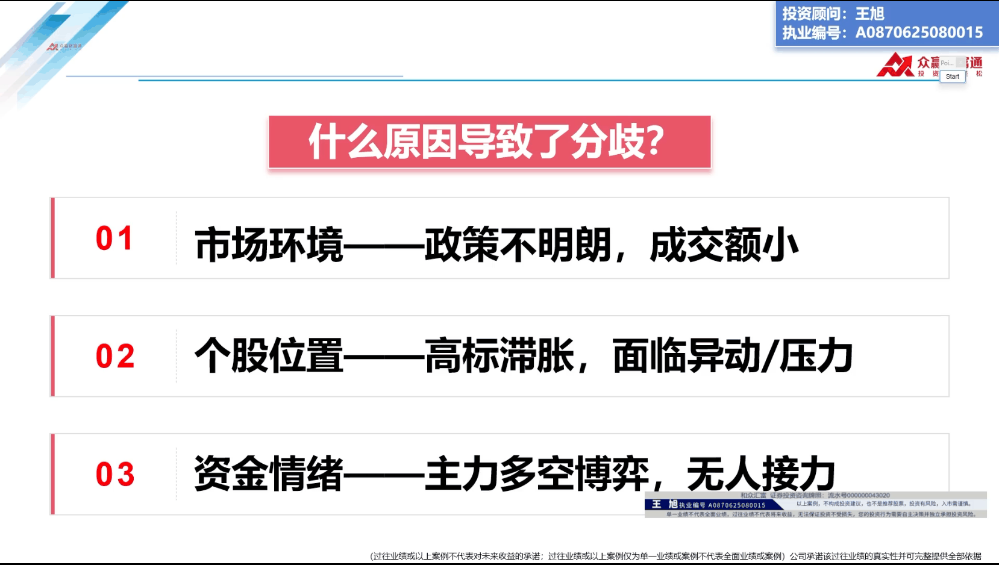

> 01 **市场环境**——政策不明朗，成交额小
> 02 **个股位置**——高标滞胀，面临异动/压力
> 03 **资金情绪**——主力多空博弈，无人接力

**核心口径（课堂金句）**：

> **新手怕分歧，高手等分歧。**
> **从混沌到共识的转折点，动能巨大。**

### 理论与金融含义

- 分歧 = 市场对"谁是下一个主线"没有答案：高标滞胀没人敢接力，新题材又没走出来。此时涨跌家数混乱、热点轮动快。
- 但分歧正是**弱转强的温床**：正因为没人接力，一旦某只票用涨停重新确立强势，它就成了资金"从混沌中抓住的那根绳"，转向一致的动能（次日溢价）反而最大。
- 反过来，一致期（单边趋势、全市场一个方向）里弱转强没有稀缺性，战法失效。**本课适用前提是震荡市**。

> 操作口诀：**新手怕分歧，高手等分歧；混沌转一致的转折点，动能巨大。**

## 3.2 分歧转一致的三种案例形态

课堂用三个案例演示"分歧之后资金怎么重新凝聚"（注意：文件编号与案例编号是反的，见勘误）：

### 案例一：军工补涨龙——一波流弱转强，炸板回封（03.png）

2025/05/12 开盘 8.39、收盘 9.83（+9.96%）、振幅 +16.11%、换手 20.34%。分时走出**一波流弱转强、炸板回封**，图上原文："**分歧转一致后 打开上行空间（军工补涨龙）**"——回封后连拉三四个涨停到 15.59。

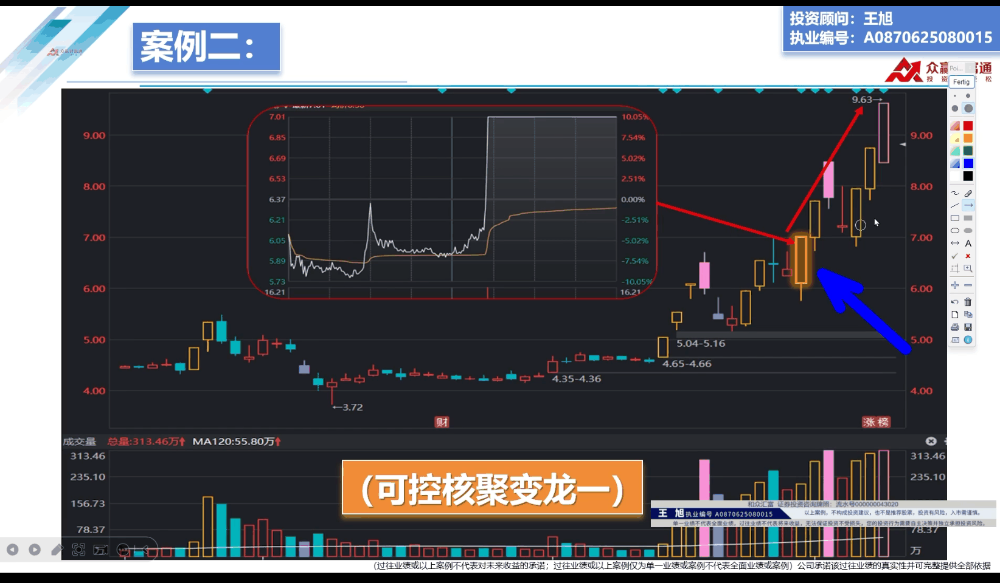

### 案例二：可控核聚变龙一——日内分歧转一致（02、.png）

分时深水（-7% 以下）震荡后直拉涨停；日线黄框标出弱转强涨停，随后一路加速到 9.63。演示的是**最极端的日内分歧转一致**：早盘恐慌盘全部洗出，午后一笔拉回。

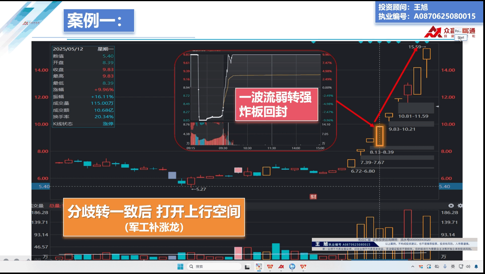

### 标准的弱转强涨停板长什么样？（05.png）

分时横盘后尾盘拉板。图上标注三个特征：

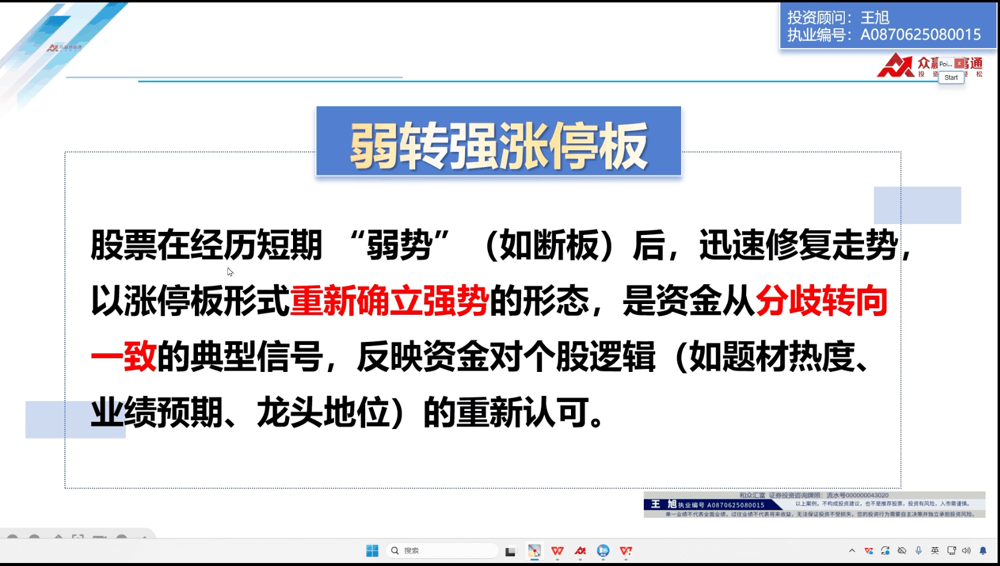

> **1 无其他热点板块　2 成交量买多卖少　3 均线有效支撑**

（配图 04.png 是"弱转强涨停板"的概念定义页，正文见下一节。）

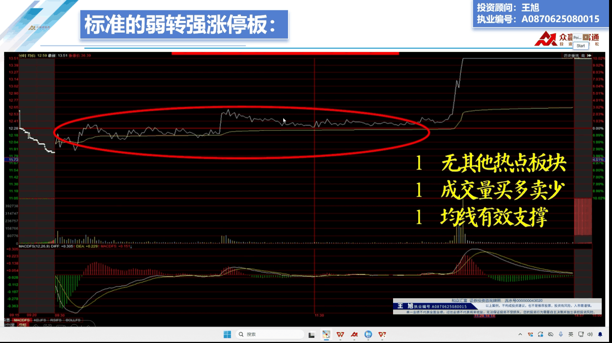

**图上原文（04.png）**：
> 股票在经历短期"弱势"（如断板）后，迅速修复走势，以涨停板形式**重新确立强势**的形态，是资金从**分歧转向一致**的典型信号，反映资金对个股逻辑（如题材热度、业绩预期、龙头地位）的重新认可。

### 弱转强案例组：九阳股份、万向德农（07.png / 08.png）

- **九阳股份（002242）**：涨停后回调数日（阴线+十字星洗盘），再涨停收复——标准的"断板—修复—再点火"结构，流值 132.47 亿。

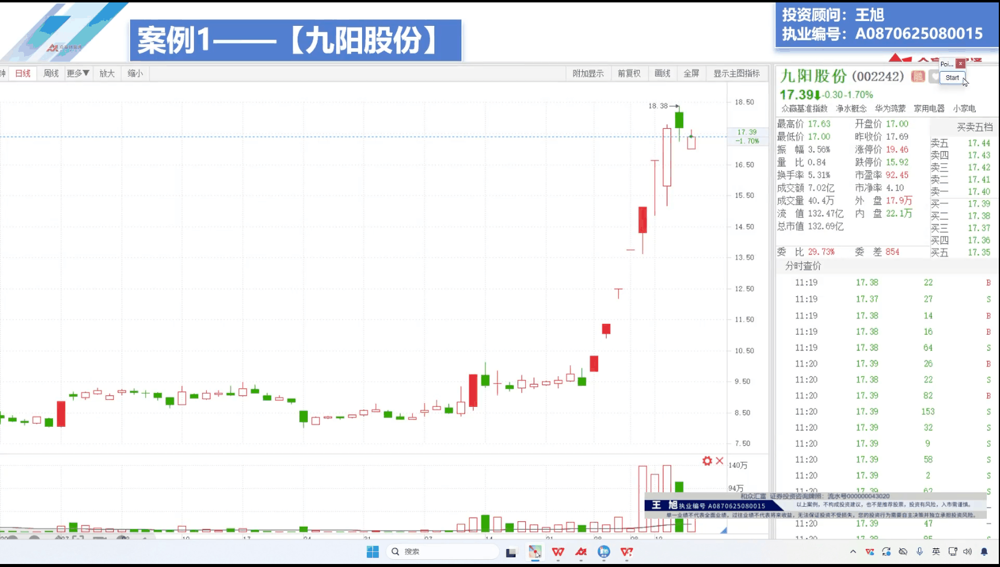

- **万向德农（600371）**：红圈标出**涨停次日断板收阴、再十字星，随后反包涨停**，一路走到 14.97；流值 42.19 亿，典型小票连板体质。

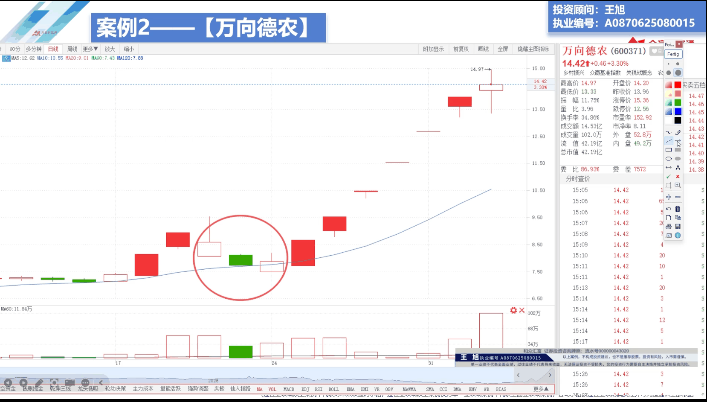

---

# 四、弱转强的本质

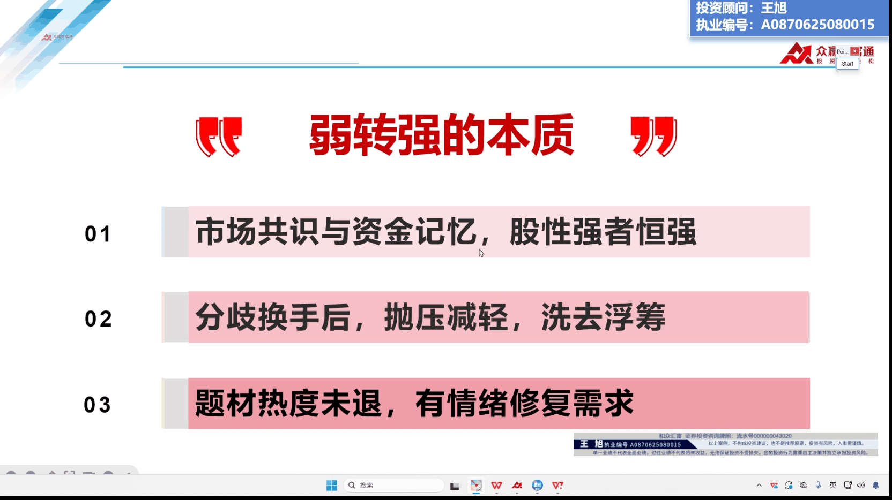

**图上原文（06.png）**：

> 01 **市场共识与资金记忆，股性强者恒强**
> 02 **分歧换手后，抛压减轻，洗去浮筹**
> 03 **题材热度未退，有情绪修复需求**

### 理论与金融含义

- **资金记忆**：市场永远记得"谁是上一波的龙头"。没有新热点时，资金的第一选择是回头做前端时间的热点，尝试防御（笔记第 3 节案例 2 的原话）。这就是弱转强能成立的心理基础。
- **洗浮筹**：断板那天冲进来的追高盘被套，反包涨停把他们全部解放并让他们小赚离场——浮筹换了一轮，上方反而轻了。
- **情绪修复需求**：题材热度未退，龙头断板只是"暂停"不是"谢幕"，资金有把故事讲完的冲动。
- 三条合起来解释了**为什么反包涨停之后往往还有连板**：不是基本面变了，是共识重建后资金抢着上同一辆车。

> 操作口诀：**股性强者恒强；断板洗浮筹；题材未退，修复需求就在。**

---

# 五、三步战法详解

# Step ① 题材为近期热点：热度周期 3、5、8 天

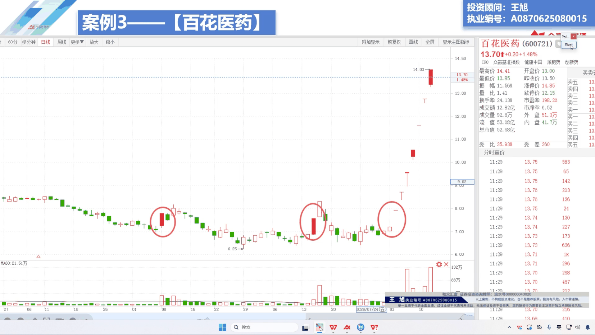

## 5.1 热度分级

**图上原文（12.png）**——某一题材按"热度消失距今多久"分三级：

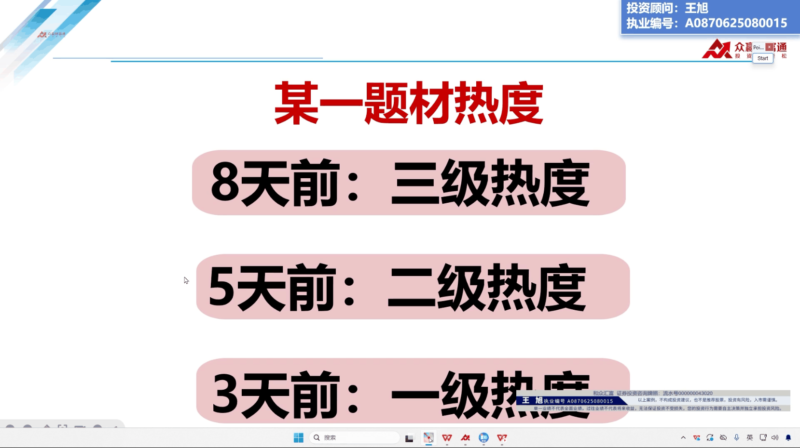

| 热度消失距今 | 热度等级 | 弱转强价值 |
| --- | --- | --- |
| **3 天前** | **一级热度** | 最高（资金记忆最新鲜） |
| **5 天前** | 二级热度 | 中等 |
| **8 天前** | 三级热度**底线** | 最低，再远不看 |

## 5.2 怎么筛选弱转强题材

**图上原文（13.png）**：

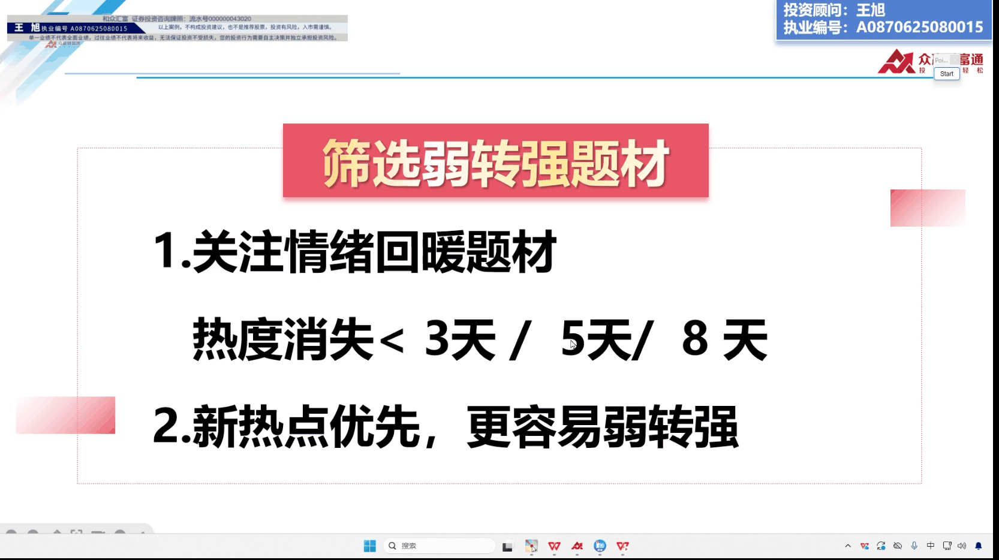

> **1. 关注情绪回暖题材——热度消失 < 3天 / 5天 / 8天**
> **2. 新热点优先，更容易弱转强**

### 操作动作（选题材）

1. 打开涨停板复盘，列出**最近 3 天**有过涨停潮的题材；
2. 标出每个题材"热度消失"的天数：≤3 天一级、≤5 天二级、≤8 天三级、>8 天直接划掉；
3. 多个题材可选时，**新热点优先**（资金记忆新、套牢盘少、修复阻力小）；
4. 记住配套特征：分歧期"热点活不过 3 天"是常态，**能活过 3 天的题材才是弱转强候选**。

### 案例三：百花医药（600721）——多次点火的题材票（11.png）

红圈标出三次"涨停—回调—再启动"的结构，最后从 7 元附近一口气到 14.03。它演示的是：**同一个题材内的票，只要热度未退，每一次断板都可能成为下一次弱转强的起点。**

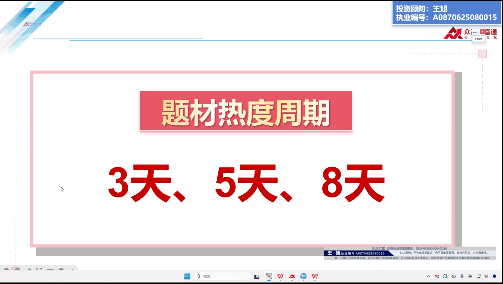

### 理论与金融含义

- **3/5/8 是资金记忆的半衰期**。A 股题材轮动快，超过 8 天市场已经换了叙事，老龙头的"名字"不再值钱。
- **新热点优先**的原因：老热点上方套牢盘层层叠叠，反包要啃的肉更厚；新热点第一次断板，上方几乎没有套牢，反包阻力最小。
- 这一步本质是**给弱转强上一个题材保险**——形态再好，题材凉了就是无人接力的独狼涨停。

> 操作口诀：**题材热度消失小于 3、5、8 天，越近越好；新热点优先；8 天开外一律不看。**

---

# Step ② 聚焦近日断板股：七板之内，优选一板、二板

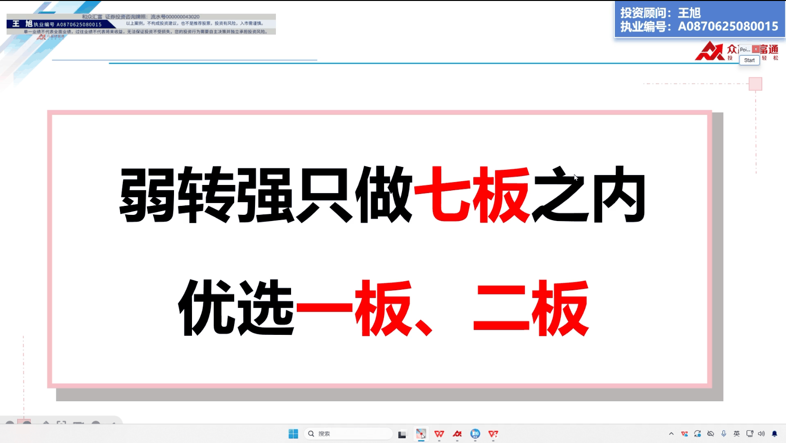

## 5.3 位置纪律

**图上原文（14.png）**：

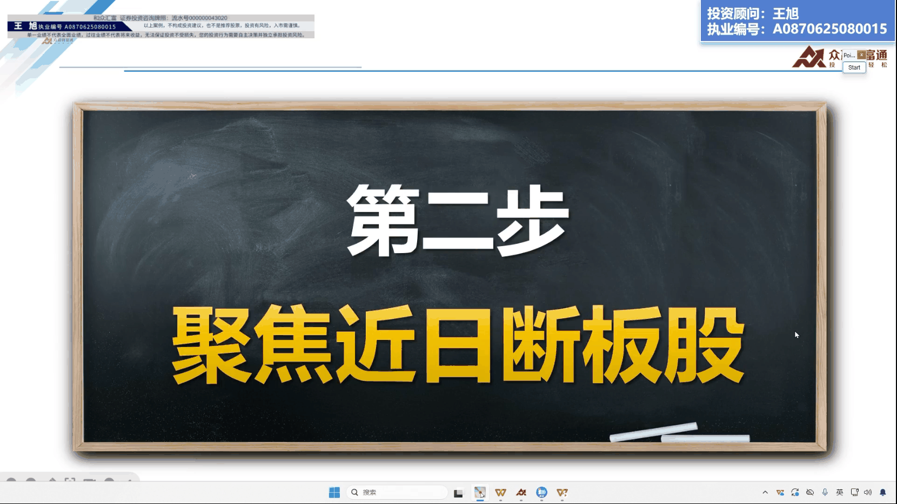

> **弱转强只做七板之内，优选一板、二板**

**图上原文（16.png）**——两类合格样本对照："一板后弱转强"（一个涨停后断板→反包）与"二板后弱转强"（两个涨停后断板→反包）：

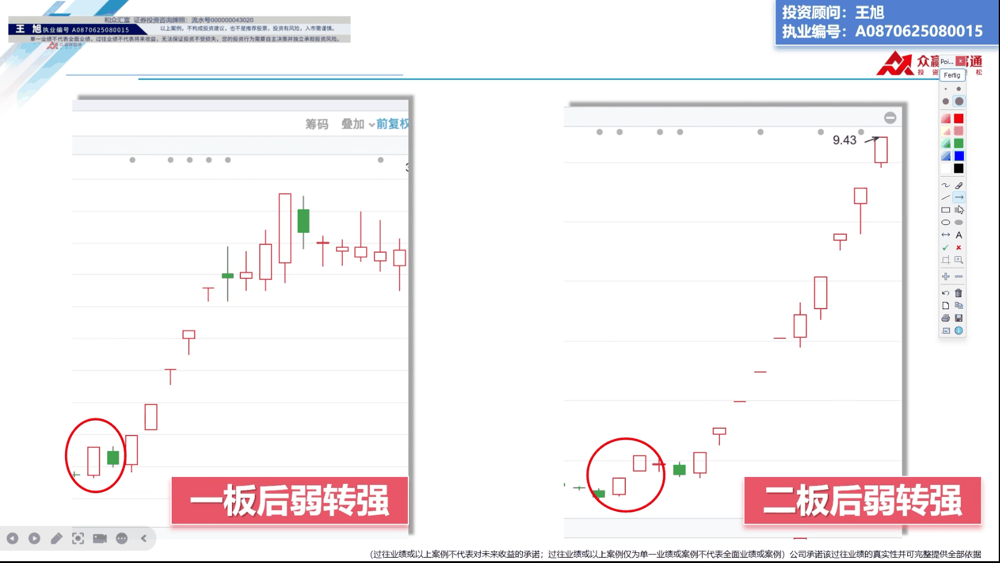

### 操作动作（选股票）

1. 在 Step ① 圈定的题材内，列出**最近 1–3 天断板**的票；
2. 数它们**此前的连板高度**：只留 **7 板以内**的；
3. 其中**优先做一板、二板后断板**的（3–7 板的断板只可谨慎观察）；
4. 叠加市值经验（Day04 口径）：这些票流通市值通常在 200 亿以内。

### 案例：平潭发展、安泰集团

- **平潭发展（000592）**：红圈标出**二板后断板收阴、次日反包**的位置，随后连板到 9.43（Day04 的老朋友，本课换了个买点视角）。

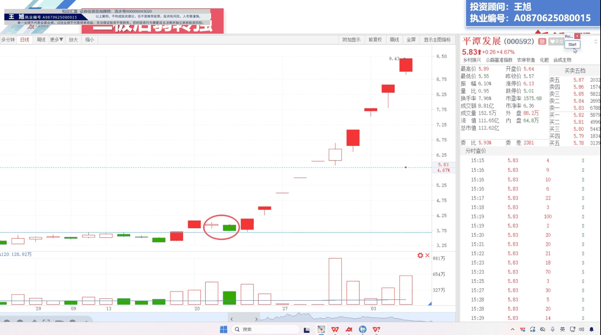

- **安泰集团（600408）**：三个红圈标出**同一波行情里三次弱转强**——每次断板都被反包收复，股价 2.5→6.89。图上标注"**多次弱转强**"，是"股性强者恒强"的直观证据。

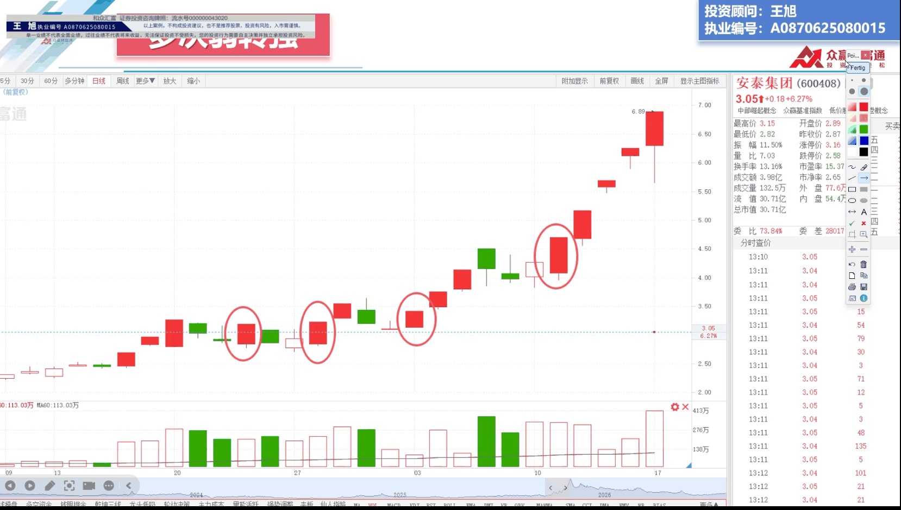

## 5.4 为什么超过 2 板一定要谨慎？

**图上原文（19.png）**：

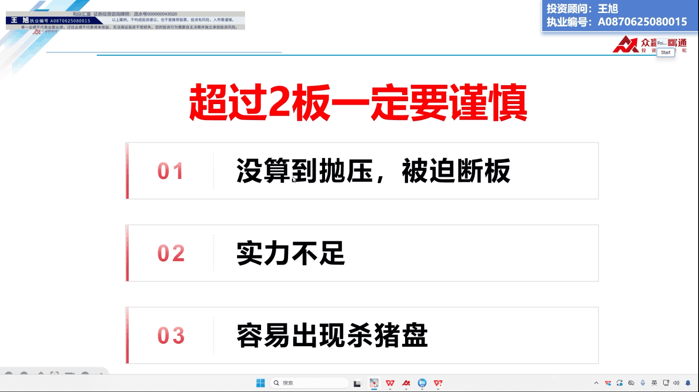

> **超过 2 板一定要谨慎**
> 01 **没算到抛压，被迫断板**
> 02 **实力不足**
> 03 **容易出现杀猪盘**

### 理论与金融含义

- **一板、二板的断板**多半是"计划内洗盘"：主力刚点火，筹码收集未完成，断板吓出浮筹再反包，是标准剧本。
- **3 板以上的断板**性质变了：能涨到 3 板说明主力已经拉升出一段空间，此时断板**更可能是抛压失控或主力开始出货**——你无法分辨"洗盘断板"还是"出货断板"，统计上后者的比例随高度上升。
- **杀猪盘**：高位断板股是庄股出货的高发区——先拉出人气，断板后用"弱转强预期"吸引接盘侠，反包乏力直接闷杀。
- 所以纪律的本质是**只在主力"刚启动、还没跑"的位置做弱转强**。

> 操作口诀：**弱转强只做七板之内，优选一板、二板；超过两板的断板，不是洗盘就是杀猪盘。**

---

# Step ③ 弱转强起爆：反包涨停 + 主力控盘分时

## 5.5 起爆两大要求

**图上原文（20.png）**：

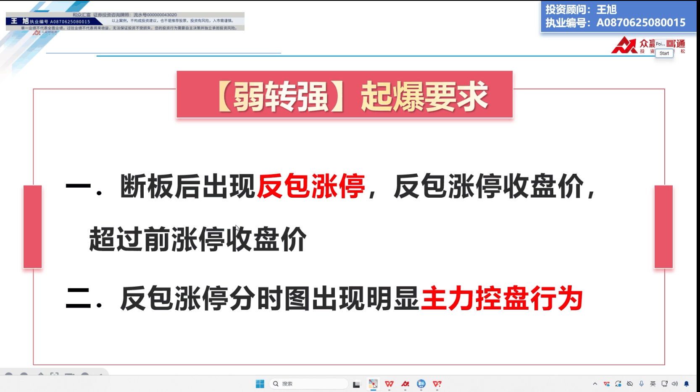

> **一．断板后出现反包涨停，反包涨停收盘价超过前涨停收盘价**
> **二．反包涨停分时图出现明显主力控盘行为**

两条缺一不可：第一条是**日线资格**（真收复，不是弱反弹），第二条是**盘中成色**（主力在操盘，不是散户踩踏反弹）。

## 5.6 什么叫反包涨停？

**图上原文（22.png）**：

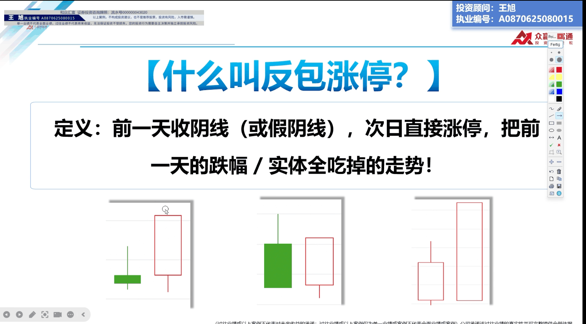

> **定义：前一天收阴线（或假阴线），次日直接涨停，把前一天的跌幅 / 实体全吃掉的走势！**

下方三张 K 线组合示意图分别对应：小阴+大阳反包、大阴+阳反包、假阴线+长阳反包。

### 随堂检验（评论区互动）

- **赤天化（600227）：这是不是反包涨停？**（21.png 两个红圈）——高位 5.40 回落途中的两次阳线涨停。**答案：不是合格的弱转强反包**——它们没有"断板前是近期热点一板/二板"的位置资格，且反包后没能继续打开空间，是下跌中继的反抽。

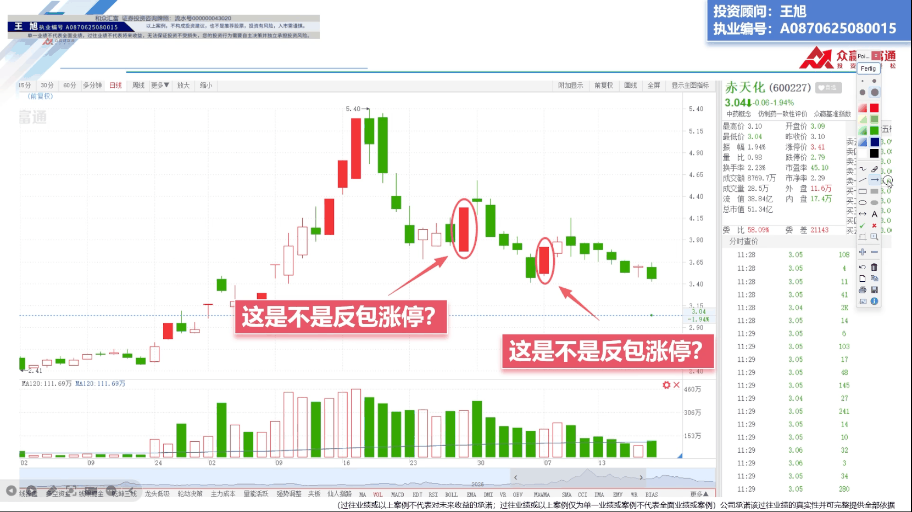

- **这里有多少个反包涨停？**（24.png）——红圈圈出 2.41→3.75 一段，阳线夹阴线反复收复，数出 3 次以上；随后继续涨到 6.24。练习的是在真实走势里"逐个认反包"。

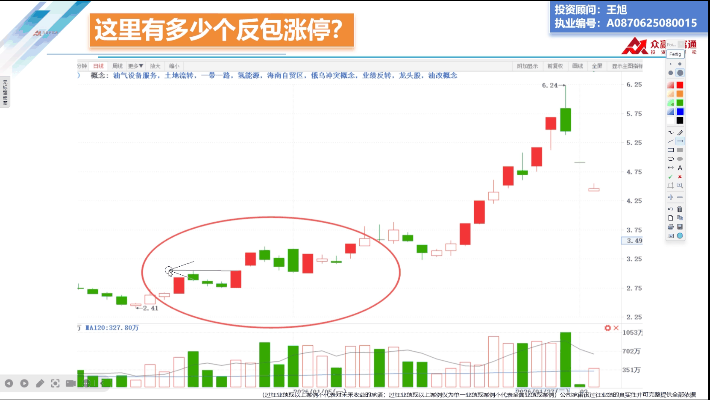

### 正向案例：法尔胜（000890）（23.png）

两个红圈标出两段"阴线—反包涨停"结构，随后 13.42 创出新高。概念标签里"**昨日触板、昨日首板、昨日连板**"说明这是连板选手的回踩修复。

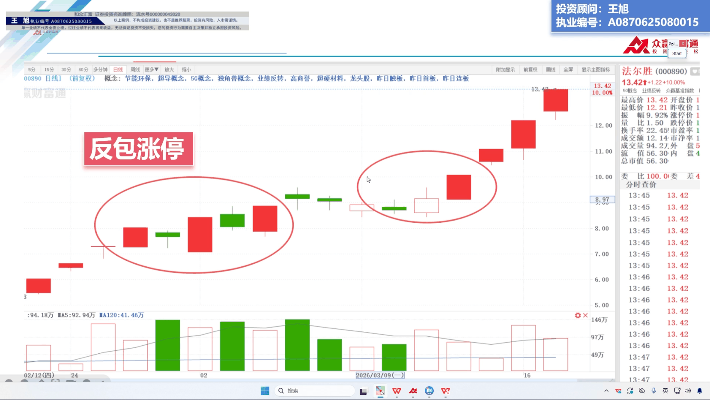

## 5.7 真正的关键：主力控盘度强弱

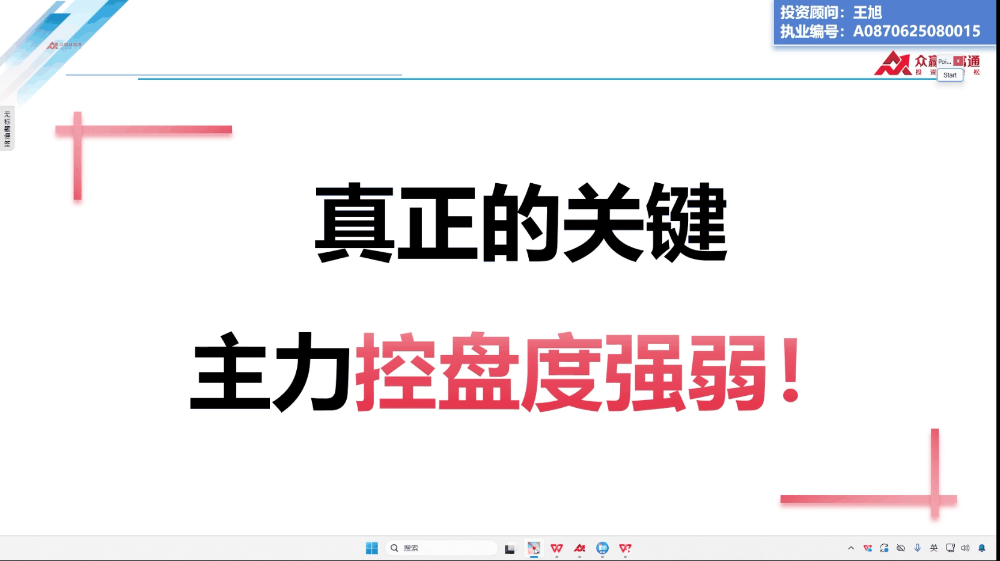

**图上原文（26.png）**：
> **真正的关键——主力控盘度强弱！**

**图上原文（27.png / 28.png）**：

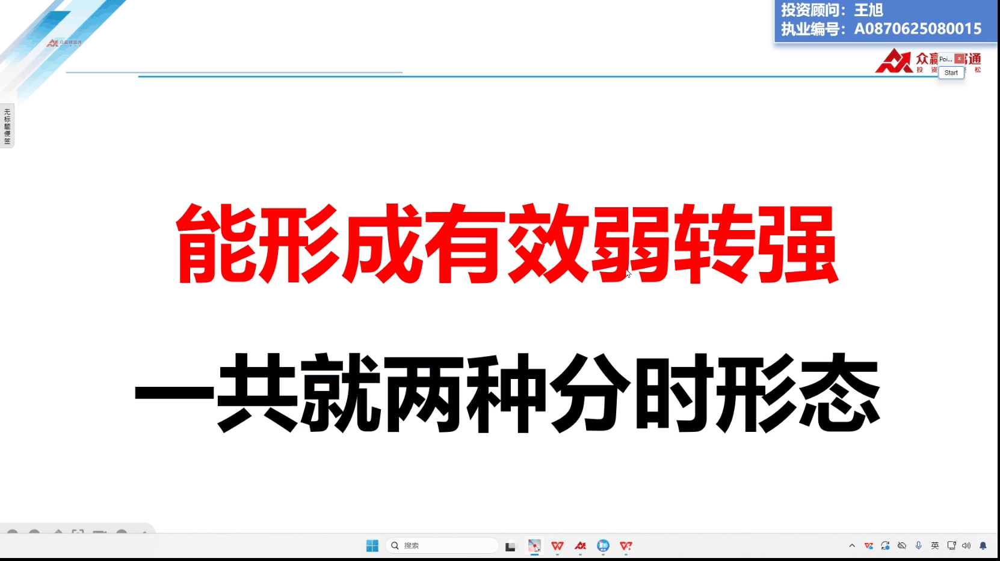

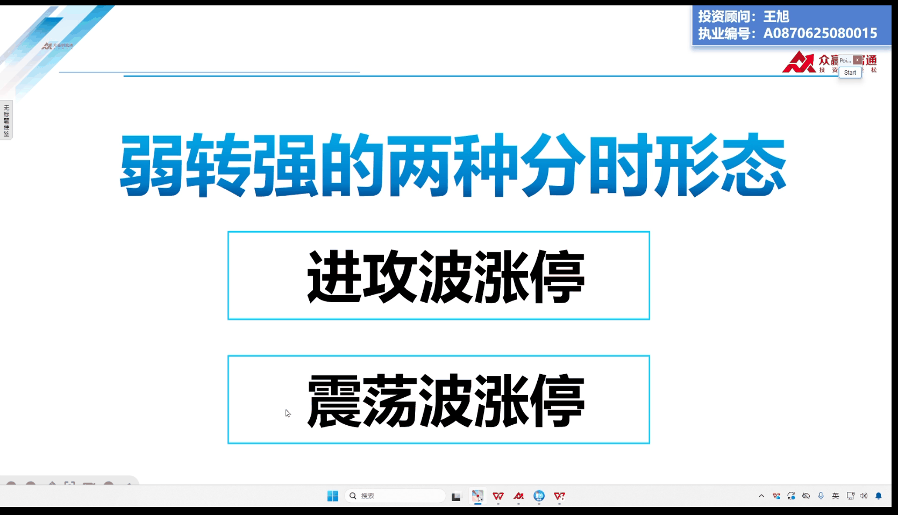

> **能形成有效弱转强，一共就两种分时形态：**
> **① 进攻波涨停　② 震荡波涨停**

日线反包只是门票，**分时形态才是验资**：只有这两种是主力控盘拉出来的，其他分时（散乱冲高、尾盘偷袭、一字无量）都不算有效弱转强。

---

# 六、两种分时形态：进攻波 vs 震荡波

## 6.1 进攻波涨停：一波或多波直接打到板

**图上原文（29.png）**：

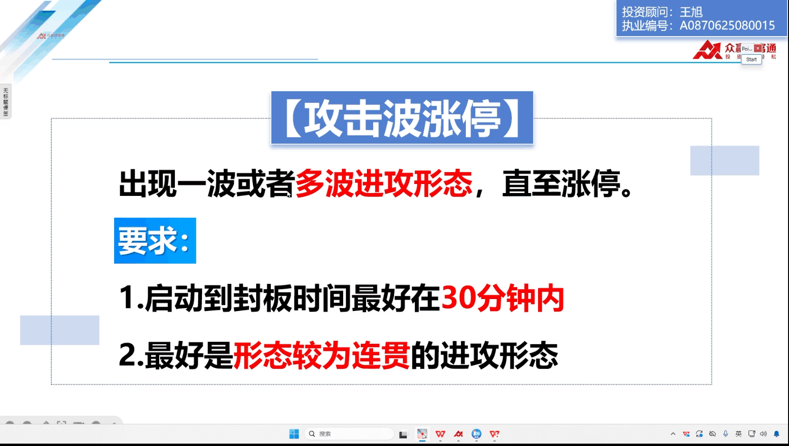

> **出现一波或者多波进攻形态，直至涨停。**
> **要求：1. 启动到封板时间最好在 30 分钟内　2. 最好是形态较为连贯的进攻形态**

### 认法：一波流 / 二波流 / 三波流

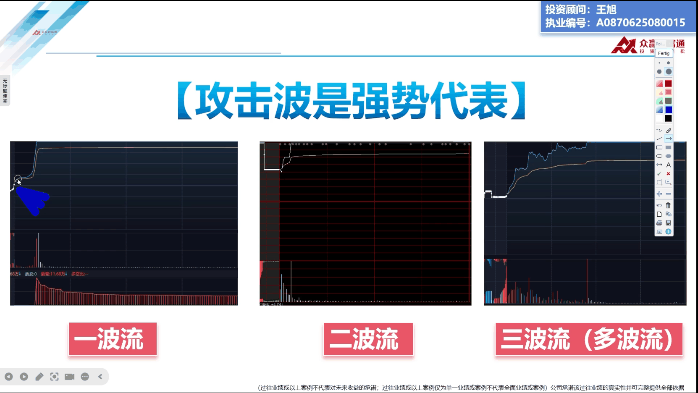

| 类型 | 分时特征 | 案例 |
| --- | --- | --- |
| **一波流** | 开盘后直线上攻，一口气到板，中间不回踩 | 人民同泰（2025-11-10，开 9.20 → 收 10.33，+10.01%） |
| **二波流** | 第一波冲高歇一口气，第二波封死 | 首开股份（开 4.13 → 收 4.25，+10.10%） |
| **三波流（多波流）** | 一波测抛压、二波洗浮筹、三波锁仓点火（与 Day02 多波流同构） | 首开股份（开 3.37 → 收 3.86，+9.97%） |

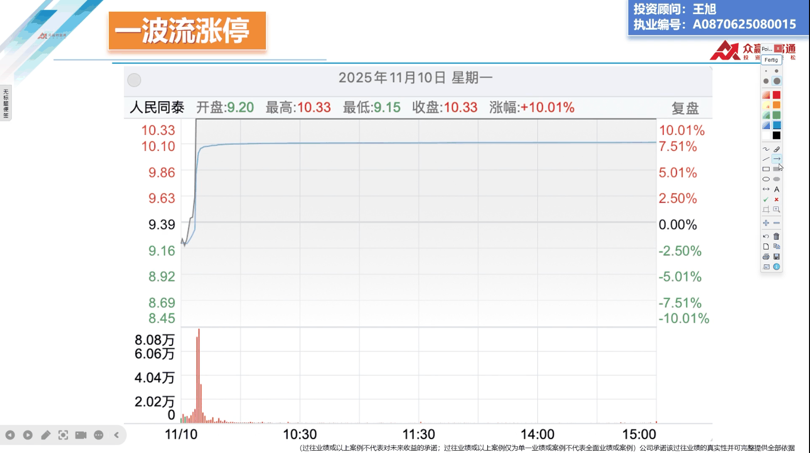

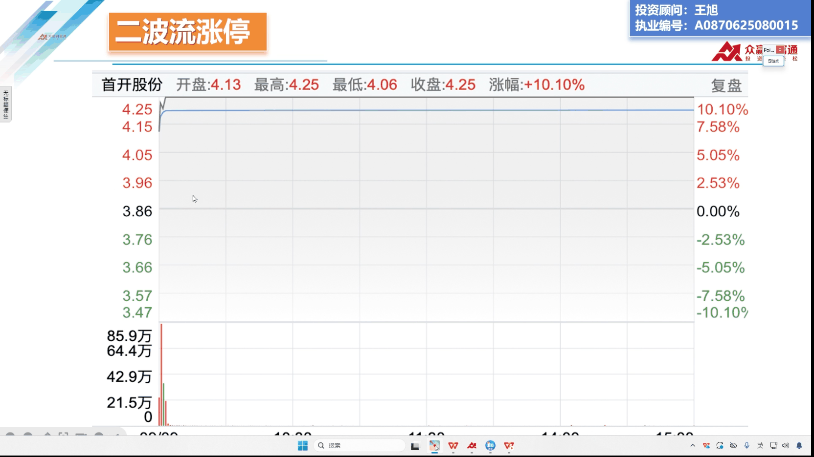

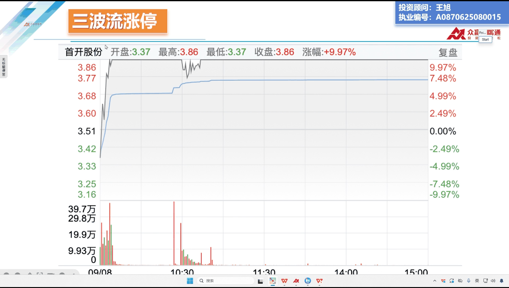

### 弱转强语境下的进攻波：法尔胜（34.png）

日线红圈反包涨停 + 分时三波流直拉，图上原文："**弱转强 分时三波流涨停！**"

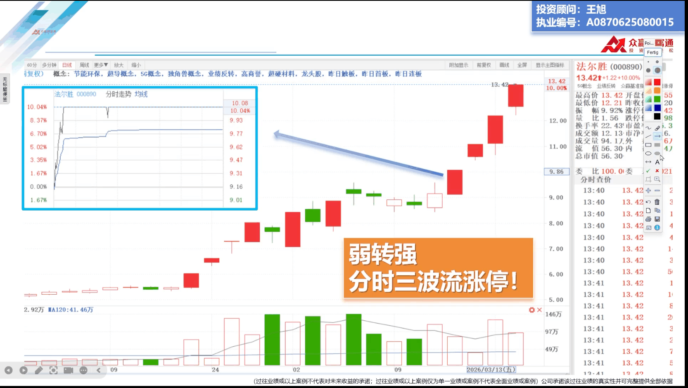

### 进攻波怎么介入？两个介入点（35.png / 36.png）

以**吉视传媒 2025-08-07**（开 2.20 → 收 2.45，+9.87%）为例：

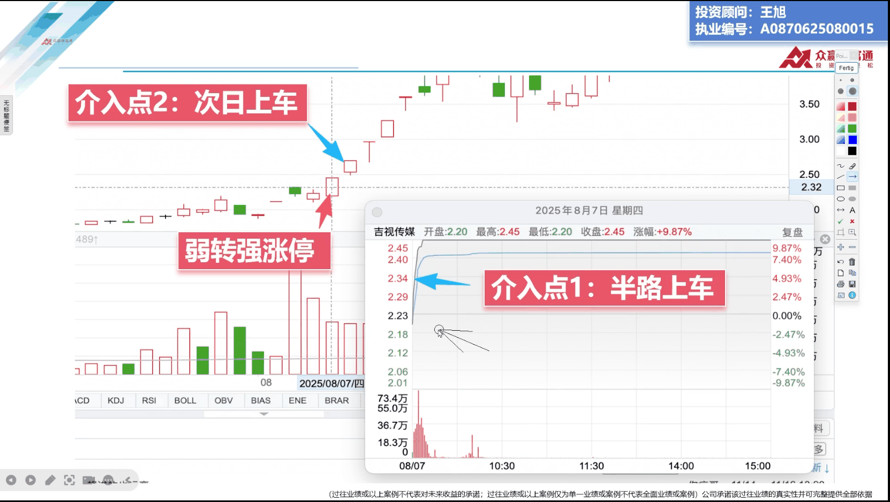

> **介入点 1：半路上车**——分时攻击波启动、确认连贯上攻时半路买（图中蓝箭头指 2.34 附近）；
> **介入点 2：次日上车**——当天封死买不进，次日再上车（图中 K 线次日位置）。

分时细节（36.png）：09:30 开盘急拉，**09:38 封板**——图上原文："**看起来心惊胆战，其实有 8 分钟让你买入！够不够？**"

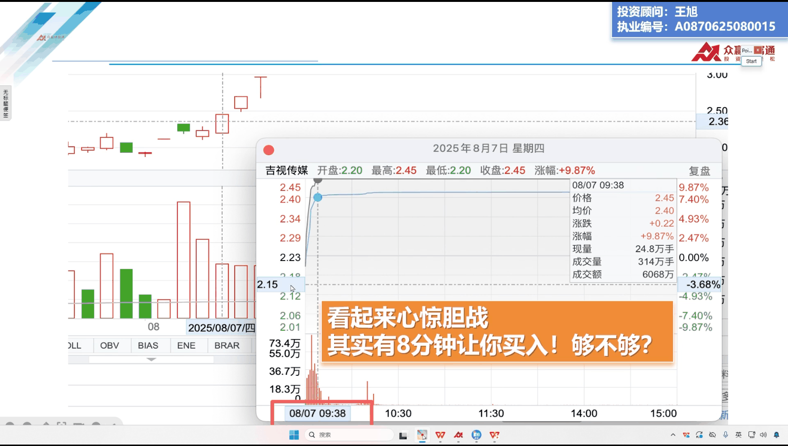

### 理论与金融含义（进攻波）

- **30 分钟内封板**是主力实力的硬指标：真控盘的资金不会给市场犹豫的时间，越早封板说明抢筹越急、次日溢价越高（与 Day02"10 点前封板是龙头"同理，弱转强放宽到 30 分钟）。
- **形态连贯**=单笔大单持续推进，不是散户凑出来的脉冲；连贯的攻击波意味着主力在**主动买**，不是试盘。
- 一波流最强但最难买（8 分钟窗口）；二波、三波给了上车机会——第一波冲高回落不破分时均线就是低吸点（Day02 多波流规则直接复用）。
- **半路 vs 次日**：半路成本低但可能吃炸板；次日成本高但确认了日线反包成立——与 Day04"要确定性不要低成本"同一取舍，按自己风险偏好选。

> 操作口诀：**进攻波=30分钟内连贯上板；一波流难买就等二波三波不破均线；半路上车或次日上车。**

## 6.2 震荡波涨停：弱转强最经典的形态

**图上原文（37.png / 38.png）**：

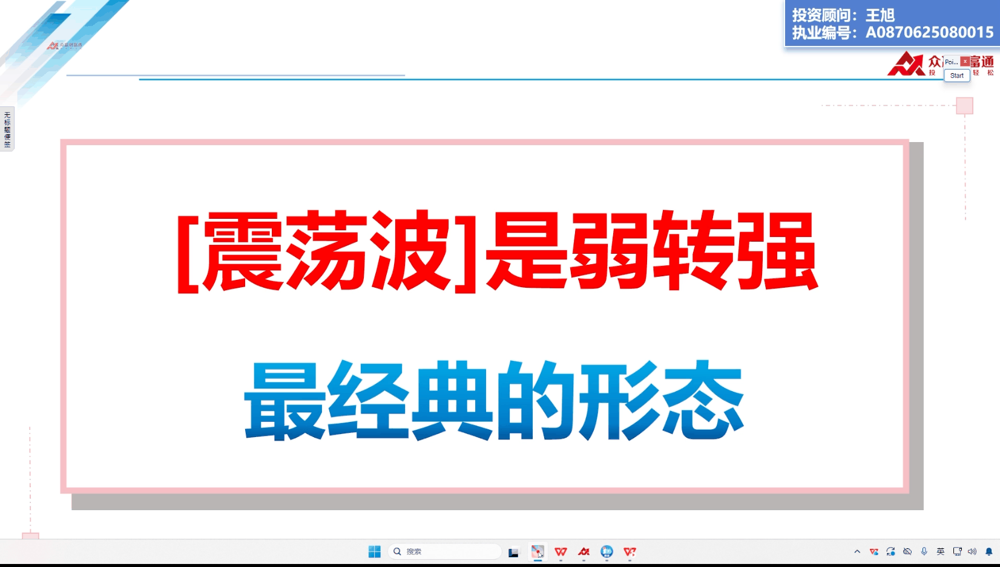

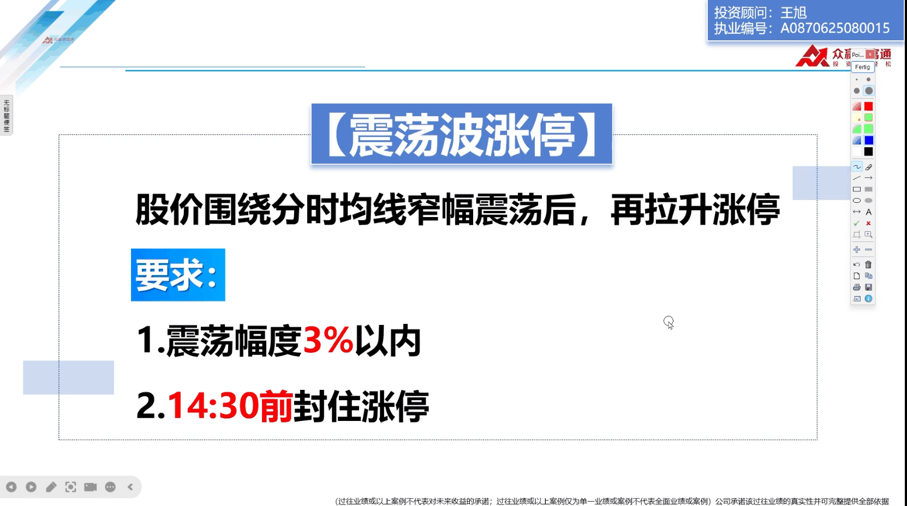

> **[震荡波] 是弱转强最经典的形态**
> **定义：股价围绕分时均线窄幅震荡后，再拉升涨停。**
> **要求：1. 震荡幅度 3% 以内　2. 14:30 前封住涨停**

### 示意与案例

**标准震荡波分时（39.png）**：全天贴着均价线在 ±2% 内横盘，午后 13:30 前后放量拉起、一波到板。

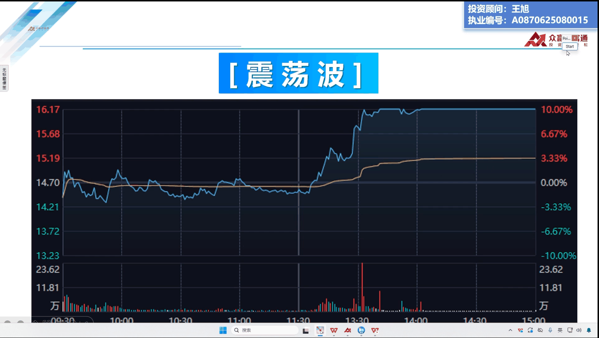

- **中马传动（2025-08-01）**：开 18.11 → 收 19.91（+10.00%）。上午 18.10 附近窄幅横盘（红框），14:30 前封板。图上标注"**震荡幅度3%以内，14:30前封住涨停**"。

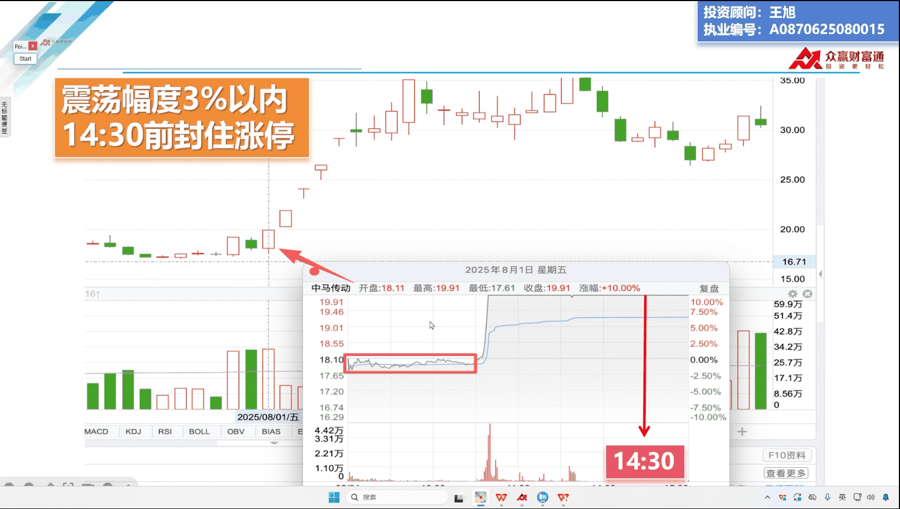

- **华光环能（2025-07-03）**：开 10.40 → 收 11.43（+10.01%）。同样上午贴均线横盘、午后拉升，红箭头标出 14:30 时间线。

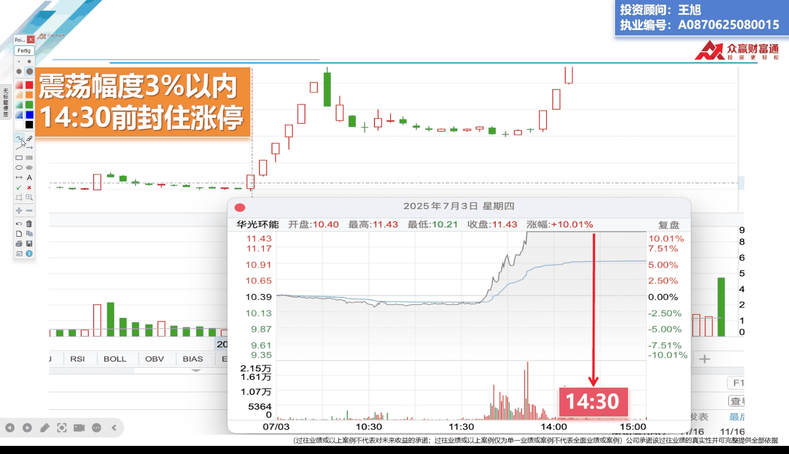

- **三房巷（600370，2026-03-13）**：历史分时显示上午 5% 以内窄幅震荡，13:56 一波拉板——同样满足"14:30 前"。

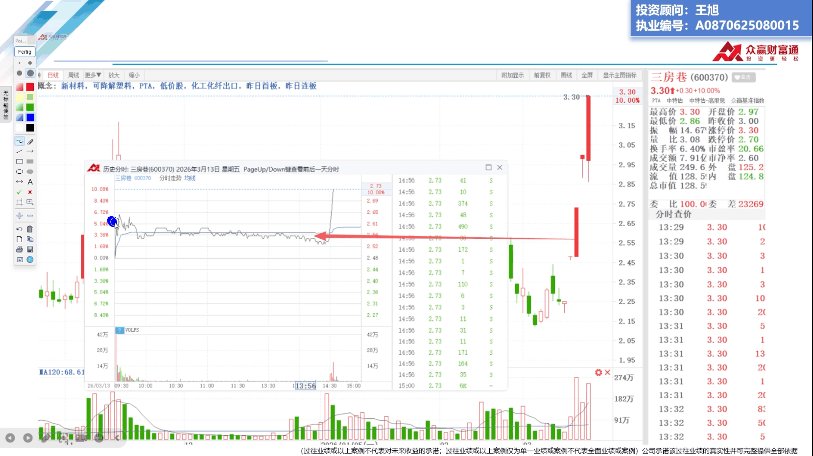

### 震荡波的买点：放量突破震荡平台（43 / 44 / 45）

**图上原文（43.png）**：

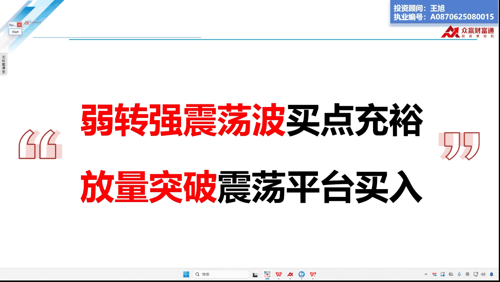

> **弱转强震荡波买点充裕——放量突破震荡平台买入**

**中马传动示范（44.png）**：红框=震荡波平台，下方红框=放量堆，红箭头指**放量突破平台上沿的那一刻**=买点，随后直线封板。

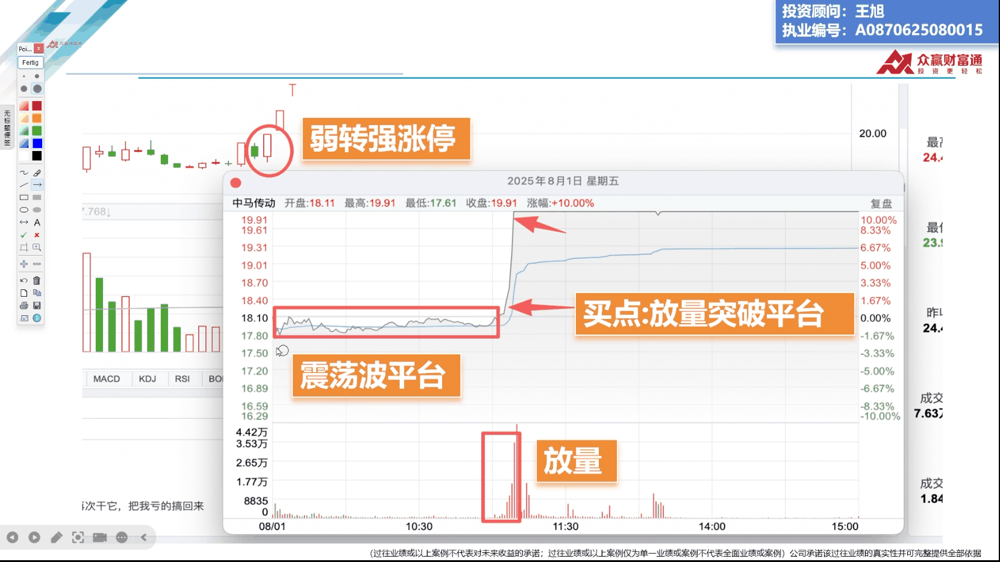

**华光环能示范（45.png）**：同款标注——震荡波平台 + 放量 + 买点：放量突破平台。

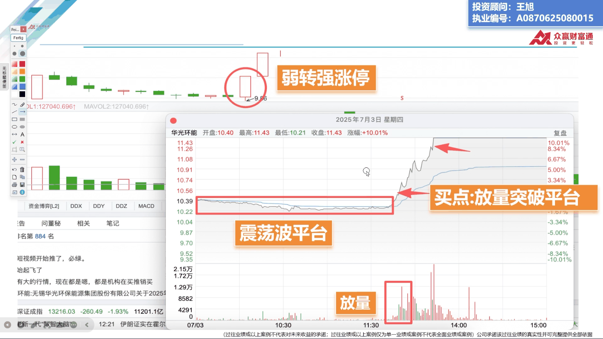

### 理论与金融含义（震荡波）

- **为什么震荡波最经典？** 它是"主力边控盘边等确认"的形态：贴着均线 3% 以内横盘 = 抛压被完全接下来（没人砸得动），主力只用小单维持秩序；这正是**控盘度强弱**最直白的证据——没有控盘的票，断板次日根本横不住。
- **3% 幅度**是控盘的量化下限：超过 3% 说明多空还在拉锯，控盘不实。
- **14:30 这条线**是 Day02"10 点前封板"的弱转强版本：断板反包不需要像首板那样争分夺秒，但拖到尾盘的板多半是跟风或做图，次日溢价无保障。**14:30 前封住**兼顾了"给主力时间表演"和"排除尾盘偷袭"。
- **买点为什么是"放量突破平台"而不是开盘就买？** 横盘期买入等于赌方向；放量突破平台 = 主力用真金白银宣告"开始拉升"，这是震荡波里**唯一不需要预测的动作点**——而且震荡波买点充裕（平台随时可能突破），比进攻波的 8 分钟窗口友好得多。

> 操作口诀：**震荡波是弱转强最经典形态：3% 以内横盘、14:30 前封死；买点只有一个——放量突破震荡平台那一刻。**

---

# 七、一只弱转强股的全景作战图

```
[ 大前提：震荡牛市，市场处于分歧期 ]          ← 板块轮动、热点活不过3天
        ↓
[ Step① 题材：热度消失 < 3/5/8 天 ]           ← 一级最优先；新热点优先
        ↓
[ Step② 个股：近日断板股，七板之内，优选一板二板 ] ← 超2板谨慎（抛压/实力/杀猪盘）
        ↓
[ Step③ 起爆·日线：反包涨停，收盘价超过前涨停收盘价 ]
        ↓
[ Step③ 起爆·分时：主力控盘二选一 ]
    ├─ 进攻波：30分钟内连贯上板 → 半路上车 / 次日上车
    └─ 震荡波：3%以内横盘，14:30前封板 → 放量突破平台买入
        ↓
[ 持有/卖出：沿用 Day02/Day04 纪律 ]          ← 烂板、断板减仓、大阴线离场
```

**与前课的接口**：
- 买之前用 Day02 的竞价知识判断次日上车点（U/V 形态、高开竞价）；
- 持有与离场沿用 Day04：出现**能量枯竭缺口（烂板涨停）**离场，没有就**断板减仓、大阴线离场**；
- 反包成功后若走出连续缺口，Day04 的**情绪加速缺口=绝不出货**纪律继续适用。

---

# 八、案例总表（本课全部案例归档）

## 8.1 分歧转一致篇（概念引入）

| 个股/案例 | 关键数据 | 教学点 | 截图 |
| --- | --- | --- | --- |
| 军工补涨龙（案例一） | 2025/05/12 收 9.83 +9.96%，换手 20.34% | 一波流弱转强、炸板回封；分歧转一致后打开上行空间 | 03.png |
| 可控核聚变龙一（案例二） | 深水直拉涨停 | 日内分歧转一致的极端样本 | 02、.png |
| —（标准样板） | — | 标准弱转强三特征：无其他热点板块、成交量买多卖少、均线有效支撑 | 05.png |

## 8.2 弱转强概念篇（案例 1–3）

| 个股 | 代码 | 教学点 | 截图 |
| --- | --- | --- | --- |
| 九阳股份 | 002242 | 断板回调数日后再点火；流值 132.47 亿 | 07.png |
| 万向德农 | 600371 | 断板收阴→十字星→反包涨停，流值 42.19 亿 | 08.png |
| 百花医药 | 600721 | 题材热度未退，三次"涨停—回调—再启动"，6.25→14.03 | 11.png |

## 8.3 题材筛选篇（Step ①）

| 知识点 | 内容 | 截图 |
| --- | --- | --- |
| 题材热度周期 | 3 天、5 天、8 天 | 09.png |
| 热度分级 | 8天前=三级 / 5天前=二级 / 3天前=一级 | 12.png |
| 筛选弱转强题材 | 情绪回暖（<3/5/8天）+ 新热点优先 | 13.png |

## 8.4 断板筛选篇（Step ②）

| 个股 | 代码 | 教学点 | 截图 |
| --- | --- | --- | --- |
| 平潭发展 | 000592 | 二板后弱转强；反包后连板至 9.43 | 17.png |
| 安泰集团 | 600408 | 同一波行情三次弱转强，2.5→6.89 | 18.png |
| —（纪律） | — | 超 2 板谨慎三原因：没算到抛压被迫断板、实力不足、杀猪盘 | 19.png |

## 8.5 反包涨停篇（Step ③ 日线资格）

| 个股 | 代码 | 教学点 | 截图 |
| --- | --- | --- | --- |
| 赤天化 | 600227 | 反向检验：高位下跌中的阳线≠合格反包 | 21.png |
| 法尔胜 | 000890 | 两段标准反包涨停，后至 13.42 | 23.png |
| —（数浪练习） | — | "这里有多少个反包涨停？"（2.41→6.24 段） | 24.png |

## 8.6 进攻波篇（分时形态 ①）

| 个股/样本 | 关键数据 | 教学点 | 截图 |
| --- | --- | --- | --- |
| 人民同泰 | 2025-11-10，9.20→10.33 +10.01% | 一波流涨停标准样板 | 30.png |
| 首开股份 | 开 4.13→4.25 +10.10% | 二波流涨停 | 32.png |
| 首开股份 | 开 3.37→3.86 +9.97% | 三波流涨停 | 33.png |
| 法尔胜 | 000890 | 弱转强 + 三波流分时 | 34.png |
| 吉视传媒 | 2025-08-07，2.20→2.45 +9.87%，09:38 封板 | 介入点：半路上车 / 次日上车；"8 分钟买入窗口" | 35.png、36.png |

## 8.7 震荡波篇（分时形态 ②）

| 个股 | 关键数据 | 教学点 | 截图 |
| --- | --- | --- | --- |
| 中马传动 | 2025-08-01，18.11→19.91 +10.00% | 3% 以内横盘、14:30 前封板；买点=放量突破平台 | 40.png、44.png |
| 华光环能 | 2025-07-03，10.40→11.43 +10.01% | 同款震荡波+放量突破买点 | 41.png、45.png |
| 三房巷 | 600370，2026-03-13，13:56 封板 | 历史分时验证"14:30 前"要求 | 42.png |

---

# 九、操作检查清单（实战前逐项打勾）

| # | 步骤 | 检查项 | 标准 | 不过则 |
| --- | --- | --- | --- | --- |
| 0 | 前提 | 大盘环境 | 震荡市（板块轮动、非单边熊牛） | 单边市弱转强无稀缺性，不做 |
| 1 | ① 选题材 | 热度周期 | 热度消失 **< 3 / 5 / 8 天**（一级最优） | 划掉 |
| 2 | ① 选题材 | 新旧 | **新热点优先** | 老热点降级处理 |
| 3 | ② 选个股 | 断板状态 | **近日（1–3 天内）刚断板** | 已断很久=记忆冷却，不做 |
| 4 | ② 选个股 | 连板高度 | **七板之内，优选一板、二板** | >2 板谨慎；>7 板不做 |
| 5 | ③ 日线 | 反包涨停 | 断板后收出涨停，**收盘价超过前涨停收盘价** | 不合格 |
| 6 | ③ 日线 | 反包质量 | 吃掉前一日阴线实体/跌幅（真反包） | 弱反弹不算 |
| 7 | ③ 分时 | 形态二选一 | **进攻波**（30 分钟内连贯上板）或 **震荡波**（3% 内横盘、14:30 前封） | 其他分时=控盘存疑，不做 |
| 8 | ③ 买点 | 进攻波介入 | 波形连贯确认后**半路上车**，或**次日上车** | 不追乱脉冲 |
| 9 | ③ 买点 | 震荡波介入 | **放量突破震荡平台**那一刻 | 横盘期不提前埋 |
| 10 | 持 | 卖出纪律 | 沿用 Day04：烂板枯竭缺口卖；无则断板减仓、大阴线离场 | 执行 |

---

# 十、理论对照表（为什么要这么做）

| 操作 | 背后的理论 |
| --- | --- |
| 只在震荡市做弱转强 | 分歧期才有"转折点动能"；单边市弱转强不稀缺 |
| 题材热度 3/5/8 天 | 资金记忆半衰期：超过 8 天叙事已换，老龙头名字不值钱 |
| 新热点优先 | 老热点上方套牢层层，反包阻力大；新热点无套牢 |
| 只做七板内、优选一二板 | 一/二板断板多为洗盘；高位断板=抛压失控或出货，易遇杀猪盘 |
| 反包收盘价超前涨停价 | 真收复才算共识重建；弱反弹只是下跌中继（赤天化反例） |
| 必须验分时控盘 | 日线反包可以是散户踩踏反弹；进攻波/震荡波才是主力操盘证据 |
| 进攻波 30 分钟内封板 | 越早封板抢筹越急、次日溢价越高 |
| 震荡波 3% 以内横盘 | 横得住=抛压被主力完全接走，控盘度的量化证明 |
| 震荡波 14:30 前封死 | 排除尾盘偷袭板/跟风板（Day02"10 点前"的弱转强放宽版） |
| 买点=放量突破平台 | 唯一不需要预测的动作点：主力用真金白银宣告拉升开始 |
| 弱转强成立后 | 回到 Day02/Day04 纪律：竞价上车、缺口持仓、烂板/大阴线离场 |

---

# 十一、金融视角的客观提示

1. **与 Day02 的"弱转强不碰"并不冲突，但必须分清语境。** Day02 说的是"**弱转强涨停板不要作为打板标的去打**"（当天巨量换手、控盘弱、次日不确定）；本课说的是"**断板之后等它走出合格弱转强再上车**"（波段视角）。同一形态，一个禁打、一个可跟——取决于你在交易的哪个环节。混用这两条纪律是最容易犯的错。
2. **3/5/8 天与七板之内都是经验阈值，不是物理定律。** 9 天前的超级热点可能照样被资金记忆唤醒；三板断板也可能只是洗盘。阈值筛的是**胜率**，不是真假；边界票需结合题材级别、市值（Day04 的 200 亿口径）个案判断。
3. **案例全部是幸存者。** 平潭发展、安泰集团、法尔胜都是反包成功后连板的样本；同样"题材热+一板断板+反包涨停"却次日闷杀的票课堂没有系统展示。**反包涨停当天买入仍可能吃到炸板/次日低开**，半路上车的介入点 1 尤其如此。
4. **"8 分钟买入窗口"是事后视角。** 吉视传媒 09:30–09:38 的拉升你在盘中无法预知它会封死还是炸掉；所谓 8 分钟是站在回看图上的从容。实盘里这 8 分钟充满噪声，**次日上车（介入点 2）才是散户更可控的方案**，代价是成本抬高。
5. **震荡波"买点充裕"也有代价。** 放量突破平台确认时，股价通常已从平台低点抬升 3–5 个点；若突破失败回落，止损距离就是全天振幅。**突破买法天然比埋伏买法胜率高、赔率低**，需要配止损纪律而不是裸奔。
6. **监管与杀猪盘风险贯穿高位。** 本课自己就警告"超两板容易出现杀猪盘"；弱转强战法因聚焦一板二板相对安全，但题材退潮时整个战法的胜率会系统性坍塌——**题材热度判断（Step ①）是这套战法真正的护城河**，不是分时形态。
7. **本课未展开卖出体系。** 课堂重心在"怎么上车"，离场沿用前课（Day04 缺口三空破阵 + 断板减仓/大阴线离场）。实战中弱转强失败的止损锚点建议设在**反包涨停的起涨点/前阴线低点**，跌破即认错。

> 风险提示：本文为课程学习笔记，仅作知识整理，不构成任何投资建议。短线弱转强/跟庄博弈风险极高，不适合所有投资者。投资有风险，入市需谨慎。

---

# 十二、全课记忆点

1. **盘中斩龙：捕捉盘中涨停瞬间，震荡牛市学做弱转强！**
2. **新手怕分歧，高手等分歧；从混沌到共识的转折点，动能巨大。**
3. **捉不到妖股的三个原因：看不懂大盘情绪、看不懂断板、看不懂真反包。**
4. **弱转强的本质：市场共识与资金记忆（股性强者恒强）+ 分歧换手洗浮筹 + 题材热度未退。**
5. **题材热度周期 3、5、8 天：3 天前一级、5 天前二级、8 天前三级；新热点优先。**
6. **弱转强只做七板之内，优选一板、二板；超过两板——没算到抛压、实力不足、易杀猪盘。**
7. **起爆两要求缺一不可：反包涨停收盘价超过前涨停收盘价 + 分时明显主力控盘。**
8. **反包涨停 = 前一天阴线（或假阴线），次日涨停全吃掉跌幅。**
9. **有效弱转强分时只有两种：进攻波涨停、震荡波涨停。**
10. **进攻波：一波/二波/三波流，30 分钟内连贯封板；半路上车或次日上车。**
11. **震荡波最经典：3% 以内横盘、14:30 前封死；买点=放量突破震荡平台。**
12. **真正的关键不是日线图形，是主力控盘度强弱。**

---

# 十三、笔记核查与勘误

对照 45 张直播截图，对 [课程记录.md](课程记录.md) 的修正与补充：

**文件层面**：
1. 第二张截图文件名是 **`02、.png`**（多了一个顿号），引用时需按原名；正文已按原名引用。
2. **缺 10.png、25.png 两张**（编号跳号），实际共 45 张，非 46 张。

**编号与案例对应修正**：
3. 笔记"案例1：02.png 日内分歧；案例2：03.png 断板后反包涨停"——**课件上的案例编号与文件序相反**：**案例一在 03.png**（军工补涨龙：一波流弱转强炸板回封，分歧转一致后打开上行空间）；**案例二在 02、.png**（可控核聚变龙一：日内分歧转一致，分时深水直拉涨停）。笔记所述内容方向正确，个股身份建议补上。
4. 笔记"案例3：04.png 标准弱转强涨停板"——**04.png 是概念定义页**（弱转强涨停板的文字定义）；**"标准的弱转强涨停板"分时图及三特征（无其他热点板块/成交量买多卖少/均线有效支撑）在 05.png**。
5. 笔记"案例：07.png（反包涨停后连板）08.png(断板3天后反包涨停) 09"——**09.png 不是案例**，是"题材热度周期 3天、5天、8天"标题页。07=九阳股份、08=万向德农（建议补个股名与代码）；真正的案例 3（百花医药 600721）在 **11.png**。
6. 笔记"题材热度周期：3天、5天、8天 (11.png, 12.png)"——周期标题页是 **09.png**；12.png 是"8天前=三级/5天前=二级/3天前=一级"分级页；**13.png** 才是"筛选弱转强题材"页；11.png 是百花医药案例。
7. 笔记"第二步…14.png 15.png 16.png / 案例：17.png 18.png"——对应正确，建议标注：14=七板之内优选一二板（纪律页）、15=黑板章节页"第二步 聚焦近日断板股"、16=一板后/二板后弱转强示意对照；17=平潭发展（000592）、18=安泰集团（600408，多次弱转强）。
8. 笔记"反向案例：21.png"——21.png 是**赤天化（600227）互动题**"这是不是反包涨停？"（两红圈均在高位回落途中），作为反向教学成立；补充 24.png 是"这里有多少个反包涨停？"**数浪练习**，不是纯正向案例。
9. 笔记"正向案例：23.png 24.png"——23=法尔胜（000890）正向反包；24 如上属练习题，建议改述。

**建议补进笔记的要点**（截图上有、笔记未记）：
- **05.png 标准弱转强三特征**：无其他热点板块、成交量买多卖少、均线有效支撑；
- **06.png 弱转强本质三条**：市场共识与资金记忆（股性强者恒强）/ 分歧换手洗浮筹 / 题材热度未退有修复需求；
- **19.png 超两板谨慎三原因**：没算到抛压被迫断板、实力不足、容易出现杀猪盘；
- **20.png 起爆要求的精确表述**：反包涨停**收盘价超过前涨停收盘价**（笔记只写"要求：20.png"）；
- **22.png 反包涨停定义**：前一天阴线（或假阴线），次日涨停吃掉前一天跌幅/实体；
- **29.png 进攻波两要求**：启动到封板最好 **30 分钟内**、形态较连贯；
- **30–34.png 进攻波案例全名单**：人民同泰（一波流）、首开股份（二波流/三波流）、法尔胜（弱转强三波流）；
- **35–36.png 吉视传媒介入点**：介入点1 半路上车、介入点2 次日上车；"看起来心惊胆战，其实有 8 分钟让你买入"（09:38 封板）；
- **38.png 震荡波两要求**：震荡幅度 **3% 以内**、**14:30 前**封住涨停；
- **40–42.png 震荡波案例**：中马传动（2025-08-01）、华光环能（2025-07-03）、三房巷（600370，13:56 封板）；
- **43–45.png 震荡波买点口径**：弱转强震荡波买点充裕，**放量突破震荡平台买入**（中马传动/华光环能示范）。

---

# 十四、本课资料索引

| 资料 | 性质 | 与本总结的关系 |
| --- | --- | --- |
| 直播截图 01–45（缺 10、25；02 文件名带顿号） | 课堂实录 | 关键页已全部嵌入正文并摘录图上原文 |
| [课程记录.md](课程记录.md) | 课堂笔记 | 第十三节已核查勘误 |
| 第五课预习资料.pdf | 课前预习 | 与直播内容主题一致，正文以直播截图口径为准 |

---

*资料来源：day05/直播截图 01–45、课程记录.md、第五课预习资料.pdf；整理日期：2026-10-20*
